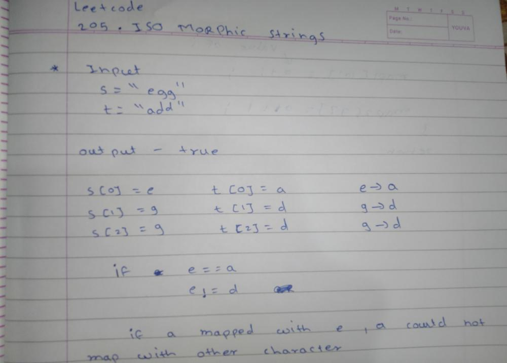
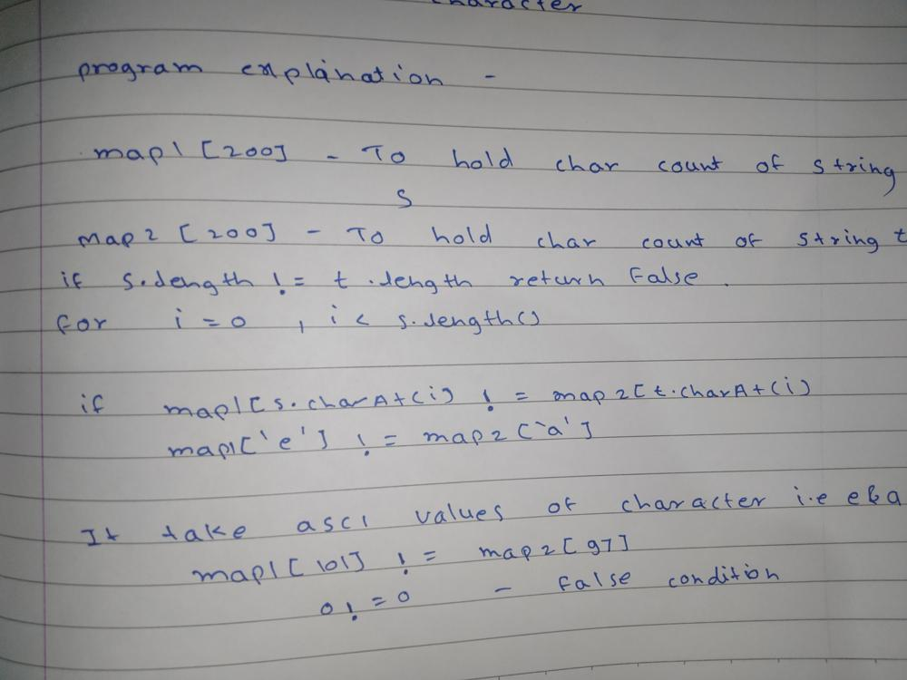
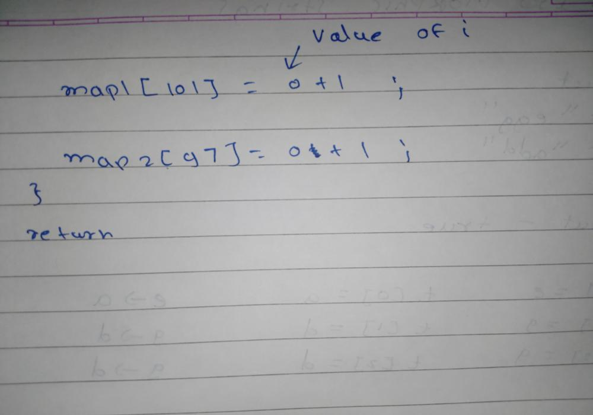

# Well Explained Simple Java ✅ || Runtime 1 ms✅ || Beats 94.7% ✅

**Author:** sourabh-jadhav
**Votes:** 581
**Link:** [https://leetcode.com/problems/isomorphic-strings/solutions/3171737/](https://leetcode.com/problems/isomorphic-strings/solutions/3171737/)

---

# Intuition
<!-- Describe your first thoughts on how to solve this problem. -->

# Approach







# Complexity
- Time complexity:
<!-- Add your time complexity here, e.g. $$O(n)$$ -->

- Space complexity:
<!-- Add your space complexity here, e.g. $$O(n)$$ -->

# Code
```
class Solution {
    public boolean isIsomorphic(String s, String t) {

        int map1[]=new int[200];
        int map2[]=new int[200];

        if(s.length()!=t.length())
            return false;


        for(int i=0;i<s.length();i++)
        {
            if(map1[s.charAt(i)]!=map2[t.charAt(i)])
                return false;

            map1[s.charAt(i)]=i+1;
            map2[t.charAt(i)]=i+1;
        }
        return true;
    }
}
```

