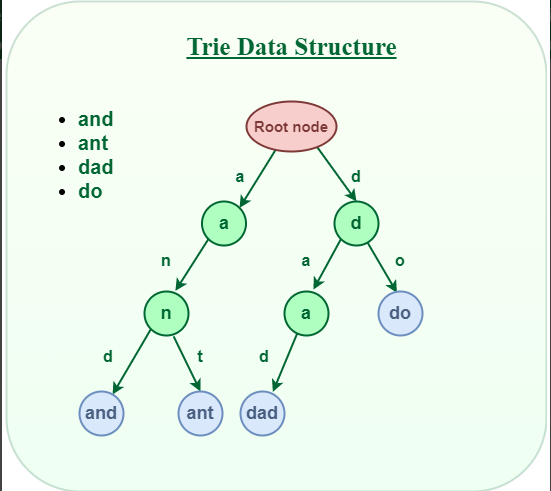

# [Data Structure Series - Trie Tutorial]  Implement Trie (Prefix Tree)

**Author:** never_get_piped
**Votes:** 15
**Link:** [https://leetcode.com/problems/implement-trie-prefix-tree/solutions/5286129/](https://leetcode.com/problems/implement-trie-prefix-tree/solutions/5286129/)

---

**Topic** :  Trie

This post is part of the **Data Structure Series**. It serves as an introductory tutorial on the **Trie** data structure, providing a template for its future usage.

The Trie implementation provided here is based on arrays and utilizes dynamic memory allocation. This is memory efficient.

### Trie:
The Trie data structure is a **tree-like** data structure used for storing a dynamic set of strings. It is commonly used for efficient retrieval and storage of keys in a large dataset. The structure supports operations such as insertion, search, and deletion of keys, making it a valuable tool in fields like computer science and information retrieval. (GFG)



Having grasped the structure and application of the aforementioned data structure, let's delve into its implementation details.

### Implementation:
Our Trie data structure supports two primary interfaces:
* `add(string)` : add a string to our trie.
* `find(string)` : Verify the existence of a prefix string in our Trie and retrieve the last node associated with it.

In addition, we have:
* `id` : An integer value denotes the ID of each Trie node. All IDs are unique.
* `root` : The id of the trie root node. It is assigned as `0`.
* `tr[][26]` : A dynamic 2D array where its first dimension is dynamically allocated, and its second dimension has a size of 26. 26 is configurable depends on the problem. 
* `isWord` : A dynamically allocated boolean array.

***How we store nodes:***
The trie has only 1 root node initially with id `0`. The id increments by 1 each time a new node is required, and this incremented id is then assigned to the newly created node.

In our trie, we don't have a separate Node class or Node structure. This is because when we request a new trie node, we do not create a standalone node object. We store the children and the state of a new node in the `tr`  and `isWord` vectors, respectively.

For examFor example, suppose a new node with ID `10` is created, and its parent has a ID of `u`, which is also the first child of node `u`. In this case, we would assign `tr[u][1] = 10` to represent the connection between the parent node and its child. In addition, if the current character being processed is the last character of the given string, we mark `isWord[u] = true` to indicate that we have reached the end of a complete string at that particular node in the trie.

Note that `tr` and `isWord` are dynamically allocated; they increase their size as new nodes are requested, ensuring that sufficient space is available to accommodate the growing trie structure.


`add(string)` :
When adding a string to our trie, we traverse the trie based on the prefix of the given string. If a node corresponding to a character is not found, we may request a new node and connect it to our current stand node in the trie structure.

`find(string)` :
Simply traverse the trie based on the prefix of the given string. It returns the last node id. If there is no last node, -`1 `is returned.
___


**C++:**
```C++
struct MyTrie {
    vector<vector<int>> tr;
    vector<bool> isWord;
    int root, id;
    
    void init() {
        root = 0;
        id = 1;
        tr.push_back(vector<int>(26, -1));
        isWord.push_back(false);
    }
    
    int newNode() {
        tr.push_back(vector<int>(26, -1));
        isWord.push_back(false);
        int newnode = id;
        id++;
        return newnode;
    }
    
    void add(string& s) {
        int u = root;
        for(int i = 0; i < s.size(); i++) {
            int c = s[i] - 'a';
            if(tr[u][c] == -1) {
                tr[u][c] = newNode();
            } 
            u = tr[u][c];
        }
        isWord[u] = true;
    }
    
    int find(string& s) {
        int u = root;
        for(int i = 0; i < s.size() && u != -1; i++) {
            int c = s[i] - 'a';
            u = tr[u][c];
        }
        return u;
    }
};

class Trie {
public:
    MyTrie tr;
    Trie() {
        tr.init();
    }
    
    void insert(string word) {
        tr.add(word);
    }
    
    bool search(string word) {
        int node = tr.find(word);
        return node != -1 && tr.isWord[node];
    }
    
    bool startsWith(string prefix) {
        int node = tr.find(prefix);
        return node != -1;
    }
};

/**
 * Your Trie object will be instantiated and called as such:
 * Trie* obj = new Trie();
 * obj->insert(word);
 * bool param_2 = obj->search(word);
 * bool param_3 = obj->startsWith(prefix);
 */
```

**Java**:
```
class MyTrie {
    List<int[]> tr;
    List<Boolean> isWord;
    int root, id;
    
    private int[] newchild() {
        int[] arr = new int[26];
        Arrays.fill(arr, -1);
        return arr;
    }
    
    public MyTrie() {
        tr = new ArrayList<>();
        isWord = new ArrayList<>();
        isWord.add(false);
        tr.add(newchild());
        root = 0;
        id = 1;
    }
    
    private int newnode() {
        int newnode = id;
        id++;
        isWord.add(false);
        tr.add(newchild());
        return newnode;
    }
    
    public void add(String s) {
        int u = root;
        for(int i = 0; i < s.length(); i++) {
            int c = s.charAt(i) - 'a';
            if(tr.get(u)[c] == -1) {
                tr.get(u)[c] = newnode();
            }
            u = tr.get(u)[c];
        }
        isWord.set(u, true);
    }
    
    public int find(String s) {
        int u = root;
        for(int i = 0; i < s.length() && u != -1; i++) {
            int c = s.charAt(i) - 'a';
            u = tr.get(u)[c];
        }
        return u;
    }
}

class Trie {
    MyTrie tr;
    public Trie() {
        tr = new MyTrie();
    }
    
    public void insert(String word) {
        tr.add(word);
    }
    
    public boolean search(String word) {
        int node = tr.find(word);
        return node != -1 && tr.isWord.get(node);
    }
    
    public boolean startsWith(String prefix) {
        int node = tr.find(prefix);
        return node != -1;
    }
}

/**
 * Your Trie object will be instantiated and called as such:
 * Trie obj = new Trie();
 * obj.insert(word);
 * boolean param_2 = obj.search(word);
 * boolean param_3 = obj.startsWith(prefix);
 */
```

**Python**:
```
class MyTrie:
    def __init__(self):
        self.tr = [ [-1] * 26 ]
        self.isWord = [False]
        self.root = 0
        self.id = 1
    
    def init(self):
        self.root = 0
        self.id = 1
        self.tr = [ [-1] * 26 ]
        self.isWord = [False]
        
    def new_node(self):
        self.tr.append([-1] * 26)
        self.isWord.append(False)
        new_node = self.id
        self.id += 1
        return new_node
    
    def add(self, s):
        u = self.root
        for i in range(len(s)):
            c = ord(s[i]) - ord('a')
            if self.tr[u][c] == -1:
                self.tr[u][c] = self.new_node()
            u = self.tr[u][c]
        self.isWord[u] = True
    
    def find(self, s):
        u = self.root
        for i in range(len(s)):
            c = ord(s[i]) - ord('a')
            if u == -1:
                return -1
            u = self.tr[u][c]
        return u

class Trie:
    def __init__(self):
        self.trie = MyTrie()
        self.trie.init()

    def insert(self, word: str) -> None:
        self.trie.add(word)

    def search(self, word: str) -> bool:
        node = self.trie.find(word)
        return node != -1 and self.trie.isWord[node]

    def startsWith(self, prefix: str) -> bool:
        node = self.trie.find(prefix)
        return node != -1


# Your Trie object will be instantiated and called as such:
# obj = Trie()
# obj.insert(word)
# param_2 = obj.search(word)
# param_3 = obj.startsWith(prefix)
```

**Go:**
```
type MyTrie struct {
	tr     [][]int
	isWord []bool
	root   int
	id     int
}

func MyTrieConstructor() MyTrie {
	trie := MyTrie{}
	return trie
}

func (this *MyTrie) Newchild() []int {
    arr := make([]int, 26)
    for i := 0; i < 26; i++ {
        arr[i] = -1
    }
    return arr
}

func (this *MyTrie) Init() {
	this.root = 0
	this.id = 1
    this.tr = [][]int{this.Newchild()}
	this.isWord = []bool{false}
}

func (this *MyTrie) NewNode() int {
	this.tr = append(this.tr, this.Newchild())
	this.isWord = append(this.isWord, false)
	newNode := this.id
	this.id++
	return newNode
}

func (this *MyTrie) Add(s string)  {
    u := this.root
    for i := 0; i < len(s); i++ {
        c := s[i] - 'a'
        if this.tr[u][c] == -1 {
            this.tr[u][c] = this.NewNode();
        }
        u = this.tr[u][c]
    }
    this.isWord[u] = true
}

func (this *MyTrie) Find(s string) int {
	u := this.root
    for i := 0; i < len(s) && u != -1; i++ {
        c := s[i] - 'a'
        u = this.tr[u][c]
    }
    return u
}

///////////////////////////////////////////////////////////////////////////////////////////////////////
type Trie struct {
    tr MyTrie 
}


func Constructor() Trie {
    tr := MyTrieConstructor()
    tr.Init()
    return Trie {
        tr : tr,
    }
}


func (this *Trie) Insert(word string)  {
    this.tr.Add(word)
}


func (this *Trie) Search(word string) bool {
    node := this.tr.Find(word)
    return node != -1 && this.tr.isWord[node]
}


func (this *Trie) StartsWith(prefix string) bool {
    node := this.tr.Find(prefix)
    return node != -1
}


/**
 * Your Trie object will be instantiated and called as such:
 * obj := Constructor();
 * obj.Insert(word);
 * param_2 := obj.Search(word);
 * param_3 := obj.StartsWith(prefix);
 */
```

**PHP**:
```
class MyTrie {
    public $tr = [];
    public $isWord = [];
    public $root;
    public $id;

    public function init() {
        $this->root = 0;
        $this->id = 1;
        array_push($this->tr, array_fill(0, 26, -1));
        array_push($this->isWord, false);
    }

    public function newNode() {
        array_push($this->tr, array_fill(0, 26, -1));
        array_push($this->isWord, false);
        $newnode = $this->id;
        $this->id++;
        return $newnode;
    }

    public function add(&$s) {
        $u = $this->root;
        $n = strlen($s);
        for ($i = 0; $i < $n; $i++) {
            $c = ord($s[$i]) - ord('a');
            if ($this->tr[$u][$c] == -1) {
                $this->tr[$u][$c] = $this->newNode();
            }
            $u = $this->tr[$u][$c];
        }
        $this->isWord[$u] = true;
    }

    public function find(&$s) {
        $u = $this->root;
        $n = strlen($s);
        for ($i = 0; $i < $n && $u != -1; $i++) {
            $c = ord($s[$i]) - ord('a');
            $u = $this->tr[$u][$c];
        }
        return $u;
    }
}

class Trie {
    /**
     */
    public $tr;
    function __construct() {
        $this->tr = new MyTrie();
        $this->tr->init();
    }
    /**
     * @param String $word
     * @return NULL
     */
    function insert($word) {
        $this->tr->add($word);
    }
  
    /**
     * @param String $word
     * @return Boolean
     */
    function search($word) {
        $node =  $this->tr->find($word);
        return $node != -1 && $this->tr->isWord[$node];
    }
  
    /**
     * @param String $prefix
     * @return Boolean
     */
    function startsWith($prefix) {
        $node =  $this->tr->find($prefix);
        return $node != -1;
    }
}

/**
 * Your Trie object will be instantiated and called as such:
 * $obj = Trie();
 * $obj->insert($word);
 * $ret_2 = $obj->search($word);
 * $ret_3 = $obj->startsWith($prefix);
 */
```
**Complexity:**
* Time Complexity : `O(m)`.
* Space Complexity : `O(n * m)`.

`n` is the number of words and `m` is the average length of all our strings.

**Feel free to leave a comment if something is confusing, or if you have any suggestions on how I can improve the post.**