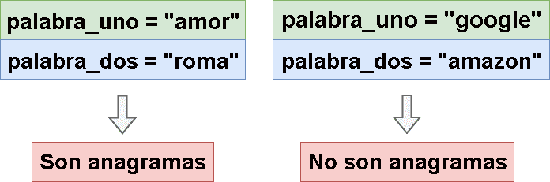

# 🔥🔥 Explicación y Resolución Del Ejercicio En Español Java | Python | PHP | C++ | JavaScript 🔥🔥

**Author:** hermescoder02
**Votes:** 5
**Link:** [https://leetcode.com/problems/valid-anagram/solutions/4094925/](https://leetcode.com/problems/valid-anagram/solutions/4094925/)

---

# Lectura

*Anagrama v\xE1lido (Java, Python, PHP, C++, Javascript)*

Este es un ejercicio que realiza facebook en sus pruebas t\xE9cnicas, y dice que:

Dadas dos palabras o strings , devolver true si son anagramas y falso en caso contrario.

Un anagrama es una palabra o frase formada reorganizando las letras de otra palabra o frase diferente.




# Explicaci\xF3n del ejercicio Paso por paso

https://youtu.be/w3dIr8eFeXI

Si te gust\xF3 el contenido \xA1visita mi canal de youtube!: 
\u2705https://www.youtube.com/@hermescoder

Si deseas profundizar m\xE1s en este tema \xA1visita mi blog!: 
\u2705https://hermescoder.com/valid-anagram-leetcode-espanol.html

# C\xF3digo 

```Java []
class Solution {
    public boolean isAnagram(String palabra_uno, String palabra_dos) {

        // Paso 1
        if (palabra_uno.length() != palabra_dos.length()) {
            return false;
        }

        // Paso 2
        Map<Character, Integer> cantidad_palabras_uno = new HashMap<>();
        Map<Character, Integer> cantidad_palabras_dos = new HashMap<>();

        // Paso 3
        for (int i = 0; i < palabra_uno.length(); i++) {
            char letra_uno = palabra_uno.charAt(i);
            char letra_dos = palabra_dos.charAt(i);

            cantidad_palabras_uno.put(letra_uno, cantidad_palabras_uno.getOrDefault(letra_uno, 0) + 1);
            cantidad_palabras_dos.put(letra_dos, cantidad_palabras_dos.getOrDefault(letra_dos, 0) + 1);
        }

        // Paso 4
        for (Map.Entry<Character, Integer> entrada : cantidad_palabras_uno.entrySet()) {
            if (!cantidad_palabras_dos.containsKey(entrada.getKey())) return false;
            if (!cantidad_palabras_dos.get(entrada.getKey()).equals(entrada.getValue())) return false;
            
        }

        // Paso 5
        return true;
    }
}
}
```
```Python []
class Solution:
    def isAnagram(self, palabra_uno, palabra_dos):
        # Paso 1
        if len(palabra_uno) != len(palabra_dos):
            return False

        # Paso 2
        cantidad_palabras_uno = {}
        cantidad_palabras_dos = {}

        # Paso 3
        for i in range(len(palabra_uno)):
            letra_uno = palabra_uno[i]
            letra_dos = palabra_dos[i]

            cantidad_palabras_uno[letra_uno] = cantidad_palabras_uno.get(letra_uno, 0) + 1
            cantidad_palabras_dos[letra_dos] = cantidad_palabras_dos.get(letra_dos, 0) + 1

        # Paso 4
        for letra, cantidad in cantidad_palabras_uno.items():
            if letra not in cantidad_palabras_dos:
                return False
            if cantidad != cantidad_palabras_dos[letra]:
                return False

        # Paso 5
        return True

```
```PHP []
class Solution {

    /**
     * @param String $palabra_uno 
     * @param String $palabra_dos
     * @return Boolean
     */
    function isAnagram($palabra_uno , $palabra_dos) {
        //paso#1
        if(strlen($palabra_uno ) !== strlen($palabra_dos)) return false;

        //paso#2
        $cantidad_palabras_uno=array();
        $cantidad_palabras_dos=array();

        //paso#3
        for($i = 0;$i < strlen($palabra_uno);$i++){
            $indice_palabra_uno=$palabra_uno[$i];
            $indice_palabra_dos=$palabra_dos[$i];

            $cantidad_palabras_uno[$indice_palabra_uno]++;
            $cantidad_palabras_dos[$indice_palabra_dos]++;
        }

        //paso#4
        foreach ($cantidad_palabras_uno as $letra => $cantidad) {
            if(!isset($cantidad_palabras_dos[$letra])) return false;
            if($cantidad_palabras_dos[$letra]!= $cantidad) return false;
        }

        //paso#5
        return true;
        
    }
}
```
```C++ []
class Solution {
public:
    /**
   * @param string $palabra_uno
   * @param string $palabra_dos
   * @return bool
   */
  bool isAnagram(const std::string& palabra_uno, const std::string& palabra_dos) {
    // Paso #1
    if (palabra_uno.size() != palabra_dos.size()) {
      return false;
    }

    // Paso #2
    std::vector<int> cantidad_palabras_uno(256, 0);
    std::vector<int> cantidad_palabras_dos(256, 0);

    // Paso #3
    for (int i = 0; i < palabra_uno.size(); i++) {
      cantidad_palabras_uno[palabra_uno[i]]++;
      cantidad_palabras_dos[palabra_dos[i]]++;
    }

    // Paso #4
    for (int i = 0; i < 256; i++) {
      if (cantidad_palabras_uno[i] != cantidad_palabras_dos[i]) {
        return false;
      }
    }

    // Paso #5
    return true;
  }
};
```
```JavaScript []
/**
 * @param {string} s
 * @param {string} t
 * @return {boolean}
 */
var isAnagram = function(palabra_uno, palabra_dos) {
    // Paso #1
    if (palabra_uno.length !== palabra_dos.length) {
      return false;
    }

    // Paso #2
    const cantidad_palabras_uno = {};
    const cantidad_palabras_dos = {};

    // Paso #3
    for (let i = 0; i < palabra_uno.length; i++) {
      const letra_uno = palabra_uno[i];
      const letra_dos = palabra_dos[i];

      cantidad_palabras_uno[letra_uno] = cantidad_palabras_uno[letra_uno] || 0;
      cantidad_palabras_uno[letra_uno]++;

      cantidad_palabras_dos[letra_dos] = cantidad_palabras_dos[letra_dos] || 0;
      cantidad_palabras_dos[letra_dos]++;
    }

    // Paso #4
    for (const letra in cantidad_palabras_uno) {
      if (!cantidad_palabras_dos.hasOwnProperty(letra)) {
        return false;
      }

      if (cantidad_palabras_uno[letra] !== cantidad_palabras_dos[letra]) {
        return false;
      }
    }

    // Paso #5
    return true;
};
```


