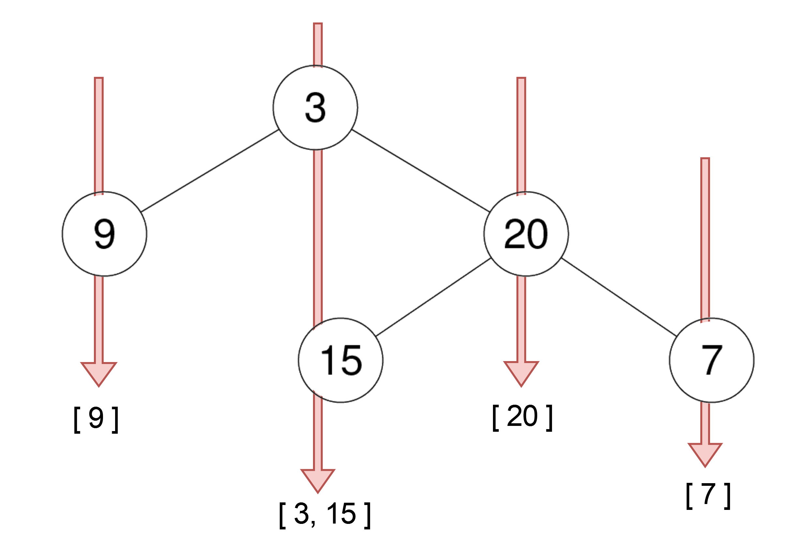
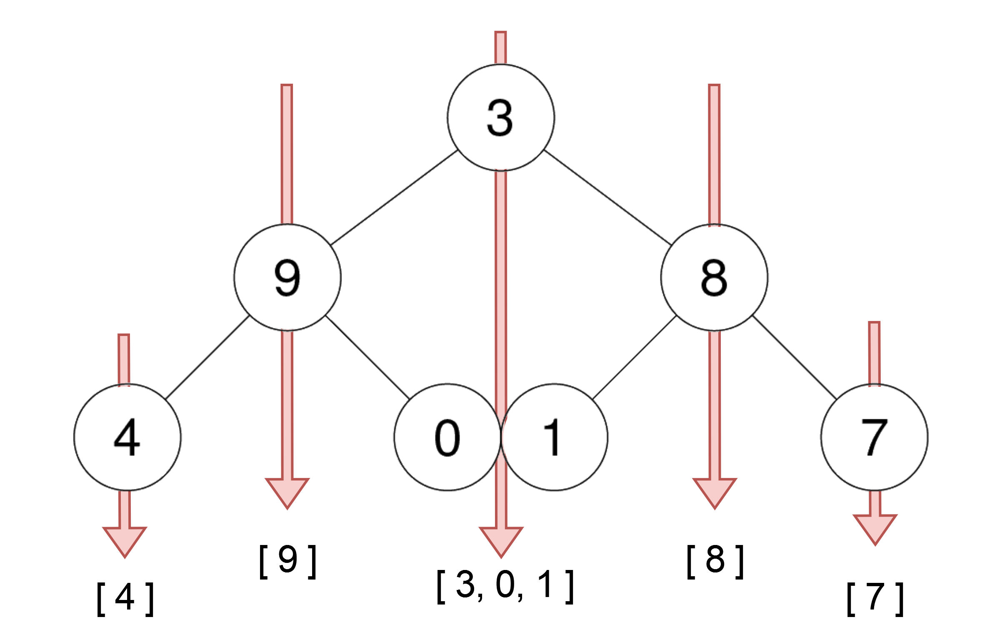
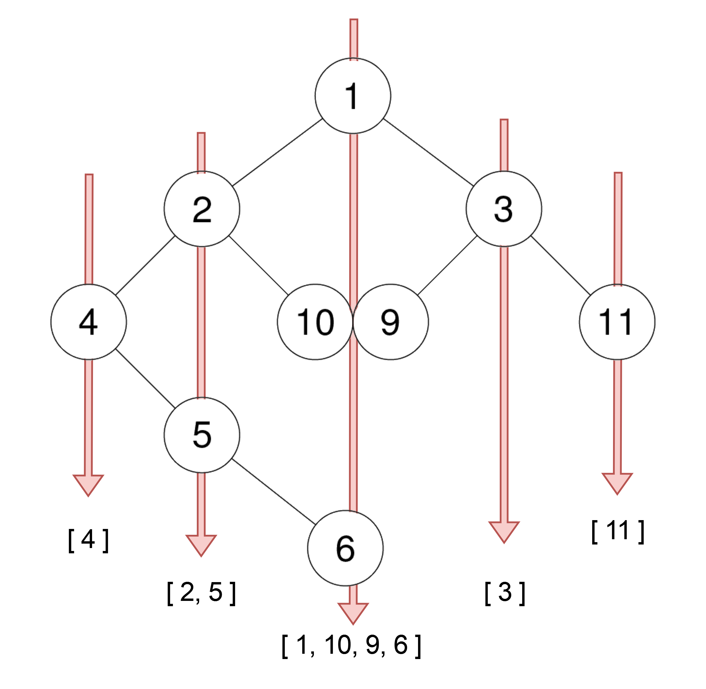

# [314. Binary Tree Vertical Order Traversal](https://leetcode.com/problems/binary-tree-vertical-order-traversal/)

| Category | Difficulty | Likes | Dislikes |
| :------: | :--------: | :---: | :------: |
| Algorithms | Medium | 3458 | 354 |

**Tags:** [`hash-table`](https://leetcode.com/tag/hash-table), [`tree`](https://leetcode.com/tag/tree), [`depth-first-search`](https://leetcode.com/tag/depth-first-search), [`breadth-first-search`](https://leetcode.com/tag/breadth-first-search), [`sorting`](https://leetcode.com/tag/sorting), [`binary-tree`](https://leetcode.com/tag/binary-tree)

**Companies:** `facebook`, `bloomberg`, `amazon`, `google`, `doordash`, `microsoft`, `tiktok`, `oracle`, `snapchat`

## Description

Given the `root` of a binary tree, return ***the vertical order traversal** of its nodes' values*. (i.e., from top to bottom, column by column).

If two nodes are in the same row and column, the order should be from **left to right**.

 

**Example 1:**


```

Input: root = [3,9,20,null,null,15,7]
Output: [[9],[3,15],[20],[7]]

```

**Example 2:**


```

Input: root = [3,9,8,4,0,1,7]
Output: [[4],[9],[3,0,1],[8],[7]]

```

**Example 3:**


```

Input: root = [1,2,3,4,10,9,11,null,5,null,null,null,null,null,null,null,6]
Output: [[4],[2,5],[1,10,9,6],[3],[11]]

```

 

**Constraints:**

	- The number of nodes in the tree is in the range `[0, 100]`.

	- `-100 <= Node.val <= 100`

---

**Links:** [Submissions](https://leetcode.com/problems/binary-tree-vertical-order-traversal/) | [Solutions](https://leetcode.com/problems/binary-tree-vertical-order-traversal/)
