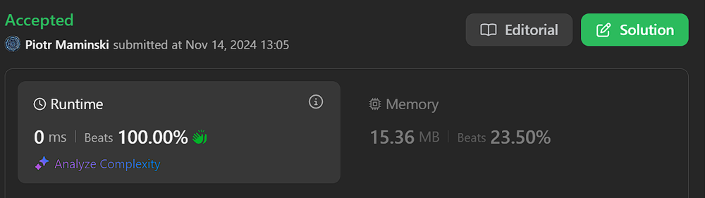

# ✅Beats 100% | Video Solution | Binary Tree + BFS

**Author:** Piotr_Maminski
**Votes:** 3
**Link:** [https://leetcode.com/problems/binary-tree-vertical-order-traversal/solutions/6044229/](https://leetcode.com/problems/binary-tree-vertical-order-traversal/solutions/6044229/)

---

# Upvote if I should write premium solutions and if anyone reads them. That way I will know.

https://youtu.be/xpXoHCFYC5c?si=aei3s5dGlmiJXnEx

# Binary Tree + Breadth-First Search (BFS)

```python3 []
from collections import defaultdict, deque

class Solution:
    def verticalOrder(self, root: TreeNode) -> List[List[int]]:
        if not root:
            return []
        
        columns = defaultdict(list)
        queue = deque([(root, 0)])
        columns[0] = [root.val]
        
        while queue:
            node, col = queue.popleft()
            
            if node.left:
                queue.append((node.left, col - 1))
                columns[col - 1].append(node.left.val)
                
            if node.right:
                queue.append((node.right, col + 1))
                columns[col + 1].append(node.right.val)
                
        return [columns[x] for x in sorted(columns.keys())]
```
```cpp []
class Solution {
public:
    vector<vector<int>> verticalOrder(TreeNode* root) {
        if (!root) {
            return {};
        }  

        map<int, vector<int>> mp;
        queue<pair<TreeNode*, int>> q;
        q.push({root, 0});
        mp[0] = {root->val};

        while (!q.empty()) {
            TreeNode* cur = q.front().first;
            int index = q.front().second;
            q.pop();

            if (cur->left) {
                q.push({cur->left, index-1});

                if (mp.find(index-1) == mp.end()) {
                    mp[index-1] = {cur->left->val};
                }
                else {
                    mp[index-1].push_back(cur->left->val);
                }
            }

            if (cur->right) {
                q.push({cur->right, index+1});

                if (mp.find(index+1) == mp.end()) {
                    mp[index+1] = {cur->right->val};
                }
                else {
                    mp[index+1].push_back(cur->right->val);
                }
            } 
        }  

        vector<vector<int>> result;
        for (auto it : mp) {
            result.push_back(it.second);
        }

        return result;
    }
};
```
```java []
class Solution {
    public List<List<Integer>> verticalOrder(TreeNode root) {
        List<List<Integer>> result = new ArrayList<>();
        if (root == null) return result;
        
        TreeMap<Integer, List<Integer>> map = new TreeMap<>();
        Queue<Pair<TreeNode, Integer>> queue = new LinkedList<>();
        
        queue.offer(new Pair<>(root, 0));
        map.put(0, new ArrayList<>(Arrays.asList(root.val)));
        
        while (!queue.isEmpty()) {
            Pair<TreeNode, Integer> pair = queue.poll();
            TreeNode node = pair.getKey();
            int col = pair.getValue();
            
            if (node.left != null) {
                queue.offer(new Pair<>(node.left, col - 1));
                map.computeIfAbsent(col - 1, k -> new ArrayList<>()).add(node.left.val);
            }
            
            if (node.right != null) {
                queue.offer(new Pair<>(node.right, col + 1));
                map.computeIfAbsent(col + 1, k -> new ArrayList<>()).add(node.right.val);
            }
        }
        
        return new ArrayList<>(map.values());
    }
}

```
```csharp []
public class Solution {
    public IList<IList<int>> VerticalOrder(TreeNode root) {
        var result = new List<IList<int>>();
        if (root == null) return result;
        
        var map = new SortedDictionary<int, List<int>>();
        var queue = new Queue<(TreeNode node, int col)>();
        
        queue.Enqueue((root, 0));
        map[0] = new List<int> { root.val };
        
        while (queue.Count > 0) {
            var (node, col) = queue.Dequeue();
            
            if (node.left != null) {
                queue.Enqueue((node.left, col - 1));
                if (!map.ContainsKey(col - 1))
                    map[col - 1] = new List<int>();
                map[col - 1].Add(node.left.val);
            }
            
            if (node.right != null) {
                queue.Enqueue((node.right, col + 1));
                if (!map.ContainsKey(col + 1))
                    map[col + 1] = new List<int>();
                map[col + 1].Add(node.right.val);
            }
        }
        
        return map.Values.ToList();
    }
}

```
```golang []
func verticalOrder(root *TreeNode) [][]int {
    if root == nil {
        return nil
    }
    
    type QueueItem struct {
        node *TreeNode
        col  int
    }
    
    columns := make(map[int][]int)
    queue := []QueueItem{{root, 0}}
    columns[0] = []int{root.Val}
    
    minCol, maxCol := 0, 0
    
    for len(queue) > 0 {
        item := queue[0]
        queue = queue[1:]
        
        if item.node.Left != nil {
            queue = append(queue, QueueItem{item.node.Left, item.col - 1})
            columns[item.col-1] = append(columns[item.col-1], item.node.Left.Val)
            minCol = min(minCol, item.col-1)
        }
        
        if item.node.Right != nil {
            queue = append(queue, QueueItem{item.node.Right, item.col + 1})
            columns[item.col+1] = append(columns[item.col+1], item.node.Right.Val)
            maxCol = max(maxCol, item.col+1)
        }
    }
    
    result := make([][]int, maxCol-minCol+1)
    for i := minCol; i <= maxCol; i++ {
        result[i-minCol] = columns[i]
    }
    
    return result
}

```
```swift []
class Solution {
    func verticalOrder(_ root: TreeNode?) -> [[Int]] {
        guard let root = root else { return [] }
        
        var columns: [Int: [Int]] = [:]
        var queue: [(node: TreeNode, col: Int)] = [(root, 0)]
        columns[0] = [root.val]
        
        var index = 0
        while index < queue.count {
            let current = queue[index]
            
            if let left = current.node.left {
                queue.append((left, current.col - 1))
                columns[current.col - 1, default: []].append(left.val)
            }
            
            if let right = current.node.right {
                queue.append((right, current.col + 1))
                columns[current.col + 1, default: []].append(right.val)
            }
            
            index += 1
        }
        
        return columns.sorted { $0.key < $1.key }.map { $0.value }
    }
}

```
```javascript [JS]
// JavaScript

var verticalOrder = function(root) {
    if (!root) return [];
    
    const columns = new Map();
    const queue = [[root, 0]];
    columns.set(0, [root.val]);
    
    while (queue.length) {
        const [node, col] = queue.shift();
        
        if (node.left) {
            queue.push([node.left, col - 1]);
            if (!columns.has(col - 1)) {
                columns.set(col - 1, []);
            }
            columns.get(col - 1).push(node.left.val);
        }
        
        if (node.right) {
            queue.push([node.right, col + 1]);
            if (!columns.has(col + 1)) {
                columns.set(col + 1, []);
            }
            columns.get(col + 1).push(node.right.val);
        }
    }
    
    return [...columns.entries()]
        .sort(([a], [b]) => a - b)
        .map(([_, vals]) => vals);
};

```
```typescript [TS]
// TypeScript

class Solution {
    verticalOrder(root: TreeNode | null): number[][] {
        if (!root) return [];
        
        const columns = new Map<number, number[]>();
        const queue: [TreeNode, number][] = [[root, 0]];
        columns.set(0, [root.val]);
        
        while (queue.length > 0) {
            const [node, col] = queue.shift()!;
            
            if (node.left) {
                queue.push([node.left, col - 1]);
                if (!columns.has(col - 1)) {
                    columns.set(col - 1, []);
                }
                columns.get(col - 1)!.push(node.left.val);
            }
            
            if (node.right) {
                queue.push([node.right, col + 1]);
                if (!columns.has(col + 1)) {
                    columns.set(col + 1, []);
                }
                columns.get(col + 1)!.push(node.right.val);
            }
        }
        
        return Array.from(columns.entries())
            .sort(([a], [b]) => a - b)
            .map(([_, vals]) => vals);
    }
}

```
```rust []
use std::collections::{HashMap, VecDeque};
use std::rc::Rc;
use std::cell::RefCell;

impl Solution {
    pub fn vertical_order(root: Option<Rc<RefCell<TreeNode>>>) -> Vec<Vec<i32>> {
        if root.is_none() {
            return vec![];
        }
        
        let mut columns: HashMap<i32, Vec<i32>> = HashMap::new();
        let mut queue = VecDeque::new();
        
        if let Some(root_node) = root {
            queue.push_back((root_node.clone(), 0));
            columns.insert(0, vec![root_node.borrow().val]);
        }
        
        while !queue.is_empty() {
            if let Some((node, col)) = queue.pop_front() {
                let node = node.borrow();
                
                if let Some(left) = node.left.clone() {
                    queue.push_back((left.clone(), col - 1));
                    columns.entry(col - 1)
                        .or_insert_with(Vec::new)
                        .push(left.borrow().val);
                }
                
                if let Some(right) = node.right.clone() {
                    queue.push_back((right.clone(), col + 1));
                    columns.entry(col + 1)
                        .or_insert_with(Vec::new)
                        .push(right.borrow().val);
                }
            }
        }
        
        let mut result: Vec<Vec<i32>> = columns
            .into_iter()
            .collect::<Vec<_>>()
            .into_iter()
            .sort_by_key(|&(k, _)| k)
            .into_iter()
            .map(|(_, v)| v)
            .collect();
            
        result
    }
}

```
```ruby []
def vertical_order(root)
    return [] if root.nil?
    
    columns = Hash.new { |h, k| h[k] = [] }
    queue = [[root, 0]]
    columns[0] = [root.val]
    
    until queue.empty?
        node, col = queue.shift
        
        if node.left
            queue.push([node.left, col - 1])
            columns[col - 1] << node.left.val
        end
        
        if node.right
            queue.push([node.right, col + 1])
            columns[col + 1] << node.right.val
        end
    end
    
    columns.sort.map { |_, vals| vals }
end

```


### Complexity
- Time complexity: O(n)


- Space complexity: O(n)


