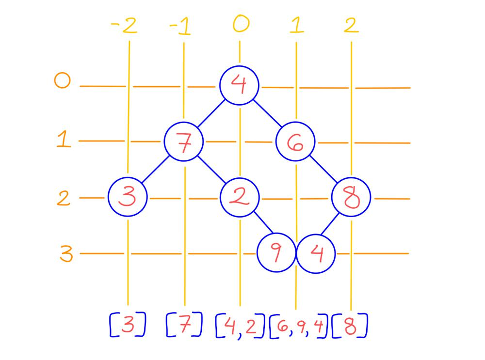

# Golang Solution With Explanation and Images

**Author:** nathannaveen
**Votes:** 8
**Link:** [https://leetcode.com/problems/binary-tree-vertical-order-traversal/solutions/1852164/](https://leetcode.com/problems/binary-tree-vertical-order-traversal/solutions/1852164/)

---

### **What the Problem is Asking:**

I feel that the examples given by the problem description are not that good, so I made an example that I find a little easier to understand:

`Input: root = [4,7,6,3,2,null,8,null,null,null,9,4]`




We add the values of the nodes starting with the topmost nodes, and then if the nodes are on the same row and same column, we add them from left to right. 

For example, in our image above in column `1`, we have our result for the column being `[6, 9, 4]` this is because we can start with node `6` in row 1, then in row 3, we have `9` and `4`. Since `9` is on the left and `4` is on the right, we first add `9` and then `4`.

### **What the Solution is Doing:**

From a bird's eyes view, this solution uses BFS to add nodes into a map of array of integer (The map is a map of `map[int] []int {}`, this is a map of `column : elements in column`). We do BFS to add the nodes in the top rows before the nodes in the bottom rows and add nodes on the left before the right.

After adding our nodes to the map of an array of integers, we can put the arrays for each column into one `[][]int` so we can return.

***

Adding the nodes into a `map[int] []int {}` is pretty simple. We use a separate type which I call `key`. The definition of this structure is:

```
type key struct {
    node *TreeNode
    col int // the column of the node
}
```

So basically, we can BFS through all the nodes. If we go to a left child, we subtract one from `col`, and if we go right, we add one.

***

Putting the nodes into an `[][]int` is not as simple as just adding each array from our map into it because the map is not sorted. Using the same example from above, our map is:

```
m = [
  2 : [8]
  0 : [4 2]
  -1 : [7]
  1 : [6 9 4]
  -2 : [3]
]
```

We can use the fact that if we start at a value, our column numbers will always go up by one up until a specific number. For example, our columns start at `-2` in this input and keep incrementing by one: `-1, 0, 1, 2`. 

So if we know the minimum column, we can know where to place the nodes in our result.

If we continue on with our example, we know that our result will be an `[5][]int`, so `res = [[],[],[],[],[]]`. We know that the minimum column is `-2`, so basically, the nodes in column `-2` would go in `res[0]`. Since column `-2` is equal to `res[0]`, we must add `2` to cancel out `-2`. So `res[-2 + 2] = res[0]`. Because of this, we can add `2` to all of our columns when putting them in `res`.

* We can start off with `2 : [8]`. `res[2 + 2] = res[4]`. `res[4] = [8]`.
* Then `0 : [4, 2]`. `res[0 + 2] = res[2]`. `res[2] = [4, 2]`.
* `-1 : [7]`. `res[-1 + 2] = res[1]`. `res[1] = [7]`.
* `1 : [6, 9, 4]`. `res[1 + 2] = res[3]`. `res[3] = [6, 9, 4]`.
* `-2 : [3]`. `res[-2 + 2] = res[0]`. `res[0] = [3]`.

So, `res = [[3],[7],[4,2],[6,9,4],[8]]`. In this example, we are adding `2` to all of our columns, but in any other test case, we would be adding the absolute value of the minimum number.

``` go
type key struct {
    node *TreeNode
    col int // the column of the node
}

func verticalOrder(root *TreeNode) [][]int {
    m := map[int] []int {} // cols : nodes per column
    queue := []key{ key{ root, 0 } }
    min := 0 // minimum column
    
    for len(queue) != 0 {
        n := len(queue)
        
        for i := 0; i < n; i++ {
            pop := queue[0]
            queue = queue[1:]
            
            if pop.node == nil {
                continue
            }
            if pop.col < min {
                min = pop.col
            }
            
            m[pop.col] = append(m[pop.col], pop.node.Val)
            
            queue = append(queue, 
                key{ pop.node.Left, pop.col - 1 }, 
                key{ pop.node.Right, pop.col + 1 },
            )
        }
    }
    
    min *= -1
    
    res := make([][]int, len(m))
    
    for a, b := range m {
        res[min + a] = b
    }
    
    return res
}
```