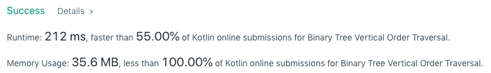

# Kotlin - 212 ms - BFS with a map of indices to columns and a min heap for non-empty indices

**Author:** ed-karabinus
**Votes:** 1
**Link:** [https://leetcode.com/problems/binary-tree-vertical-order-traversal/solutions/571919/](https://leetcode.com/problems/binary-tree-vertical-order-traversal/solutions/571919/)

---


```
class Solution {
    val ORIGIN = Pair(0, 0)
    
    fun verticalOrder(root: TreeNode?): List<List<Int>> {
        val nonEmptyColumns = HashMap<Int, ArrayList<Pair<Int, Int>>>()
        val orderedNonEmptyColumnKeys = PriorityQueue<Int>()
        val bfsNodeQueue = LinkedList<TreeNode>()
        val bfsPositionQueue = LinkedList<Pair<Int, Int>>()
        var nodeIndex = 0
        if (root != null) {
            bfsNodeQueue.offer(root)
            bfsPositionQueue.offer(ORIGIN)
        }
        while (bfsNodeQueue.peek() != null && bfsPositionQueue.peek() != null) {
            val polledNode = bfsNodeQueue.poll()
            val polledPosition = bfsPositionQueue.poll()
            nodeIndex++
            val (polledXPosition, polledYPosition) = polledPosition
            if (!nonEmptyColumns.containsKey(polledXPosition)) {
                nonEmptyColumns.put(polledXPosition, ArrayList<Pair<Int, Int>>())
                orderedNonEmptyColumnKeys.offer(polledXPosition)
            }
            nonEmptyColumns.get(polledXPosition)?.add(Pair(polledNode.`val`, nodeIndex))
            if (polledNode.left != null) {
                bfsNodeQueue.offer(polledNode.left)
                bfsPositionQueue.offer(Pair(polledXPosition - 1, polledYPosition - 1))
            }
            if (polledNode.right != null) {
                bfsNodeQueue.offer(polledNode.right)
                bfsPositionQueue.offer(Pair(polledXPosition + 1, polledYPosition - 1))   
            }
        }
        val verticalOrder = ArrayList<List<Int>>()
        while (orderedNonEmptyColumnKeys.peek() != null) {
            val nonEmptyColumnKey = orderedNonEmptyColumnKeys.poll()
            val sortedNonEmptyColumnPairs = nonEmptyColumns.get(nonEmptyColumnKey)
                ?.sortedWith(compareBy({ it.second }, { it.first }))
            val nonEmptyColumn = sortedNonEmptyColumnPairs?.map { it.first }
            verticalOrder.add(nonEmptyColumn!!)
        }
        return verticalOrder
    }
}
```