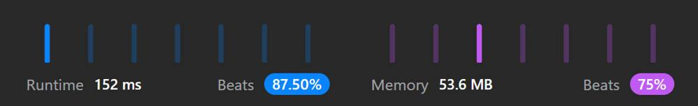

# JS fast solution. Easy array.

**Author:** hanbi58
**Votes:** 7
**Link:** [https://leetcode.com/problems/data-stream-as-disjoint-intervals/solutions/3107431/](https://leetcode.com/problems/data-stream-as-disjoint-intervals/solutions/3107431/)

---

# Intuition
Constraints:
0 <= value <= 10^4

This approach works great when all input are positive integers.

# Complexity
- Time complexity:
O(n)

- Space complexity:
O(n)

# Code
```
class SummaryRanges {
  constructor() {
    this.list = [];
  }
  addNum(num) {
    this.list[num] = true;
  }
  getIntervals() {
    const res = [];
    for (let i = 0; i < this.list.length; i++) {
      if (this.list[i]) {
        let j = i;
        while (this.list[j]) j++;
        res.push([i, j - 1]);
        i = j;
      }
    }
    return res;
  }
}
```


