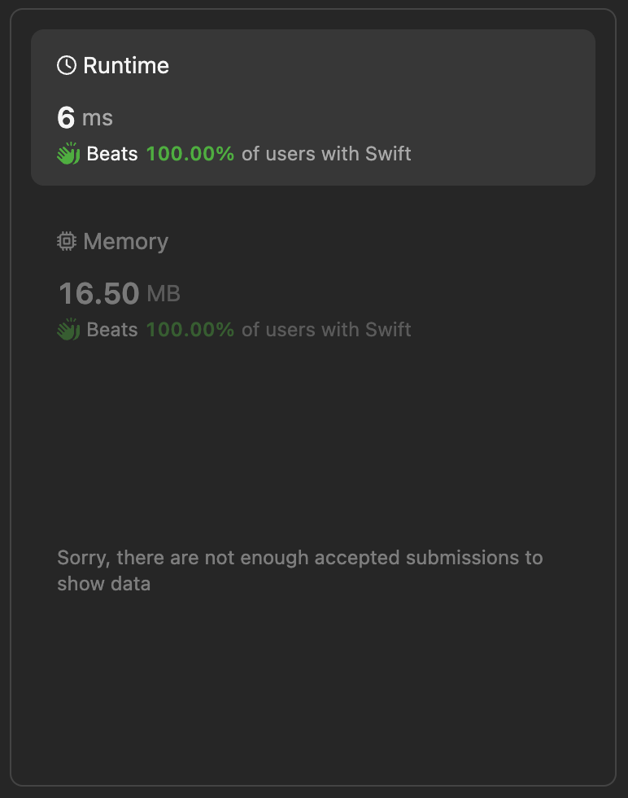

# Summary Range 🚦 Best performing and detailed Swift implementation

**Author:** lebon
**Votes:** 0
**Link:** [https://leetcode.com/problems/data-stream-as-disjoint-intervals/solutions/5072796/](https://leetcode.com/problems/data-stream-as-disjoint-intervals/solutions/5072796/)

---

# Intuition
The `SummaryRanges` class is designed to manage and retrieve intervals of numbers. The class uses a dictionary (`treeMap`) to keep track of unique numbers added and their existence (using a boolean value `true`). The main functionalities of this class are to add numbers (`addNum`) and retrieve consecutive intervals of numbers (`getIntervals`).

# Approach
1. **Initialization (`init`):**
   - The `init` method initializes the `treeMap` as an empty dictionary when an instance of `SummaryRanges` is created.

2. **Adding a Number (`addNum`):**
   - The `addNum` method takes an integer `value` and adds it to the `treeMap` dictionary with a boolean value of `true`. This indicates the presence of the number in the dictionary.

3. **Getting Intervals (`getIntervals`):**
   - The `getIntervals` method retrieves consecutive intervals of numbers from the `treeMap`.
   - It initializes an empty array `res` to store the intervals.
   - It uses `currentStart` and `currentEnd` variables to track the current interval being processed.
   - It iterates through the sorted keys of `treeMap` (sorted in ascending order).
     - If there's an existing interval (`currentStart` and `currentEnd` are not `nil`), it checks if the current number (`num`) can extend the interval (`end + 1 == num`).
       - If it can extend the interval, it updates `currentEnd` to include the current number.
       - If not, it completes the current interval by appending `[start, end]` to `res` and starts a new interval with the current number.
     - If there's no existing interval (`currentStart` and `currentEnd` are `nil`), it initializes the first interval with the current number.
   - After iterating through all numbers, it appends the last interval to `res` if it exists (`if let start = currentStart, let end = currentEnd`).
   - Finally, it returns the array `res` containing all consecutive intervals of numbers.

# Complexity
- **Time complexity:** 
  - The `addNum` operation is $$(O(1))$$ on average because it directly inserts into the dictionary.
  - The `getIntervals` operation iterates through the sorted keys of `treeMap`, which takes $$(O(n log n))$$ time due to sorting, where $$(n)$$ is the number of unique keys (numbers).
  - Overall time complexity is dominated by the `getIntervals` operation.
  
- **Space complexity:**
  - The space complexity is $$(O(n))$$, where $$(n)$$ is the number of unique numbers added to `treeMap` (size of dictionary). The `res` array stores the intervals, which could be up to $$(n)$$ in size in the worst case if each number forms a separate interval.

This implementation efficiently manages and retrieves consecutive intervals of numbers using a dictionary in Swift. The `getIntervals` method is designed to process the dictionary keys in sorted order to identify and consolidate consecutive numbers into intervals.





# Code
```

class SummaryRanges {

    var treeMap = [Int: Bool]()  // Using Dictionary to simulate SortedDict
    
    init() {
        // Constructor is empty in Swift
    }
    
    func addNum(_ value: Int) {
        treeMap[value] = true
    }
    
    func getIntervals() -> [[Int]] {
        var res = [[Int]]()
        var currentStart: Int?
        var currentEnd: Int?
        
        // Sort keys of treeMap (equivalent to iterating in sorted order)
        for num in treeMap.keys.sorted() {
            if let start = currentStart, let end = currentEnd {
                if end + 1 == num {
                    // Extend current interval
                    currentEnd = num
                } else {
                    // Complete current interval and start a new one
                    res.append([start, end])
                    currentStart = num
                    currentEnd = num
                }
            } else {
                // Initialize first interval
                currentStart = num
                currentEnd = num
            }
        }
        
        // Append last interval if exists
        if let start = currentStart, let end = currentEnd {
            res.append([start, end])
        }
        
        return res
        
    }
}

/**
 * Your SummaryRanges object will be instantiated and called as such:
 * let obj = SummaryRanges()
 * obj.addNum(value)
 * let ret_2: [[Int]] = obj.getIntervals()
 */
```