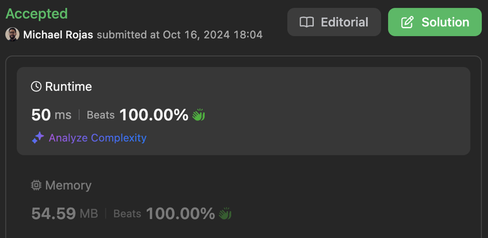
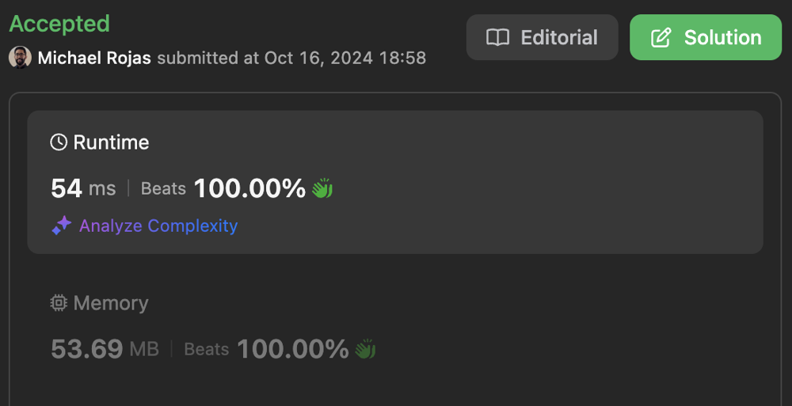

# 100% | Greedy | Time: O(N) | Space: O(N)

**Author:** rojas
**Votes:** 2
**Link:** [https://leetcode.com/problems/rearrange-string-k-distance-apart/solutions/4020070/](https://leetcode.com/problems/rearrange-string-k-distance-apart/solutions/4020070/)

---

# Table of Contents

[toc]

# Complexity

- Time complexity: $$O(N)$$

- Space complexity: $$O(N)$$

# Performance

[Typescript Submission](https://leetcode.com/problems/rearrange-string-k-distance-apart/submissions/1424747606/)



[Javascript Submission](https://leetcode.com/problems/rearrange-string-k-distance-apart/submissions/1424773716/)



# Code

```typescript []
const ALPHABET_MIN = 97; // ASCII a; aka "a".charCodeAt(0);
const ALPHABET_LEN = 26;

function rearrangeString(s: string, k: number): string {
    
    // If s is empty
    // OR s has only one (therefore unique) char
    // OR no distance required
    const N = s.length;
    if (N < 2 || k < 2) {
        return s;
    }

    // Get char counts
    const counts = new Array(ALPHABET_LEN).fill(0);
    for (let i = 0; i < N; ++i){
        ++counts[s.charCodeAt(i) - ALPHABET_MIN];
    }

    // Sort letters by counts in DESC order
    const codes: number[] = new Array(ALPHABET_LEN);
    for (let i = 0; i < ALPHABET_LEN; ++i){
        codes[i] = i;
    }
    codes.sort((a, b) => counts[b] - counts[a]);
    
    // Check if all chars unique
    let max = counts[codes[0]];
    if (max === 1) {
        return s;
    }
    
    // Get number of max count
    let numMax = 1;
    while (numMax < ALPHABET_LEN && counts[codes[numMax]] === max) {
        ++numMax;
    }

    // If required spacing too large
    if (k * (max - 1) + numMax > N) {
        return "";
    }

    // Compile max chars
    let buf: string[] = new Array(numMax);
    for (let i = 0; i < numMax; ++i) {
        buf[i] = String.fromCharCode(codes[i] + ALPHABET_MIN);
    }

    // Create groups
    const groups: string[][] = new Array(max);
    for (let i = 0; i < max; ++i){
        groups[i] = Array.from(buf);
    }

    // Add remaining chars
    --max;
    for (let i = numMax, j = 0; i < ALPHABET_LEN; ++i) {
        const code = codes[i];
        const char = String.fromCharCode(code + ALPHABET_MIN);
        while (--counts[code] >= 0) {
            groups[j].push(char);
            j = (j + 1) % max;
        }
    }

    // Return string
    buf = new Array(max + 1);
    for (let i = 0; i <= max; ++i){
        buf[i] = groups[i].join("");
    }
    return buf.join("");
};
```

```javascript []
const ALPHABET_MIN = 97; // ASCII a; aka "a".charCodeAt(0);
const ALPHABET_LEN = 26;

/**
 * @param {string} s
 * @param {number} k
 * @return {string}
 */
function rearrangeString(s, k) {
    
    // If s is empty
    // OR s has only one (therefore unique) char
    // OR no distance required
    const N = s.length;
    if (N < 2 || k < 2) {
        return s;
    }

    // Get char counts
    const counts = new Array(ALPHABET_LEN).fill(0);
    for (let i = 0; i < N; ++i){
        ++counts[s.charCodeAt(i) - ALPHABET_MIN];
    }

    // Get max count
    let max = 0;
    for (let i = 0; i < ALPHABET_LEN; ++i){
        max = Math.max(max, counts[i]);
    }

    // If all chars unique
    if (max === 1) {
        return s;
    }
    
    // Get number of max count
    let numMax = 0;
    for (let i = 0; i < ALPHABET_LEN; ++i) {
        numMax += +(counts[i] === max);
    }

    // If required spacing too large
    if (k * (max - 1) + numMax > N) {
        return "";
    }

    // Sort letters by counts in DESC order
    const codes = new Array(ALPHABET_LEN);
    for (let i = 0; i < ALPHABET_LEN; ++i){
        codes[i] = i;
    }
    codes.sort((a, b) => counts[b] - counts[a]);

    // Compile max chars
    let buf = new Array(numMax);
    for (let i = 0; i < numMax; ++i) {
        buf[i] = String.fromCharCode(codes[i] + ALPHABET_MIN);
    }

    // Create buffers
    const bufs = new Array(max);
    for (let i = 0; i < max; ++i){
        bufs[i] = Array.from(buf);
    }

    // Add remaining chars
    --max;
    for (let i = numMax, j = 0; i < ALPHABET_LEN; ++i) {
        const code = codes[i];
        const char = String.fromCharCode(code + ALPHABET_MIN);
        while (--counts[code] >= 0) {
            bufs[j].push(char);
            j = (j + 1) % max;
        }
    }

    // Return string
    buf = new Array(max + 1);
    for (let i = 0; i <= max; ++i){
        buf[i] = bufs[i].join("");
    }
    return buf.join("");
};
```