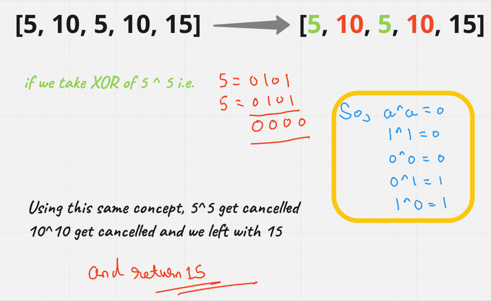

# [Java/C++/Python] very-very EASY to go solution

**Author:** hi-malik
**Votes:** 258
**Link:** [https://leetcode.com/problems/find-the-difference/solutions/1751380/](https://leetcode.com/problems/find-the-difference/solutions/1751380/)

---

```
What the question is saying, we are given two strings s and t.
String t is generated by random shuffling string s and then add one more letter at a random position.
Return the letter that was added to t.
```

In this problem we are given 2 strings "t" & "s". example:
**s = "abc"**
**t = "bacx"** in "t" we have one additional character

So, we have to find one additional character `there are couple of ways to solve this problem.But we will use BITWISE method to solve this problem`

So, using XOR concept we will get our additional character, understand it visually :-


```
So, here also let's say our character are:
s = abc
t = cabx

if we take XOR of every character. all the n character of s "abc" is similar to n character of t "cab". So, they will cancel each other. 
And we left with our answer.

s =   abc
t =   cbax
------------
ans -> x
-----------
```

**Java**
```
class Solution {
    public char findTheDifference(String s, String t) {
        char c = 0;
        for(char cs : s.toCharArray()) c ^= cs;
        for(char ct : t.toCharArray()) c ^= ct;
        return c;
    }
}
```
**C++**
```
class Solution {
public:
    char findTheDifference(string s, string t) {
        char c = 0;
        for(char cs : s) c ^= cs;
        for(char ct : t) c ^= ct;
        return c;
    }
};
```
**Python**
```
class Solution:
    def findTheDifference(self, s: str, t: str) -> str:
        c = 0
        for cs in s: c ^= ord(cs) #ord is ASCII value
        for ct in t: c ^= ord(ct)
        return chr(c) #chr = convert ASCII into character
```
ANALYSIS :-
* **Time Complexity :-** BigO(N)

* **Space Complexity :-** BigO(1)