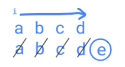

# JavaScript | Daily Leetcode Challenge Feb, Day 7

**Author:** nimishapundhir
**Votes:** 60
**Link:** [https://leetcode.com/problems/find-the-difference/solutions/1752624/](https://leetcode.com/problems/find-the-difference/solutions/1752624/)

---

Algo: 
we have 2 strings, 
suppose -
String1 : abcd
String2 : abcde
we will ittrate loop through String1 and remove each character from String2.
after the loop extra character will be left. and we'll return that.

Visually :- 
Code:- 
```
var findTheDifference = function(s, t) {
    for (let letter of s)
        t = t.replace(letter, '');
    return t;
};
```

***Upvote*** if it helped.