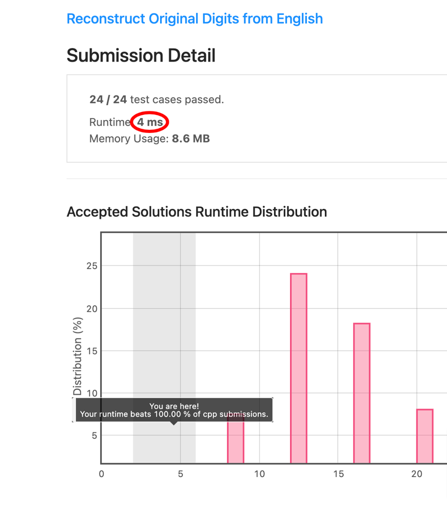

# [C++] 4ms Fastest to Date Solution Explained, 100% Time, ~96% Space

**Author:** Ajna
**Votes:** 13
**Link:** [https://leetcode.com/problems/reconstruct-original-digits-from-english/solutions/1131953/](https://leetcode.com/problems/reconstruct-original-digits-from-english/solutions/1131953/)

---

Great problem today! You might be tempted to use some graph-like approach to decide if, say, a "f" should go to compose a "five" or "four", but there is a smarter way around it.

For example `'z'`s are used only in `"zero"`s and `'x'` are used only `"six"`es; and after you remove `"six"`es, you know that the only `'s'`es left are in `"seven"`s; same with `'g'`: they are only in `eight`s and once you remove them, the only other `h`s left are in `three`; and once you remove them, the only `'r'`s left are in `"four"`s - and so on, you get the gist of it.

Now, in order to code this logic down, we will declare a couple of support variables as `static constexpr`s:
* `digChars` will store all the unique letters and the matching numbers in pairs (their order reflects the logic states above: first unique letters and then going down removing only the ones that are now left as uniques and so on;
* `digWord` is an array containing the name of each number in the `0 - 9` range in letters.

In the main function, we will define 2 more arrays and one other variable:
* `digits` will store how many digits are actually present in our final solution - all elements set to `0`;
* `alpha` will store the frequency of each character (the array is sized to be `123` in order to avoid somehow expensive subtractions of `0` at each step) - all elements set to `0` again;
* `tot` will store the total number of characters in our response string (declare only later, to optimise).

We will then first of all populate `alpha`, iterating through each character `c` of `s` and increasing the matching cell by `1`.

Time to actually figure out what numbers we have there next and for each element `d` in `digChars`, we will:
* assign the number of occurrences of its unique character `d.first` to `n`;
* increase `tot` by `n`;
* remove all the characters matching that digits from `alpha` (I know I might have optimised removing only needed characters, but it would have made little difference and made the code more complex, needing another array and less intuitive logic).

Now, last steps and we will start compoising a result creating a string `res` already of the right size (`tot`) to avoid reallocations.

We will then loop with `i` from `0` to `9` and, while we still have any of that number to insert (`digits[i] > 0`), we will add that character to the next slot in the final result: `res[j++] = i + '0'`.

Once done, we can just return `res` :)

The code:

```cpp
static constexpr pair<char, int> digChars[10] = {{'z', 0}, {'w', 2}, {'x', 6}, {'s', 7}, {'g', 8}, {'h', 3}, {'v', 5}, {'f', 4}, {'o', 1}, {'e', 9}};

static string digWord[10] = {"zero", "one", "two", "three", "four", "five", "six", "seven", "eight", "nine"};

class Solution {
public:
    string originalDigits(string s) {
        // support variables
		int digits[10], tot = 0, alpha[123] = {};
        // populating alpha
        for (char c: s) alpha[c]++;
        for (auto d: digChars) {
            // getting the number of matches
            int n = alpha[d.first];
            // updating digits with the number of matches
            digits[d.second] = n;
            // updating tot by the number of needed characters
            tot += n;
            // clearing up alpha accordingly
            for (char c: digWord[d.second]) alpha[c] -= n;
        }
        //  creating and populating res
        string res(tot, '*');
        for (int i = 0, j = 0; i < 10; i++) {
            while(digits[i]--) {
                res[j++] = i + '0';
            }
        }
        return res;
    }
};
```

The brag:



Extra goodie, variant to get you the solution with words - because, yes: I did it this morning and being half-asleep I just came up wtih a needlessly more complex logic \uD83E\uDD26\u200D:

```cpp
class Solution {
public:
    string originalDigits(string s) {
        // support variables
        int digits[10], tot = 0;
        char alpha[123] = {};
        // populating alpha
        for (char c: s) alpha[c]++;
        for (auto d: digChars) {
            // getting the number of matches
            int n = alpha[d.first];
            // updating digits with the number of matches
            digits[d.second] = n;
            // updating tot by the number of needed characters
            tot += n * digWord[d.second].size();
            // clearing up alpha accordingly
            for (char c: digWord[d.second]) alpha[c] -= n;
        }
        // creating and populating res
        string res(tot, '*');
        for (int i = 0, j = 0; i < 10; i++) {
            while(digits[i]--) {
                for (char c: digWord[i]) res[j++] = c;
            }
        }
        return res;
    }
};
```