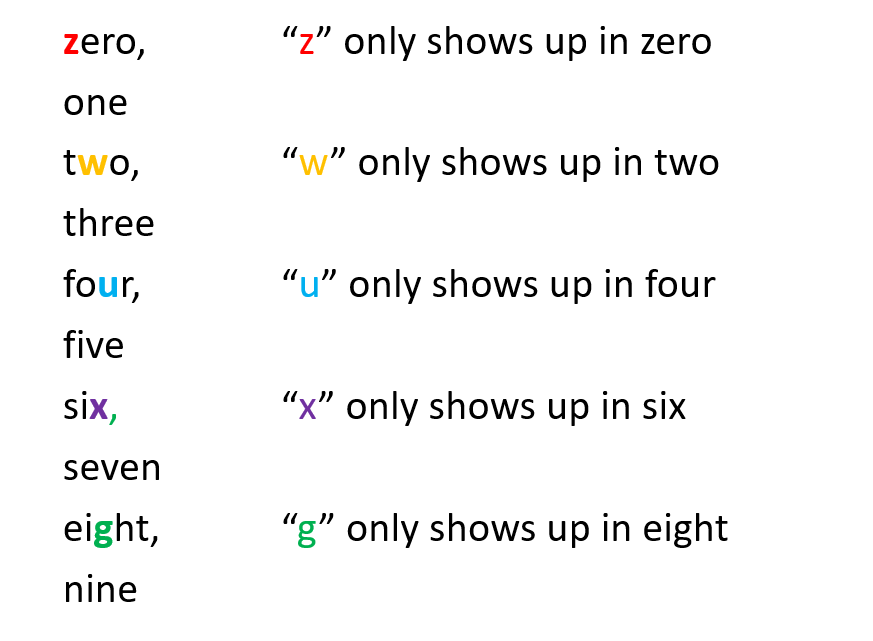
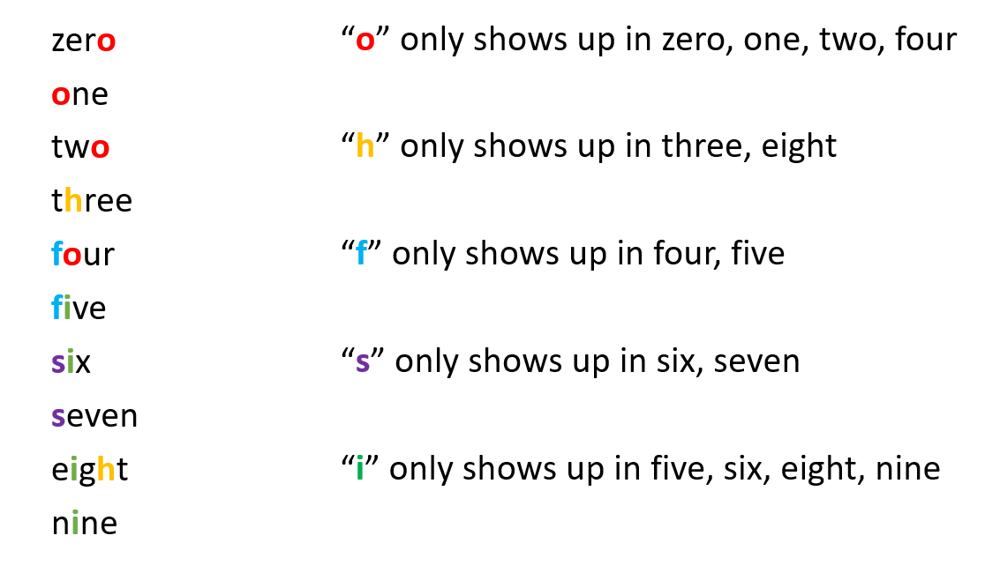

# Python/Go O(n) by dictionary [w/ Diagram]

**Author:** brianchiang_tw
**Votes:** 17
**Link:** [https://leetcode.com/problems/reconstruct-original-digits-from-english/solutions/1131114/](https://leetcode.com/problems/reconstruct-original-digits-from-english/solutions/1131114/)

---

**Hint**:

1. Rebuild **even digits** first, becuase each even digit has corresponding **unique character** naturally

1. Then rebuild **odd digits** from observed character-occurrence mapping.

---

**Diagram** for even digits (i.e., 0, 2, 4, 6, 8 ) rebuilding based on character-occurrence mapping



---

**Diagram** for odd digits (i.e., 1, 3, 5, 7, 9 ) rebuilding based on character-occurrence mapping




---

**Implementation** by dictioanry in Python:

```


class Solution:
    def originalDigits(self, s: str) -> str:

        
        # ----------------------------------------------------------
        
        def mapping_rebuild( digit_occ_dict , char_occ_dict ):
            
            
            ## Rebuild the number and its occurrence from character frequency analysis
            
            
            # "z" only shows up in "zero"
            digit_occ_dict [0] = char_occ_dict['z']

            # "w" only shows up in "two"
            digit_occ_dict [2] = char_occ_dict['w']

            # "u" only shows up in "four"
            digit_occ_dict [4] = char_occ_dict['u']

            # "x" only shows up in "six"
            digit_occ_dict [6] = char_occ_dict['x']

            # "g" only shows up in "eight"
            digit_occ_dict [8] = char_occ_dict['g']

            # "o" only shows up in "zero", "one", "two", "four"
            digit_occ_dict [1] = char_occ_dict['o'] - digit_occ_dict [0] - digit_occ_dict [2] - digit_occ_dict [4]

            # "h" only shows up in "three", "eight"
            digit_occ_dict [3] = char_occ_dict['h'] - digit_occ_dict [8]

            # "f" only shows up in "four", "five"
            digit_occ_dict [5] = char_occ_dict['f'] - digit_occ_dict [4]

            # "s" only shows up in "six", "seven"
            digit_occ_dict [7] = char_occ_dict['s'] - digit_occ_dict [6]

            # "i" only shows up in "five", "six", "eight", "nine"
            digit_occ_dict [9] = char_occ_dict['i'] - digit_occ_dict [5] - digit_occ_dict [6] - digit_occ_dict [8]

            return
        # ----------------------------------------------------------
        
        ## dictionary of input s
        # key: ascii character
        # value: occurrence of ascii character
        char_occ_dict = Counter(s)
        
        ## dictionary
        # key: digit
        # value: occurrence of digit
        digit_occ_dict = defaultdict( int )
        
        # rebuild digit-occurrence mapping from input s and its char-occurrence mapping
        mapping_rebuild( digit_occ_dict , char_occ_dict)
        
        # rebuild digit string in ascending order
        digit_string = "".join( (str(digit) * digit_occ_dict [digit]) for digit in range(0, 10) )
        
        return digit_string
                
            
```

---


**Implementation** by dictiaonry in Golang:

```

import (
	"strings"
	"strconv"
)

func originalDigits(s string) string {
    
    //// dictionary of input s
    // key: ascii character
    // value: occurrence of ascii character
    charOccDict := make( map[rune]int )
    
    for _, char := range s{
        charOccDict[char] += 1
    }
    
    //// dictionary
    // key: digit
    // value: occurrence of digit    
    digitOccDict := make( map[int]int )
    
    // rebuild digit-occurrence mapping from input s and its char-occurrence mapping
    mapping_rebuild( &digitOccDict, &charOccDict )
    
    
    // rebuild digit string in ascending order
    outputString := ""
    
    for digit := 0 ; digit <= 9 ; digit++{
     
        occurrence := digitOccDict[digit]
        outputString += strings.Repeat( strconv.Itoa(digit), occurrence)
    }
    
    return outputString
}


func mapping_rebuild( digitMap *map[int]int, letterMap *map[rune]int){
    // Rebuild the number and its occurrence from character frequency analysis
    
    // "z" only shows up in "zero"
    (*digitMap)[0] = (*letterMap)['z']
    
    // "w" only shows up in "two"
    (*digitMap)[2] = (*letterMap)['w']
    
    // "u" only shows up in "four"
    (*digitMap)[4] = (*letterMap)['u']
    
    // "x" only shows up in "six"
    (*digitMap)[6] = (*letterMap)['x']
    
    // "g" only shows up in "eight"
    (*digitMap)[8] = (*letterMap)['g']
    
    // "o" only shows up in "zero", "one", "two", "four"
    (*digitMap)[1] = (*letterMap)['o'] - (*digitMap)[0] - (*digitMap)[2] - (*digitMap)[4] 
    
    // "h" only shows up in "three", "eight"
    (*digitMap)[3] = (*letterMap)['h'] - (*digitMap)[8]
    
    // "f" only shows up in "four", "five"
    (*digitMap)[5] = (*letterMap)['f'] - (*digitMap)[4] 
    
    // "s" only shows up in "six", "seven"
    (*digitMap)[7] = (*letterMap)['s'] - (*digitMap)[6]
    
    // "i" only shows up in "five", "six", "eight", "nine"
    (*digitMap)[9] = (*letterMap)['i'] - (*digitMap)[5] - (*digitMap)[6] - (*digitMap)[8]     

}

```

---


Reference:

[1] [Python official docs about specialized dictionary Counter( ... )](https://docs.python.org/3/library/collections.html#collections.Counter)

[2] [Golang official docs about dictionary map[]](https://blog.golang.org/maps)