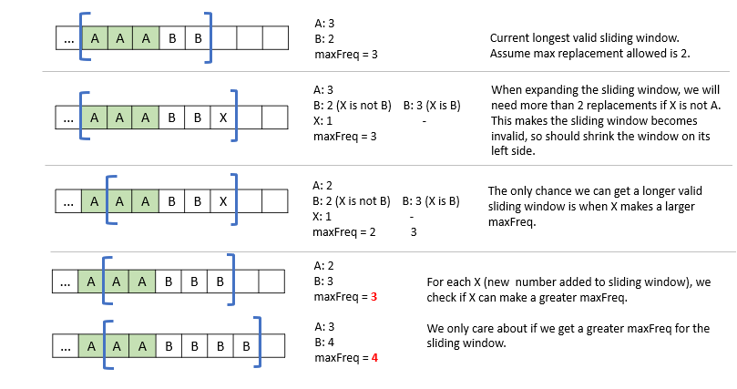

# C# solution (Sliding Window)

**Author:** newbiecoder1
**Votes:** 10
**Link:** [https://leetcode.com/problems/longest-repeating-character-replacement/solutions/699751/](https://leetcode.com/problems/longest-repeating-character-replacement/solutions/699751/)

---

# Intuition
The size of the valid sliding window is determined by the most frequent character. To get a larger valid sliding window, it should contain more instances of the most frequent character.




# Complexity
- Time: O(n)
- Space: O(1). Dictionary has at most 26 characters.

# Implementation
```
public class Solution {
    public int CharacterReplacement(string s, int k) {
        
        if(s == null || s.Length == 0)
            return 0;
        
        Dictionary<char,int> dic = new Dictionary<char,int>();
        
        // maxCnt: number of occurrence of the most frequenct character historically
        int left = 0, right = 0, cnt = 0, maxCnt = 0, maxlen = 0;
               
        while(right < s.Length)
        {            
            char rightChar = s[right];
            if(dic.ContainsKey(rightChar))
                dic[rightChar]++;
            else
                dic.Add(rightChar, 1);
            right++;    
                        
            // update maxCnt. Only newly added character (rightChar) could change the maxCnt.
            maxCnt = Math.Max(maxCnt, dic[rightChar]);
            
            // right - left - maxCnt: number of chars in the substring need to be replaced to keep the sliding window valid.
            // right - left - maxCnt <= k  --> right - left <= k + maxCnt
            // so the size of valid sliding window is determined by maxCnt. It increases only when maxCnt increases.  
            if(right - left - maxCnt > k)
            {
                // Sliding window becomes invalid, we need to move the left boundary.
                // This will shrink the current sliding window. But this won't impact the historical maximum sliding window.
                // In the next round of loop, maxCnt will updated to explore the next maximum sliding window.
                char leftChar = s[left];      
                dic[leftChar]--;
                left++;
            }
            
            maxlen = Math.Max(maxlen, right - left);   
        }
        
        return maxlen;
    }
}
```