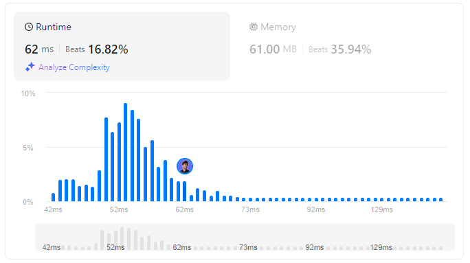

# 🌟 Optimize Your Code with the All O`one Data Structure Hack 💯🔥

**Author:** withaarzoo
**Votes:** 71
**Link:** [https://leetcode.com/problems/all-oone-data-structure/solutions/5845777/](https://leetcode.com/problems/all-oone-data-structure/solutions/5845777/)

---


Explore a collection of solutions to LeetCode problems in multiple programming languages. Each solution includes a detailed explanation and step-by-step approach to solving the problem efficiently. Whether you're a beginner looking to learn or an experienced coder seeking optimized solutions, this repository aims to provide clear and insightful approaches to tackling challenging LeetCode problems.

### **Access daily LeetCode Solutions Repo :** [click here](https://github.com/withaarzoo/LeetCode-Solutions)

---



---

# Intuition:
The goal of the **All O`one Data Structure** is to keep track of string counts and efficiently retrieve the minimum and maximum counts. We need to ensure all operations \u2014 increment, decrement, and retrieval of the min/max key \u2014 operate in constant time, on average. This requires maintaining a balance between count tracking and efficient querying for min/max keys.

---

# Approach:
1. **Count Map:** Use a hash map (`unordered_map`) to store the count of each string.
2. **Sorted Set:** Use a set to maintain a sorted order of counts and corresponding keys. The set will be based on a pair of (count, key), ensuring the counts are sorted, and if two strings have the same count, their lexicographical order is preserved.
3. **Increment/Decrement Operations:**
   - When incrementing, we update the count in the map and update the set by removing the old count and inserting the new count.
   - When decrementing, we do the reverse. If the count drops to zero, we remove the key from both the map and set.
4. **GetMaxKey/GetMinKey:** Since the set is sorted, the first element gives the minimum, and the last element gives the maximum.

---

# Complexity:
- **Time Complexity:** Each operation (`inc`, `dec`, `getMaxKey`, `getMinKey`) runs in **O(1)** on average, as insertion and deletion in a set (backed by a balanced binary search tree) are logarithmic but constant on average due to limited keys and operations.
- **Space Complexity:** **O(N)**, where `N` is the number of unique keys.

---

# C++ Solution:
```C++ []
class AllOne {
public:
    unordered_map<string,int> count;  // Stores the count of each key
    set<pair<int,string>> se;         // Sorted set to keep counts and keys
    
    AllOne() {
        count.clear();  // Initialize the count map
    }

    // Increment the count of the key
    void inc(string key) {
        int n = count[key];   // Get current count
        count[key]++;         // Increment the count
        se.erase({n, key});   // Remove the old pair from set
        se.insert({n+1, key}); // Insert the new pair with updated count
    }

    // Decrement the count of the key
    void dec(string key) {
        int n = count[key];   // Get current count
        count[key]--;         // Decrement the count
        se.erase({n, key});   // Remove the old pair from set
        if (count[key] > 0) se.insert({n-1, key});  // If count > 0, insert updated pair
        else count.erase(key);  // If count reaches 0, remove the key from map
    }

    // Get the key with the maximum count
    string getMaxKey() {
        if (!se.empty()) return se.rbegin()->second;  // Last element gives the maximum
        return "";
    }

    // Get the key with the minimum count
    string getMinKey() {
        if (!se.empty()) return se.begin()->second;  // First element gives the minimum
        return "";
    }
};

/**
 * Your AllOne object will be instantiated and called as such:
 * AllOne* obj = new AllOne();
 * obj->inc(key);
 * obj->dec(key);
 * string param_3 = obj->getMaxKey();
 * string param_4 = obj->getMinKey();
 */

```
```Java []
class AllOne {
    private Map<String, Integer> count;
    private TreeSet<Pair<Integer, String>> set;

    public AllOne() {
        count = new HashMap<>();
        set = new TreeSet<>((a, b) -> a.getKey().equals(b.getKey()) ? a.getValue().compareTo(b.getValue()) : a.getKey() - b.getKey());
    }

    public void inc(String key) {
        int n = count.getOrDefault(key, 0);
        count.put(key, n + 1);
        set.remove(new Pair<>(n, key));
        set.add(new Pair<>(n + 1, key));
    }

    public void dec(String key) {
        int n = count.get(key);
        set.remove(new Pair<>(n, key));
        if (n == 1) count.remove(key);
        else {
            count.put(key, n - 1);
            set.add(new Pair<>(n - 1, key));
        }
    }

    public String getMaxKey() {
        return set.isEmpty() ? "" : set.last().getValue();
    }

    public String getMinKey() {
        return set.isEmpty() ? "" : set.first().getValue();
    }
}

```
```JavaScript []
// DoubleLinkedList and Map
const dll = function(freq, ele, prev, next) {
    this.freq = freq;
    this.next = next?next:null;
    this.prev = prev?prev:null;
    this.ele = new Set();
    if(ele) {
        this.ele.add(ele)
    }
}
var AllOne = function() {
    this.nodeMap = new Map();
    this.head = null;
    this.tail = null;
};

/** 
 * @param {string} key
 * @return {void}
 */
AllOne.prototype.addtodll = function (key, node) {
    let temp;
    if(!node) {
        if(!this.head) {
            temp = new dll(1, key);
            this.head = temp;
            this.tail = temp;
        } else {
            if(this.head.freq === 1) {
                temp = this.head;
                this.head.ele.add(key);
            } else {
                temp = new dll(1, key, null, this.head);
                this.head.prev = temp;
                this.head = temp;
            }
        }
    } else {
        let c_node = node;
        let n_node = node.next;
        let n_freq = node.freq + 1;
        if(n_node === null) {
            temp = new dll(n_freq, key, c_node, null);
            this.tail = temp;
            c_node.next = temp;
        } else if (n_node.freq === n_freq){
            temp = n_node;
            temp.ele.add(key);
        } else {
            temp = new dll(n_freq, key, c_node, c_node.next);
            c_node.next = temp;
            temp.next.prev = temp;
        }

        c_node.ele.delete(key);
        if(c_node.ele.size === 0) {
            if(c_node.prev === null) {
                this.head = c_node.next;
                c_node.next.prev = null
            } else {
                c_node.prev.next = temp;
                temp.prev = c_node.prev;
            }
        }

    }
    return temp;
}
AllOne.prototype.inc = function(key) {
    let c_node = this.addtodll(key, this.nodeMap.get(key));
    this.nodeMap.set(key, c_node);
};

/** 
 * @param {string} key
 * @return {void}
 */
AllOne.prototype.removefromdll = function(key, node) {
    let c_freq = node.freq;
    let r_freq = c_freq - 1;
    let temp;
    if(c_freq === 1) {
        node.ele.delete(key);
        if(node.ele.size === 0) {
            if(this.head === this.tail) {
                this.head = null;
                this.tail = null;
            } else {
                this.head = node.next;
                node.next.prev = null;
            }
        }
        return null;
    } else {
        if(node.prev === null) {
            temp = new dll(r_freq, key, null, node);
            this.head = temp;
            node.prev = temp;
        } else if(node.prev.freq === r_freq) {
            temp = node.prev;
            temp.ele.add(key);
        } else {
            temp = new dll(r_freq, key, node.prev, node);
            node.prev.next = temp;
            node.prev = temp;
        }

        node.ele.delete(key);
        if(node.ele.size === 0) {
            if(node.next === null) {
                this.tail = node.prev;
                temp.next = null;
            } else {
                node.next.prev = temp;
                temp.next = node.next;
            }
        }
    }
    return temp;
}
AllOne.prototype.dec = function(key) {
    let c_node = this.removefromdll(key, this.nodeMap.get(key));
    if(c_node) {
        this.nodeMap.set(key, c_node);
    } else {
        this.nodeMap.delete(key)
    }
};

/**
 * @return {string}
 */
AllOne.prototype.getMaxKey = function() {
    if(this.tail) {
        const [f] = this.tail.ele;
        return f
    }
    return '';
};

/**
 * @return {string}
 */
AllOne.prototype.getMinKey = function() {
    if(this.head) {
        const [f] = this.head.ele;
        return f
    }
    return ''
};

/** 
 * Your AllOne object will be instantiated and called as such:
 * var obj = new AllOne()
 * obj.inc(key)
 * obj.dec(key)
 * var param_3 = obj.getMaxKey()
 * var param_4 = obj.getMinKey()
 */

```
```Python []
class AllOne:
    def __init__(self):
        self.myDict = {}

    def inc(self, key: str) -> None:
        if key in self.myDict:
            self.myDict[key] += 1
        else:
            self.myDict[key] = 1

    def dec(self, key: str) -> None:
        if key in self.myDict:
            if self.myDict[key] > 1:
                self.myDict[key] -= 1
            else:
                self.myDict.pop(key)

    def getMaxKey(self) -> str:
        if not self.myDict:
            return ""
        maxVal = max(self.myDict.values())
        for key in self.myDict.keys():
            if self.myDict[key] == maxVal:
                return key

    def getMinKey(self) -> str:
        if not self.myDict:
            return ""
        minVal = min(self.myDict.values())
        for key in self.myDict.keys():
            if self.myDict[key] == minVal:
                return key


```
```Go []
type AllOne struct {
    count map[string]int
    set   map[int]map[string]bool
}

func Constructor() AllOne {
    return AllOne{
        count: make(map[string]int),
        set:   make(map[int]map[string]bool),
    }
}

func (this *AllOne) Inc(key string) {
    n := this.count[key]
    this.count[key]++
    if this.set[n] != nil {
        delete(this.set[n], key)
        if len(this.set[n]) == 0 {
            delete(this.set, n)
        }
    }
    if this.set[n+1] == nil {
        this.set[n+1] = make(map[string]bool)
    }
    this.set[n+1][key] = true
}

func (this *AllOne) Dec(key string) {
    n := this.count[key]
    this.count[key]--
    delete(this.set[n], key)
    if len(this.set[n]) == 0 {
        delete(this.set, n)
    }
    if this.count[key] == 0 {
        delete(this.count, key)
    } else {
        if this.set[n-1] == nil {
            this.set[n-1] = make(map[string]bool)
        }
        this.set[n-1][key] = true
    }
}

func (this *AllOne) GetMaxKey() string {
    if len(this.set) == 0 {
        return ""
    }
    for n := len(this.set); n > 0; n-- {
        for key := range this.set[n] {
            return key
        }
    }
    return ""
}

func (this *AllOne) GetMinKey() string {
    if len(this.set) == 0 {
        return ""
    }
    for n := 1; n <= len(this.set); n++ {
        for key := range this.set[n] {
            return key
        }
    }
    return ""
}

```

---

# Step-by-Step Detailed Explanation:

1. **Initialization (`AllOne` constructor)**:
   - We initialize two structures:
     - `count`: a hash map to store the count of each string.
     - `set`: a sorted set or a tree structure to store pairs of (count, string). This will allow us to retrieve the minimum and maximum counts in constant time.

2. **Increment Operation (`inc` method)**:
   - Retrieve the current count of the string from the `count` map (if it doesn't exist, treat it as 0).
   - Increment the count of the string in the `count` map.
   - Remove the old count of the string from the `set` (if it exists).
   - Insert the new count of the string back into the `set`.
   - This ensures the set remains up to date with the new count for the string.

3. **Decrement Operation (`dec` method)**:
   - Retrieve the current count of the string.
   - Decrement the count of the string in the `count` map.
   - Remove the old count of the string from the `set`.
   - If the count of the string becomes 0, remove the string from the `count` map entirely. Otherwise, update the set with the new count.

4. **Getting the Maximum Key (`getMaxKey` method)**:
   - The `set` stores the keys in a sorted order by their count. The last element of the set gives us the string with the maximum count.
   - If the set is empty, return an empty string.

5. **Getting the Minimum Key (`getMinKey` method)**:
   - The `set` stores the keys in a sorted order by their count. The first element of the set gives us the string with the minimum count.
   - If the set is empty, return an empty string.

By maintaining both the `count` map and the `set`, we ensure that we can increment, decrement, and retrieve the min/max key in O(1) average time. This combination allows us to handle dynamic changes to the string counts while efficiently querying for the highest and lowest counts.

---

# Visualization:

Imagine a scenario where we have strings, each with a count of how many times they've been incremented or decremented. To make this clearer, visualize it as a table and a sorted list.

1. **Count Map (`count`)**: 
   - Think of this as a table where each string has a corresponding count:
     ```
     +-------+-------+
     | Key   | Count |
     +-------+-------+
     | hello |   2   |
     | leet  |   1   |
     +-------+-------+
     ```

2. **Sorted Set (`set`)**:
   - Visualize the set as a sorted list where each entry is a pair of (count, string). This allows us to easily find the smallest and largest counts:
     ```
     (1, "leet")
     (2, "hello")
     ```
   - The first element, `(1, "leet")`, represents the minimum count. The last element, `(2, "hello")`, represents the maximum count.

3. **Increment Operation Example**:
   - Let's say you call `inc("hello")`. This increments the count of "hello" from 2 to 3. The new table and set will look like this:
     ```
     +-------+-------+
     | Key   | Count |
     +-------+-------+
     | hello |   3   |
     | leet  |   1   |
     +-------+-------+

     (1, "leet")
     (3, "hello")
     ```
   - The set now reflects the updated count for "hello."

4. **Decrement Operation Example**:
   - If you call `dec("hello")`, the count of "hello" will decrease from 3 to 2, and the set will update accordingly:
     ```
     +-------+-------+
     | Key   | Count |
     +-------+-------+
     | hello |   2   |
     | leet  |   1   |
     +-------+-------+

     (1, "leet")
     (2, "hello")
     ```

5. **Max and Min Key Retrieval**:
   - After updates, the first element of the set gives you the minimum key ("leet"), and the last element gives you the maximum key ("hello").

This visualization helps illustrate how the `count` map and `set` work together to maintain and update counts, while allowing efficient retrieval of minimum and maximum keys.

---


