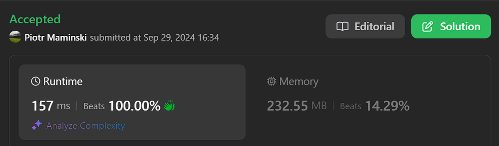

# Just Code | 99% Beats |  With O(1) and without version  | ✅ Working - 29.09.2024

**Author:** Piotr_Maminski
**Votes:** 5
**Link:** [https://leetcode.com/problems/all-oone-data-structure/solutions/5846045/](https://leetcode.com/problems/all-oone-data-structure/solutions/5846045/)

---


```python3 []
class AllOne:

    def __init__(self):
       
        self.d={}
       
        self.op=0
       
        self.res=""

    def inc(self, key: str) -> None:
      
        self.op=0
        if (key in self.d):
            self.d[key]+=1
        else:
            self.d[key]=1
        return None
    def dec(self, key: str) -> None:
     
        self.op=0
        if (self.d[key]>1):
            self.d[key]-=1
        else:
            del self.d[key]
        return None

    def getMaxKey(self) -> str:
       
        if (self.op==1):
            return self.res
        self.op=1
        if (self.d):
            a=list(self.d.values())[0]
            b=list(self.d.keys())[0]
            for i in self.d.keys():
                if (self.d[i]>a):
                    a=self.d[i]
                    b=i
            self.res=b
            return b
        self.res=""
        return ""

    def getMinKey(self) -> str:
       
        if (self.op==2):
            return self.res
        self.op=2
        if (self.d):
            a=list(self.d.values())[0]
            b=list(self.d.keys())[0]
            for i in self.d.keys():
                if (self.d[i]<a):
                    a=self.d[i]
                    b=i
            self.res=b
            return b
        self.res=""
        return ""

```
```cpp []
#include <unordered_map>
#include <string>

class AllOne {
public:
    AllOne() {
        op = 0;
        res = "";
    }

    void inc(const std::string& key) {
        op = 0;
        if (d.find(key) != d.end()) {
            d[key] += 1;
        } else {
            d[key] = 1;
        }
    }

    void dec(const std::string& key) {
        op = 0;
        if (d[key] > 1) {
            d[key] -= 1;
        } else {
            d.erase(key);
        }
    }

    std::string getMaxKey() {
        if (op == 1) {
            return res;
        }
        op = 1;
        if (!d.empty()) {
            int a = d.begin()->second;
            std::string b = d.begin()->first;
            for (const auto& pair : d) {
                if (pair.second > a) {
                    a = pair.second;
                    b = pair.first;
                }
            }
            res = b;
            return b;
        }
        res = "";
        return "";
    }

    std::string getMinKey() {
        if (op == 2) {
            return res;
        }
        op = 2;
        if (!d.empty()) {
            int a = d.begin()->second;
            std::string b = d.begin()->first;
            for (const auto& pair : d) {
                if (pair.second < a) {
                    a = pair.second;
                    b = pair.first;
                }
            }
            res = b;
            return b;
        }
        res = "";
        return "";
    }

private:
    std::unordered_map<std::string, int> d;
    int op;
    std::string res;
};


```
```csharp []
using System;
using System.Collections.Generic;

public class AllOne
{
    private Dictionary<string, int> d;
    private int op;
    private string res;

    public AllOne()
    {
        d = new Dictionary<string, int>();
        op = 0;
        res = "";
    }

    public void Inc(string key)
    {
        op = 0;
        if (d.ContainsKey(key))
        {
            d[key]++;
        }
        else
        {
            d[key] = 1;
        }
    }

    public void Dec(string key)
    {
        op = 0;
        if (d.ContainsKey(key))
        {
            if (d[key] > 1)
            {
                d[key]--;
            }
            else
            {
                d.Remove(key);
            }
        }
    }

    public string GetMaxKey()
    {
        if (op == 1)
        {
            return res;
        }
        op = 1;
        if (d.Count > 0)
        {
            int maxVal = int.MinValue;
            string maxKey = "";
            foreach (var pair in d)
            {
                if (pair.Value > maxVal)
                {
                    maxVal = pair.Value;
                    maxKey = pair.Key;
                }
            }
            res = maxKey;
            return maxKey;
        }
        res = "";
        return "";
    }

    public string GetMinKey()
    {
        if (op == 2)
        {
            return res;
        }
        op = 2;
        if (d.Count > 0)
        {
            int minVal = int.MaxValue;
            string minKey = "";
            foreach (var pair in d)
            {
                if (pair.Value < minVal)
                {
                    minVal = pair.Value;
                    minKey = pair.Key;
                }
            }
            res = minKey;
            return minKey;
        }
        res = "";
        return "";
    }
}
```
```java []
import java.util.HashMap;

class AllOne {

    private HashMap<String, Integer> d;
    private int op;
    private String res;

    public AllOne() {
        d = new HashMap<>();
        op = 0;
        res = "";
    }

    public void inc(String key) {
        op = 0;
        d.put(key, d.getOrDefault(key, 0) + 1);
    }

    public void dec(String key) {
        op = 0;
        if (d.containsKey(key)) {
            if (d.get(key) > 1) {
                d.put(key, d.get(key) - 1);
            } else {
                d.remove(key);
            }
        }
    }

    public String getMaxKey() {
        if (op == 1) {
            return res;
        }
        op = 1;
        if (!d.isEmpty()) {
            int a = (int) d.values().toArray()[0];
            String b = (String) d.keySet().toArray()[0];
            for (String key : d.keySet()) {
                if (d.get(key) > a) {
                    a = d.get(key);
                    b = key;
                }
            }
            res = b;
            return b;
        }
        res = "";
        return "";
    }

    public String getMinKey() {
        if (op == 2) {
            return res;
        }
        op = 2;
        if (!d.isEmpty()) {
            int a = (int) d.values().toArray()[0];
            String b = (String) d.keySet().toArray()[0];
            for (String key : d.keySet()) {
                if (d.get(key) < a) {
                    a = d.get(key);
                    b = key;
                }
            }
            res = b;
            return b;
        }
        res = "";
        return "";
    }
}
```
```javascript [JavaS]
//JavaScript

class AllOne {
    constructor() {
        this.d = {};
        this.op = 0;
        this.res = "";
    }

    inc(key) {
        this.op = 0;
        if (key in this.d) {
            this.d[key] += 1;
        } else {
            this.d[key] = 1;
        }
        return null;
    }

    dec(key) {
        this.op = 0;
        if (this.d[key] > 1) {
            this.d[key] -= 1;
        } else {
            delete this.d[key];
        }
        return null;
    }

    getMaxKey() {
        if (this.op === 1) {
            return this.res;
        }
        this.op = 1;
        if (Object.keys(this.d).length > 0) {
            let a = Object.values(this.d)[0];
            let b = Object.keys(this.d)[0];
            for (let i in this.d) {
                if (this.d[i] > a) {
                    a = this.d[i];
                    b = i;
                }
            }
            this.res = b;
            return b;
        }
        this.res = "";
        return "";
    }

    getMinKey() {
        if (this.op === 2) {
            return this.res;
        }
        this.op = 2;
        if (Object.keys(this.d).length > 0) {
            let a = Object.values(this.d)[0];
            let b = Object.keys(this.d)[0];
            for (let i in this.d) {
                if (this.d[i] < a) {
                    a = this.d[i];
                    b = i;
                }
            }
            this.res = b;
            return b;
        }
        this.res = "";
        return "";
    }
}


```
```typescript [TypeS]
//TypeScript
class AllOne:

    def __init__(self):
       
        self.d={}
       
        self.op=0
       
        self.res=""

    def inc(self, key: str) -> None:
      
        self.op=0
        if (key in self.d):
            self.d[key]+=1
        else:
            self.d[key]=1
        return None
    def dec(self, key: str) -> None:
     
        self.op=0
        if (self.d[key]>1):
            self.d[key]-=1
        else:
            del self.d[key]
        return None

    def getMaxKey(self) -> str:
       
        if (self.op==1):
            return self.res
        self.op=1
        if (self.d):
            a=list(self.d.values())[0]
            b=list(self.d.keys())[0]
            for i in self.d.keys():
                if (self.d[i]>a):
                    a=self.d[i]
                    b=i
            self.res=b
            return b
        self.res=""
        return ""

    def getMinKey(self) -> str:
       
        if (self.op==2):
            return self.res
        self.op=2
        if (self.d):
            a=list(self.d.values())[0]
            b=list(self.d.keys())[0]
            for i in self.d.keys():
                if (self.d[i]<a):
                    a=self.d[i]
                    b=i
            self.res=b
            return b
        self.res=""
        return ""
```
```rust []
use std::collections::HashMap;

struct AllOne {
    d: HashMap<String, i32>,
    op: i32,
    res: String,
}

impl AllOne {
    fn new() -> Self {
        AllOne {
            d: HashMap::new(),
            op: 0,
            res: String::new(),
        }
    }

    fn inc(&mut self, key: String) {
        self.op = 0;
        *self.d.entry(key).or_insert(0) += 1;
    }

    fn dec(&mut self, key: String) {
        self.op = 0;
        if let Some(count) = self.d.get_mut(&key) {
            if *count > 1 {
                *count -= 1;
            } else {
                self.d.remove(&key);
            }
        }
    }

    fn get_max_key(&mut self) -> String {
        if self.op == 1 {
            return self.res.clone();
        }
        self.op = 1;
        if !self.d.is_empty() {
            let mut max_key = String::new();
            let mut max_value = i32::MIN;
            for (key, &value) in &self.d {
                if value > max_value {
                    max_value = value;
                    max_key = key.clone();
                }
            }
            self.res = max_key.clone();
            return max_key;
        }
        self.res.clear();
        String::new()
    }

    fn get_min_key(&mut self) -> String {
        if self.op == 2 {
            return self.res.clone();
        }
        self.op = 2;
        if !self.d.is_empty() {
            let mut min_key = String::new();
            let mut min_value = i32::MAX;
            for (key, &value) in &self.d {
                if value < min_value {
                    min_value = value;
                    min_key = key.clone();
                }
            }
            self.res = min_key.clone();
            return min_key;
        }
        self.res.clear();
        String::new()
    }
}


```
```ruby []
class AllOne
  def initialize
    @d = {}
    @op = 0
    @res = ""
  end

  def inc(key)
    @op = 0
    if @d.key?(key)
      @d[key] += 1
    else
      @d[key] = 1
    end
    nil
  end

  def dec(key)
    @op = 0
    if @d[key] > 1
      @d[key] -= 1
    else
      @d.delete(key)
    end
    nil
  end

  def get_max_key
    return @res if @op == 1

    @op = 1
    if !@d.empty?
      a = @d.values.first
      b = @d.keys.first
      @d.each do |k, v|
        if v > a
          a = v
          b = k
        end
      end
      @res = b
      return b
    end
    @res = ""
    ""
  end

  def get_min_key
    return @res if @op == 2

    @op = 2
    if !@d.empty?
      a = @d.values.first
      b = @d.keys.first
      @d.each do |k, v|
        if v < a
          a = v
          b = k
        end
      end
      @res = b
      return b
    end
    @res = ""
    ""
  end
end
```
```golang []

import "fmt"

type Node struct {
	Val   string
	Count int
	Prev  *Node
	Next  *Node
}

type AllOne struct {
	CountMap map[string]*Node
	Head *Node
	Tail *Node
}

func newNode(val string) *Node {
	return &Node{Val: val, Count: 1}
}

func Constructor() AllOne {
	cm := make(map[string]*Node)
	head := newNode("")
	tail := newNode("")

	head.Next = tail
	tail.Prev = head

	return AllOne{
		CountMap: cm,
		Head:     head,
		Tail:     tail,
	}
}

func (this *AllOne) insert(newNode *Node) {
	last := this.Tail.Prev

	last.Next = newNode
	newNode.Prev = last

	newNode.Next = this.Tail
	this.Tail.Prev = newNode
}

func (this *AllOne) swap(lhs, rhs *Node) {
	prev := lhs.Prev
	next := rhs.Next

	prev.Next = rhs
	rhs.Prev = prev

	rhs.Next = lhs
	lhs.Prev = rhs

	lhs.Next = next
	next.Prev = lhs
}

func (this *AllOne) sortBackward(node *Node) {
	for node.Prev != this.Head && node.Count > node.Prev.Count {
		this.swap(node.Prev, node)
	}
}

func (this *AllOne) Inc(key string) {
	if node, ok := this.CountMap[key]; ok {
		node.Count++
		this.sortBackward(node)
	} else {
		newNode := newNode(key)
		this.CountMap[key] = newNode
		this.insert(newNode)
	}
	// this.printAll("Inc")
}

func (this *AllOne) delete(node *Node) {
	prev := node.Prev
	next := node.Next

	prev.Next = next
	next.Prev = prev

	node.Next = nil
	node.Prev = nil
}

func (this *AllOne) sortForward(node *Node) {
	for node.Next != this.Tail && node.Count < node.Next.Count {
		this.swap(node, node.Next)
	}
}

func (this *AllOne) Dec(key string) {
	node := this.CountMap[key]
	node.Count--
	if node.Count == 0 {
		delete(this.CountMap, key)
		this.delete(node)
	} else {
		this.sortForward(node)
	}
}

func (this *AllOne) GetMaxKey() string {
	if this.Head.Next == this.Tail {
		return ""
	}
	return this.Head.Next.Val
}

func (this *AllOne) GetMinKey() string {
	if this.Head.Next == this.Tail {
		return ""
	}
	return this.Tail.Prev.Val
}


```
```php []
class AllOne {

    private $d;
    private $op;
    private $res;

    public function __construct() {
        $this->d = array();
        $this->op = 0;
        $this->res = "";
    }

    public function inc($key) {
        $this->op = 0;
        if (array_key_exists($key, $this->d)) {
            $this->d[$key] += 1;
        } else {
            $this->d[$key] = 1;
        }
    }

    public function dec($key) {
        $this->op = 0;
        if ($this->d[$key] > 1) {
            $this->d[$key] -= 1;
        } else {
            unset($this->d[$key]);
        }
    }

    public function getMaxKey() {
        if ($this->op == 1) {
            return $this->res;
        }
        $this->op = 1;
        if (!empty($this->d)) {
            $a = reset($this->d);
            $b = key($this->d);
            foreach ($this->d as $key => $value) {
                if ($value > $a) {
                    $a = $value;
                    $b = $key;
                }
            }
            $this->res = $b;
            return $b;
        }
        $this->res = "";
        return "";
    }

    public function getMinKey() {
        if ($this->op == 2) {
            return $this->res;
        }
        $this->op = 2;
        if (!empty($this->d)) {
            $a = reset($this->d);
            $b = key($this->d);
            foreach ($this->d as $key => $value) {
                if ($value < $a) {
                    $a = $value;
                    $b = $key;
                }
            }
            $this->res = $b;
            return $b;
        }
        $this->res = "";
        return "";
    }
}

```
## O(1)

```python3 []
class Node:
    def __init__(self, freq):
        self.freq = freq
        self.prev = None
        self.next = None
        self.strSet = set()

class AllOne:
    def __init__(self):
        self.head = Node(0)
        self.tail = Node(0)
        self.head.next = self.tail
        self.tail.prev = self.head
        self.strToNodeMap = {}

    def inc(self, key: str) -> None:
        if key in self.strToNodeMap:
            node = self.strToNodeMap[key]
            freq = node.freq
            node.strSet.remove(key)

            nextNode = node.next
            if nextNode == self.tail or nextNode.freq != freq + 1:
                newNode = Node(freq + 1)
                newNode.strSet.add(key)
                newNode.prev = node
                newNode.next = nextNode
                node.next = newNode
                nextNode.prev = newNode
                self.strToNodeMap[key] = newNode
            else:
                nextNode.strSet.add(key)
                self.strToNodeMap[key] = nextNode

            if not node.strSet:
                self.deleteNode(node)
        else:
            firstNode = self.head.next
            if firstNode == self.tail or firstNode.freq > 1:
                newNode = Node(1)
                newNode.strSet.add(key)
                newNode.prev = self.head
                newNode.next = firstNode
                self.head.next = newNode
                firstNode.prev = newNode
                self.strToNodeMap[key] = newNode
            else:
                firstNode.strSet.add(key)
                self.strToNodeMap[key] = firstNode

    def dec(self, key: str) -> None:
        if key not in self.strToNodeMap:
            return

        node = self.strToNodeMap[key]
        node.strSet.remove(key)
        freq = node.freq

        if freq == 1:
            del self.strToNodeMap[key]
        else:
            prevNode = node.prev
            if prevNode == self.head or prevNode.freq != freq - 1:
                newNode = Node(freq - 1)
                newNode.strSet.add(key)
                newNode.prev = prevNode
                newNode.next = node
                prevNode.next = newNode
                node.prev = newNode
                self.strToNodeMap[key] = newNode
            else:
                prevNode.strSet.add(key)
                self.strToNodeMap[key] = prevNode

        if not node.strSet:
            self.deleteNode(node)

    def getMaxKey(self) -> str:
        if self.tail.prev == self.head:
            return ""
        return next(iter(self.tail.prev.strSet))

    def getMinKey(self) -> str:
        if self.head.next == self.tail:
            return ""
        return next(iter(self.head.next.strSet))

    def deleteNode(self, node):
        prevNode = node.prev
        afterNode = node.next

        prevNode.next = afterNode
        afterNode.prev = prevNode

```
```golang []
package main

import (
	"container/list"
)

type Node struct {
	freq    int
	strSet  map[string]struct{}
	element *list.Element
}

type AllOne struct {
	dll          *list.List
	strToNodeMap map[string]*Node
}

func Constructor() AllOne {
	return AllOne{
		dll:          list.New(),
		strToNodeMap: make(map[string]*Node),
	}
}

func (this *AllOne) Inc(key string) {
	if node, exists := this.strToNodeMap[key]; exists {
		freq := node.freq
		delete(node.strSet, key)

		var nextNode *Node
		if node.element.Next() != nil {
			nextNode = node.element.Next().Value.(*Node)
		}

		if nextNode == nil || nextNode.freq != freq+1 {
			newNode := &Node{
				freq:    freq + 1,
				strSet:  make(map[string]struct{}),
				element: this.dll.InsertAfter(nil, node.element),
			}
			newNode.strSet[key] = struct{}{}
			newNode.element.Value = newNode
			this.strToNodeMap[key] = newNode
		} else {
			nextNode.strSet[key] = struct{}{}
			this.strToNodeMap[key] = nextNode
		}

		if len(node.strSet) == 0 {
			this.dll.Remove(node.element)
		}
	} else {
		var firstNode *Node
		if this.dll.Len() > 0 {
			firstNode = this.dll.Front().Value.(*Node)
		}

		if firstNode == nil || firstNode.freq > 1 {
			newNode := &Node{
				freq:    1,
				strSet:  make(map[string]struct{}),
				element: this.dll.PushFront(nil),
			}
			newNode.strSet[key] = struct{}{}
			newNode.element.Value = newNode
			this.strToNodeMap[key] = newNode
		} else {
			firstNode.strSet[key] = struct{}{}
			this.strToNodeMap[key] = firstNode
		}
	}
}

func (this *AllOne) Dec(key string) {
	if node, exists := this.strToNodeMap[key]; exists {
		delete(node.strSet, key)
		freq := node.freq

		if freq == 1 {
			delete(this.strToNodeMap, key)
		} else {
			var prevNode *Node
			if node.element.Prev() != nil {
				prevNode = node.element.Prev().Value.(*Node)
			}

			if prevNode == nil || prevNode.freq != freq-1 {
				newNode := &Node{
					freq:    freq - 1,
					strSet:  make(map[string]struct{}),
					element: this.dll.InsertBefore(nil, node.element),
				}
				newNode.strSet[key] = struct{}{}
				newNode.element.Value = newNode
				this.strToNodeMap[key] = newNode
			} else {
				prevNode.strSet[key] = struct{}{}
				this.strToNodeMap[key] = prevNode
			}
		}

		if len(node.strSet) == 0 {
			this.dll.Remove(node.element)
		}
	}
}

func (this *AllOne) GetMaxKey() string {
	if this.dll.Len() == 0 {
		return ""
	}
	lastNode := this.dll.Back().Value.(*Node)
	for k := range lastNode.strSet {
		return k
	}
	return ""
}

func (this *AllOne) GetMinKey() string {
	if this.dll.Len() == 0 {
		return ""
	}
	firstNode := this.dll.Front().Value.(*Node)
	for k := range firstNode.strSet {
		return k
	}
	return ""
}

```
```cpp []
#include <unordered_map>
#include <unordered_set>
#include <string>

class Node {
public:
    int freq;
    Node* prev;
    Node* next;
    std::unordered_set<std::string> strSet;

    Node(int freq) : freq(freq), prev(nullptr), next(nullptr) {}
};

class AllOne {
private:
    Node* head;
    Node* tail;
    std::unordered_map<std::string, Node*> strToNodeMap;

    void deleteNode(Node* node) {
        Node* prevNode = node->prev;
        Node* afterNode = node->next;

        prevNode->next = afterNode;
        afterNode->prev = prevNode;
    }

public:
    AllOne() {
        head = new Node(0);
        tail = new Node(0);
        head->next = tail;
        tail->prev = head;
    }

    void inc(std::string key) {
        if (strToNodeMap.find(key) != strToNodeMap.end()) {
            Node* node = strToNodeMap[key];
            int freq = node->freq;
            node->strSet.erase(key);

            Node* nextNode = node->next;
            if (nextNode == tail || nextNode->freq != freq + 1) {
                Node* newNode = new Node(freq + 1);
                newNode->strSet.insert(key);
                newNode->prev = node;
                newNode->next = nextNode;
                node->next = newNode;
                nextNode->prev = newNode;
                strToNodeMap[key] = newNode;
            } else {
                nextNode->strSet.insert(key);
                strToNodeMap[key] = nextNode;
            }

            if (node->strSet.empty()) {
                deleteNode(node);
                delete node;
            }
        } else {
            Node* firstNode = head->next;
            if (firstNode == tail || firstNode->freq > 1) {
                Node* newNode = new Node(1);
                newNode->strSet.insert(key);
                newNode->prev = head;
                newNode->next = firstNode;
                head->next = newNode;
                firstNode->prev = newNode;
                strToNodeMap[key] = newNode;
            } else {
                firstNode->strSet.insert(key);
                strToNodeMap[key] = firstNode;
            }
        }
    }

    void dec(std::string key) {
        if (strToNodeMap.find(key) == strToNodeMap.end()) {
            return;
        }

        Node* node = strToNodeMap[key];
        node->strSet.erase(key);
        int freq = node->freq;

        if (freq == 1) {
            strToNodeMap.erase(key);
        } else {
            Node* prevNode = node->prev;
            if (prevNode == head || prevNode->freq != freq - 1) {
                Node* newNode = new Node(freq - 1);
                newNode->strSet.insert(key);
                newNode->prev = prevNode;
                newNode->next = node;
                prevNode->next = newNode;
                node->prev = newNode;
                strToNodeMap[key] = newNode;
            } else {
                prevNode->strSet.insert(key);
                strToNodeMap[key] = prevNode;
            }
        }

        if (node->strSet.empty()) {
            deleteNode(node);
            delete node;
        }
    }

    std::string getMaxKey() {
        if (tail->prev == head) {
            return "";
        }
        return *(tail->prev->strSet.begin());
    }

    std::string getMinKey() {
        if (head->next == tail) {
            return "";
        }
        return *(head->next->strSet.begin());
    }

    ~AllOne() {
        Node* current = head;
        while (current != nullptr) {
            Node* next = current->next;
            delete current;
            current = next;
        }
    }
};
```





