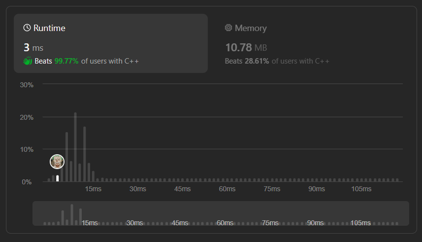

# ✅☑Beats 100% Users || [C++/Java/Python/JavaScript] || 2 Approaches || EXPLAINED🔥

**Author:** MarkSPhilip31
**Votes:** 160
**Link:** [https://leetcode.com/problems/sort-characters-by-frequency/solutions/4689154/](https://leetcode.com/problems/sort-characters-by-frequency/solutions/4689154/)

---

# PLEASE UPVOTE IF IT HELPED

---


---


# Approaches
(Also explained in the code)

#### *Approach 1*


1. Iterate through the input string 's' and count the frequency of each character using an unordered map 'hm'.
1.  Use a priority queue 'pq' to store pairs of characters and their frequencies, sorted in decreasing order of frequency.
1.  Define a lambda function 'cmp' to compare pairs based on the second element (frequency).
1.  Iterate through the hashmap entries and push each pair into the priority queue.
1.  Pop elements from the priority queue and append characters to the result string according to their frequency.


# Complexity
- Time complexity:
   $$O(nlogn)$$
    

- Space complexity:
   $$O(n)$$
    


# Code
```C++ []
class Solution {
public:
    string frequencySort(string s) {
        auto cmp = [](const pair<char, int>& a, const pair<char, int>& b) {
            return a.second < b.second;
        };
        
        priority_queue<pair<char, int>, vector<pair<char, int>>, decltype(cmp)> pq(cmp);
        
        unordered_map<char, int> hm;
        
        for (char c : s) {
            hm[c]++;
        }
        
        for (const auto& entry : hm) {
            pq.push(make_pair(entry.first, entry.second));
        }
        
        string result = "";
        while (!pq.empty()) {
            pair<char, int> p = pq.top();
            pq.pop();
            result.append(p.second, p.first);
        }
        
        return result;
    }
};


```
```Java []


class Solution {
    public String frequencySort(String s) {
        Map<Character, Integer> hm = new HashMap<>();
        
        for (char c : s.toCharArray()) {
            hm.put(c, hm.getOrDefault(c, 0) + 1);
        }
        
        PriorityQueue<Map.Entry<Character, Integer>> pq = new PriorityQueue<>(
            (a, b) -> b.getValue() - a.getValue()
        );
        
        pq.addAll(hm.entrySet());
        
        StringBuilder result = new StringBuilder();
        while (!pq.isEmpty()) {
            Map.Entry<Character, Integer> entry = pq.poll();
            result.append(String.valueOf(entry.getKey()).repeat(entry.getValue()));
        }
        
        return result.toString();
    }
}


```
```python3 []


class Solution:
    def frequencySort(self, s: str) -> str:
        counter = Counter(s)
        pq = [(-freq, char) for char, freq in counter.items()]
        heapq.heapify(pq)
        result = ''
        while pq:
            freq, char = heapq.heappop(pq)
            result += char * -freq
        return result


```
```javascript []
var frequencySort = function(s) {
    const counter = new Map();
    for (const char of s) {
        counter.set(char, (counter.get(char) || 0) + 1);
    }
    
    const pq = Array.from(counter.entries());
    pq.sort((a, b) => b[1] - a[1]);
    
    let result = '';
    for (const [char, freq] of pq) {
        result += char.repeat(freq);
    }
    
    return result;
};


```
---

#### *Approach 2*
1. **Frequency Counting:** Iterate through the input string `s` and count the frequency of each character using an unordered map `mp`.

1. **Mapping Frequency to Characters:** Use a multimap `r` to associate each character with its frequency. The multimap allows multiple elements with the same key (frequency) and automatically sorts them in ascending order based on the key.

1. **Sorting by Frequency:** Iterate through the entries in the frequency map `mp` and insert them into the multimap `r` with the frequency as the key and the character as the value. This ensures that characters with the same frequency are grouped together and sorted based on their frequency.

1. **Building the Result String:** Traverse the multimap `r` in reverse order (using reverse iterators) to access elements with higher frequencies first. Concatenate characters to the string `ss` based on their frequency, ensuring characters with higher frequencies appear first.

1. **Returning the Result:** Return the final string `ss`, which contains characters sorted by frequency in descending order.


# Complexity
- Time complexity:
   $$O(nlogn)$$
    

- Space complexity:
   $$O(n)$$
    


# Code
```C++ []

class Solution {
public:
    string frequencySort(string s) {
        unordered_map<char,int> mp;
        multimap<int,char> r;
        string ss="";

        for(auto a : s)
            mp[a]++;

        for(auto a : mp)
            r.insert({a.second, a.first});

        for(auto it = r.rbegin(); it != r.rend(); ++it)
            ss += string(it->first, it->second);

        //for(auto it = r.rbegin(); it != r.rend(); ++it){
        //   for (int i = 0; i < it->first; ++i) {
        //          ss += it->second;
        //        }
        //} 

        return ss;
    }
};


```
```Java []

class Solution {
    public String frequencySort(String s) {
        Map<Character, Integer> mp = new HashMap<>();
        TreeMap<Integer, List<Character>> r = new TreeMap<>(Collections.reverseOrder());
        StringBuilder ss = new StringBuilder();

        for (char a : s.toCharArray())
            mp.put(a, mp.getOrDefault(a, 0) + 1);

        for (Map.Entry<Character, Integer> entry : mp.entrySet()) {
            if (!r.containsKey(entry.getValue())) {
                r.put(entry.getValue(), new ArrayList<>());
            }
            r.get(entry.getValue()).add(entry.getKey());
        }

        for (Map.Entry<Integer, List<Character>> entry : r.entrySet()) {
            int freq = entry.getKey();
            List<Character> chars = entry.getValue();
            for (char c : chars) {
                for (int i = 0; i < freq; i++) {
                    ss.append(c);
                }
            }
        }

        return ss.toString();
    }
}


```
```python3 []
from collections import Counter, OrderedDict

class Solution:
    def frequencySort(self, s: str) -> str:
        mp = Counter(s)
        r = OrderedDict(sorted(mp.items(), key=lambda x: x[1], reverse=True))
        ss = ''.join([char * freq for char, freq in r.items()])
        return ss


```
```javascript []
var frequencySort = function(s) {
    const mp = new Map();
    for (const char of s) {
        mp.set(char, (mp.get(char) || 0) + 1);
    }
    
    const r = new Map([...mp.entries()].sort((a, b) => b[1] - a[1]));
    let ss = '';
    for (const [char, freq] of r.entries()) {
        ss += char.repeat(freq);
    }
    
    return ss;
};


```
---


# PLEASE UPVOTE IF IT HELPED

---
---


---