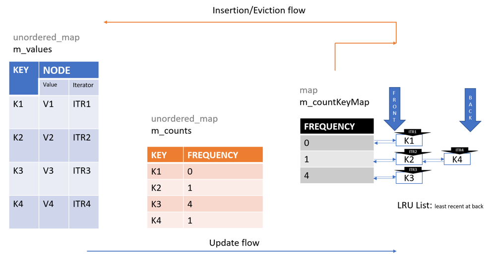

# C++: O(1) time complexity with algorithm

**Author:** vmk1802
**Votes:** 49
**Link:** [https://leetcode.com/problems/lfu-cache/solutions/937737/](https://leetcode.com/problems/lfu-cache/solutions/937737/)

---

# Algorithm
Please refer http://dhruvbird.com/lfu.pdf

One adoption of above algorithm in real product is found at [Apache ActiveMQ Message broker](https://github.com/apache/activemq/blob/master/activemq-kahadb-store/src/main/java/org/apache/activemq/util/LFUCache.java).

PS: A rough depiction of my current implementation is given below. 



### Correction to the picture
m_countKeyMap is unordered_map. 

```

//Just for better readability
using Key_t = int;
using Count_t = int;


struct Node
{
    int value;
    list<Key_t>::iterator itr;
};

class LFUCache
{
    unordered_map<Key_t, Node> m_values;
    unordered_map<Key_t, Count_t> m_counts;
    unordered_map<Count_t, list<Key_t>> m_countKeyMap;
    int m_lowestFrequency;
    int m_maxCapacity;

public:
    LFUCache(int capacity)
    {
        m_maxCapacity = capacity;
        m_lowestFrequency = 0;
    }

    int get(int key)
    {
        if (m_values.find(key) == m_values.end() || m_maxCapacity <= 0)
        {
            return -1;
        }
        //update frequency, & return value
        put(key, m_values[key].value);
        return m_values[key].value;
    }

    void put(int key, int value)
    {
        if (m_maxCapacity <= 0)
        {
            return;
        }

        //If key is not present and capacity has exceeded,
        //then remove the key entry with least frequency
        //else just make the new key entry
        if (m_values.find(key) == m_values.end())
        {
            if (m_values.size() == m_maxCapacity)
            {
                int keyToDelete = m_countKeyMap[m_lowestFrequency].back(); 
                m_countKeyMap[m_lowestFrequency].pop_back();
                if (m_countKeyMap[m_lowestFrequency].empty())
                {
                    m_countKeyMap.erase(m_lowestFrequency);
                }
                m_values.erase(keyToDelete);
                m_counts.erase(keyToDelete);
            }
            m_values[key].value = value;
            m_counts[key] = 0;
            m_lowestFrequency = 0;
            m_countKeyMap[m_counts[key]].push_front(key);
            m_values[key].itr = m_countKeyMap[0].begin();
        }
        //Just update value and frequency
        else
        {
            m_countKeyMap[m_counts[key]].erase(m_values[key].itr);
            if (m_countKeyMap[m_counts[key]].empty())
            {
                if (m_lowestFrequency == m_counts[key])
                    m_lowestFrequency++;
                m_countKeyMap.erase(m_counts[key]);
            }
            m_values[key].value = value;
            m_counts[key]++;
            m_countKeyMap[m_counts[key]].push_front(key);
            m_values[key].itr = m_countKeyMap[m_counts[key]].begin();
        }
    }
};
```