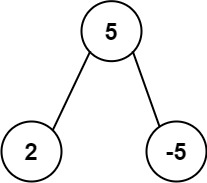

# [508. Most Frequent Subtree Sum](https://leetcode.com/problems/most-frequent-subtree-sum/)

| Category | Difficulty | Likes | Dislikes |
| :------: | :--------: | :---: | :------: |
| Algorithms | Medium | 2360 | 331 |

**Tags:** [`hash-table`](https://leetcode.com/tag/hash-table), [`tree`](https://leetcode.com/tag/tree), [`depth-first-search`](https://leetcode.com/tag/depth-first-search), [`binary-tree`](https://leetcode.com/tag/binary-tree)

**Companies:** `amazon`, `uber`

## Description

Given the `root` of a binary tree, return the most frequent **subtree sum**. If there is a tie, return all the values with the highest frequency in any order.

The **subtree sum** of a node is defined as the sum of all the node values formed by the subtree rooted at that node (including the node itself).

 

**Example 1:**


```

Input: root = [5,2,-3]
Output: [2,-3,4]

```

**Example 2:**


```

Input: root = [5,2,-5]
Output: [2]

```

 

**Constraints:**

	- The number of nodes in the tree is in the range `[1, 10^4]`.

	- `-10^5 <= Node.val <= 10^5`

---

**Links:** [Submissions](https://leetcode.com/problems/most-frequent-subtree-sum/) | [Solutions](https://leetcode.com/problems/most-frequent-subtree-sum/)
