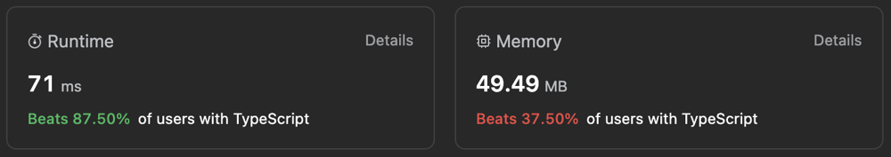

# Simple Post-Order DFS | TypeScript | Beats 90%

**Author:** ArtemLeet
**Votes:** 0
**Link:** [https://leetcode.com/problems/most-frequent-subtree-sum/solutions/4320118/](https://leetcode.com/problems/most-frequent-subtree-sum/solutions/4320118/)

---



# Intuition
Traverse in post-order dfs and save subtree sum, then find most frequent sums

# Approach
Post-Order DFS

# Complexity
- Time complexity:
$$O(n)$$

- Space complexity:
$$O(n)$$

# Code
```
/**
 * Definition for a binary tree node.
 * class TreeNode {
 *     val: number
 *     left: TreeNode | null
 *     right: TreeNode | null
 *     constructor(val?: number, left?: TreeNode | null, right?: TreeNode | null) {
 *         this.val = (val===undefined ? 0 : val)
 *         this.left = (left===undefined ? null : left)
 *         this.right = (right===undefined ? null : right)
 *     }
 * }
 */

function findFrequentTreeSum(root: TreeNode | null): number[] {
  const values = [];
  function dfs(node) {
    if (!node) {
      return 0;
    }

    const l = dfs(node.left);
    const r = dfs(node.right);
    values.push(node.val + l + r);

    return node.val + l + r;
  }

  dfs(root);

  if (new Set(values).size === values.length) {
    return values;
  }

  const freqMap = {};
  let maxFreq = 0;
  values.forEach((val) => {
    freqMap[val] ||= 0;
    freqMap[val]++;
    maxFreq = Math.max(maxFreq, freqMap[val]);
  });

  const res = [];
  for (const val in freqMap) {
    if (freqMap[val] === maxFreq) {
      res.push(Number(val));
    }
  }

  return res;
};
```