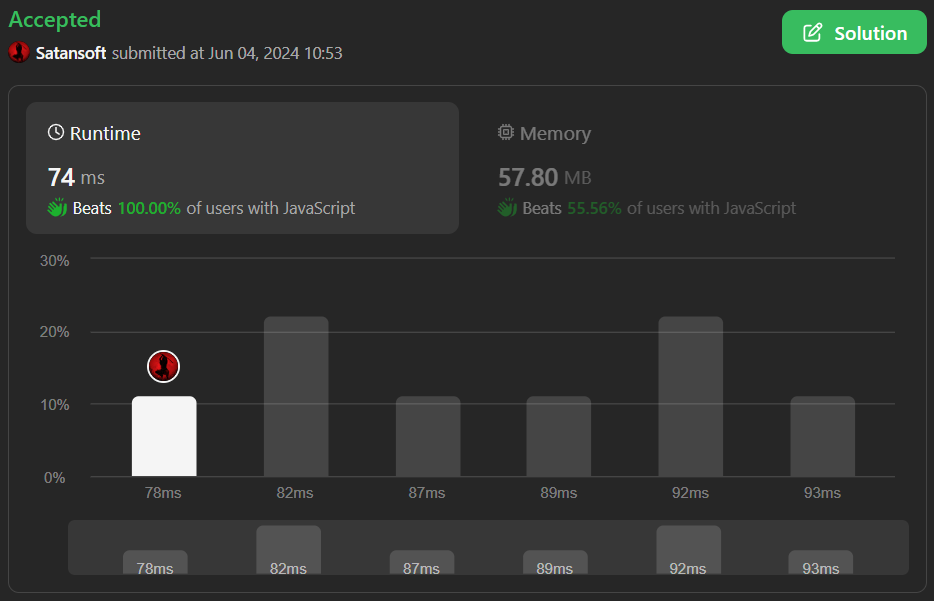

# ✅ Javascript | Simplest Solution | 🏆Hash Set🏆 |🔥Beats 100%🔥

**Author:** Satansoft
**Votes:** 1
**Link:** [https://leetcode.com/problems/random-flip-matrix/solutions/5259400/](https://leetcode.com/problems/random-flip-matrix/solutions/5259400/)

---



# Intuition
Generate indices `(0, m)` and `(0, n)` and use Hash Set to store already generated indices.

# Approach
Define `m` (number of rows), `n` (number of columns) and `set` to store already generated indices.

In `flip` method run `generator` and generate until generate indices not presented in `set`, then add `key` to `set` and return `value`.

In `reset` method clear `set`.

In `generate` method generate `m` from `0` to `this.m - 1`, `n` from `0` to `this.n - 1` and forming as `[m, n]`. Return object with stringifyed and original version.


# Complexity
- Time complexity:
$$O(k)$$

- Space complexity:
$$O(k)$$

# Code
```
/**
 * @param {number} m
 * @param {number} n
 */
var Solution = function(m, n) {
    this.m = m;
    this.n = n;
    this.set = new Set();
};

/**
 * @return {number[]}
 */
Solution.prototype.flip = function() {
    let generated = this.generate();

    while(this.set.has(generated.key)) {
        generated = this.generate();
    }

    this.set.add(generated.key);

    return generated.value;
};

/**
 * @return {void}
 */
Solution.prototype.reset = function() {
    this.set.clear();
};

/**
 * @return {void}
 */
Solution.prototype.generate = function() {
    const m = Math.ceil(Math.random() * this.m - 1);
    const n = Math.ceil(Math.random() * this.n - 1);

    const value = [m, n];

    return {key: `${value}`, value};
};

/** 
 * Your Solution object will be instantiated and called as such:
 * var obj = new Solution(m, n)
 * var param_1 = obj.flip()
 * obj.reset()
 */
```