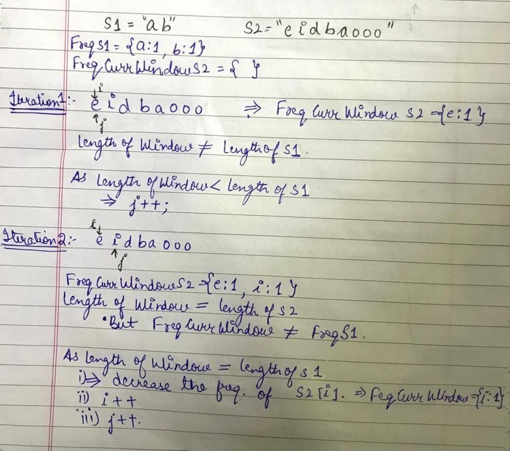
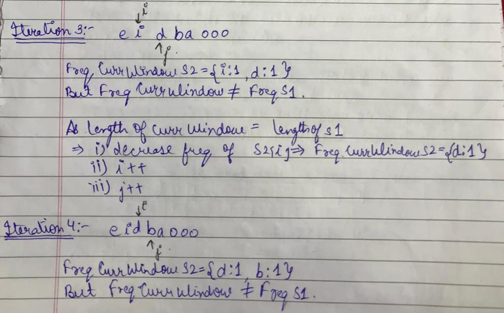
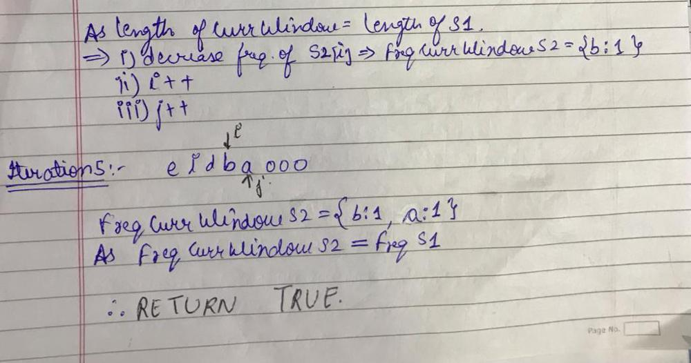

# 🚀 C++ || SLIDING WINDOW OPTIMIZED || Well Explained

**Author:** sukhseeratkaur0226
**Votes:** 805
**Link:** [https://leetcode.com/problems/permutation-in-string/solutions/1762469/](https://leetcode.com/problems/permutation-in-string/solutions/1762469/)

---

***There is a secret at the end of the post \uD83D\uDE09***

Let us first **redefine the problem**.
```
So permutation of a string basically means just the reordering of the letters of the string. That means all the permutations of a string are just the anagrams of the string, with all the letters included, just in another way.
And we have to find if such a substring exists in s2 which is a permutation of s1, which means we have to find a substring in s2 such that the frequency of the characters in that substring is same as the frequency of the characters in s1.
```

So we will be using **SLIDING WINDOW APPROACH** to find such a window in s2 in which the freq of characters is same as s1.

#### Algorithm:
```
1. The first step is to find the freq of all characters of s1.

2. Then we will be starting with a window of size 1 initially in s2. That means start=0, end=0.

3. Along with this, we will also be maintaining the frequency of the characters in the current window.

4. We will be continuing the below steps untill we reach a situation where the end of the window reaches the end of s2. That means we will be doing the steps while end<length of s2.
		a) Increase the frequency of the character which is just now newly included inside the window. That means increase the frequency of s2[end].
		b) Now check if the frequency of the characters in the current window, is same as the frequency of characters int s1. But this is only possible if the length of current substring(window) is same as the length of s1. If this is true, then we can directly return true from here.
		c) If the frequency doesnt match, we have to change the window:-
					i) If the length of window in less than the length of s1, then we should increase the length of the the window by increasing the end. So end+=1.
					ii) If not, that means length of window is greater than or equal to the length of s1, so we will need to move to a new window. For that we will have to move start to the next character but before that we will have to decrease the frequency of start character from the curr window frequency. That means
							-Decrese the frequency of s2[start].
							-Move start to the next element.
							-Move end to the next element.
							
5. If the algorithm did not return true for any window, then we will reach here(out of the loop). This will mean that we did not find any such substring in s2. So return false.
		
```

#### Example:









#### Code:

```cpp
class Solution {
    bool areVectorsEqual(vector<int> a, vector<int> b){
        for(int i=0; i<26; i++){
            if(a[i]!=b[i]) return false;
        }
        return true;
    }
public:
    bool checkInclusion(string s1, string s2) {
        if(s2.size()<s1.size()) return false;
        vector<int> freqS1(26, 0);
        for(char c: s1) freqS1[c-'a']++;
        
        vector<int> freqS2(26, 0);
        int i=0, j=0;
        
        while(j<s2.size()){
            freqS2[s2[j]-'a']++;
            
            if(j-i+1==s1.size()){
                if(areVectorsEqual(freqS1, freqS2)) return true;
            }
            
            if(j-i+1<s1.size()) j++;
            else{
                freqS2[s2[i]-'a']--;
                i++;
                j++;
            }
        }
        return false;
    }
};

```

#### The Secret:
This problem is excatly same as [438. Find All Anagrams in a String](https://leetcode.com/problems/find-all-anagrams-in-a-string/)
Just the answer to be returned is in another format. You can try this question too.


***Plz UPVOTE if you found the post useful***


