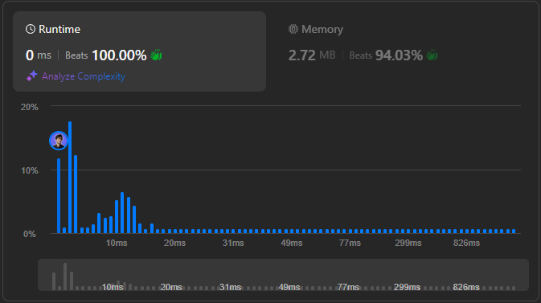

# 🌟 Quick Way to Detect String Permutations 💯🔥

**Author:** withaarzoo
**Votes:** 69
**Link:** [https://leetcode.com/problems/permutation-in-string/solutions/5871072/](https://leetcode.com/problems/permutation-in-string/solutions/5871072/)

---


Explore a collection of solutions to LeetCode problems in multiple programming languages. Each solution includes a detailed explanation and step-by-step approach to solving the problem efficiently. Whether you're a beginner looking to learn or an experienced coder seeking optimized solutions, this repository aims to provide clear and insightful approaches to tackling challenging LeetCode problems.

### **Access daily LeetCode Solutions Repo :** [click here](https://github.com/withaarzoo/LeetCode-Solutions)

---




---

# Intuition
The problem is about checking if one string `s2` contains any permutation of another string `s1`. Since permutations of a string have the same character frequency, the idea is to compare the character frequencies of a sliding window of size `s1.length()` in `s2` with the character frequencies of `s1`.

---

# Approach
1. Create frequency arrays for both `s1` and the first window of size `s1.length()` in `s2`.
2. Slide the window across `s2` by one character at a time, updating the window's frequency counts.
3. Compare the frequency arrays after each slide. If they match, it means a permutation of `s1` is found in `s2`.

---

# Complexity
- **Time complexity**:  
  $$O(n)$$, where \\(n\\) is the length of `s2`. We traverse `s2` once, updating the frequency array in constant time.

- **Space complexity**:  
  $$O(1)$$. The space used is constant because we only store two frequency arrays of fixed size (26 for lowercase letters).

---

# Code
```C++ []
class Solution {
public:
    bool checkInclusion(string s1, string s2) {
        if (s1.length() > s2.length()) return false;

        vector<int> s1Count(26, 0), s2Count(26, 0);
        
        // Count frequencies of s1 and the first window in s2
        for (int i = 0; i < s1.length(); ++i) {
            s1Count[s1[i] - 'a']++;
            s2Count[s2[i] - 'a']++;
        }

        // Slide the window over s2
        for (int i = 0; i < s2.length() - s1.length(); ++i) {
            if (s1Count == s2Count) return true;
            // Update the window
            s2Count[s2[i] - 'a']--;
            s2Count[s2[i + s1.length()] - 'a']++;
        }

        // Check the last window
        return s1Count == s2Count;
    }
};

```
```Java []
class Solution {
    public boolean checkInclusion(String s1, String s2) {
        if (s1.length() > s2.length()) return false;

        int[] s1Count = new int[26];
        int[] s2Count = new int[26];

        // Count the frequency of characters in s1 and the first window of s2
        for (int i = 0; i < s1.length(); i++) {
            s1Count[s1.charAt(i) - 'a']++;
            s2Count[s2.charAt(i) - 'a']++;
        }

        // Slide the window over s2
        for (int i = 0; i < s2.length() - s1.length(); i++) {
            if (matches(s1Count, s2Count)) return true;
            // Update the window
            s2Count[s2.charAt(i) - 'a']--;
            s2Count[s2.charAt(i + s1.length()) - 'a']++;
        }

        // Check the last window
        return matches(s1Count, s2Count);
    }

    private boolean matches(int[] s1Count, int[] s2Count) {
        for (int i = 0; i < 26; i++) {
            if (s1Count[i] != s2Count[i]) return false;
        }
        return true;
    }
}

```
```JavaScript []
var checkInclusion = function(s1, s2) {
    if (s1.length > s2.length) return false;

    let s1Count = Array(26).fill(0);
    let s2Count = Array(26).fill(0);

    // Initialize counts for s1 and the first window in s2
    for (let i = 0; i < s1.length; i++) {
        s1Count[s1.charCodeAt(i) - 97]++;
        s2Count[s2.charCodeAt(i) - 97]++;
    }

    // Slide the window over s2
    for (let i = 0; i < s2.length - s1.length; i++) {
        if (matches(s1Count, s2Count)) return true;
        s2Count[s2.charCodeAt(i) - 97]--;
        s2Count[s2.charCodeAt(i + s1.length) - 97]++;
    }

    // Check the last window
    return matches(s1Count, s2Count);
};

function matches(s1Count, s2Count) {
    for (let i = 0; i < 26; i++) {
        if (s1Count[i] !== s2Count[i]) return false;
    }
    return true;
}

```
```Python []
class Solution:
    def checkInclusion(self, s1: str, s2: str) -> bool:
        if len(s1) > len(s2):
            return False

        s1Count = [0] * 26
        s2Count = [0] * 26

        # Initialize frequency counts for s1 and the first window in s2
        for i in range(len(s1)):
            s1Count[ord(s1[i]) - ord('a')] += 1
            s2Count[ord(s2[i]) - ord('a')] += 1

        # Slide the window over s2
        for i in range(len(s2) - len(s1)):
            if s1Count == s2Count:
                return True
            s2Count[ord(s2[i]) - ord('a')] -= 1
            s2Count[ord(s2[i + len(s1)]) - ord('a')] += 1

        # Check the last window
        return s1Count == s2Count

```
```Go []
func checkInclusion(s1 string, s2 string) bool {
    if len(s1) > len(s2) {
        return false
    }

    s1Count := make([]int, 26)
    s2Count := make([]int, 26)

    // Initialize counts for s1 and the first window of s2
    for i := 0; i < len(s1); i++ {
        s1Count[s1[i]-'a']++
        s2Count[s2[i]-'a']++
    }

    // Slide the window over s2
    for i := 0; i < len(s2)-len(s1); i++ {
        if match(s1Count, s2Count) {
            return true
        }
        s2Count[s2[i]-'a']--
        s2Count[s2[i+len(s1)]-'a']++
    }

    // Check the last window
    return match(s1Count, s2Count)
}

func match(a, b []int) bool {
    for i := 0; i < 26; i++ {
        if a[i] != b[i] {
            return false
        }
    }
    return true
}

```

---

# Step-by-Step Detailed Explanation

1. **Frequency Array Initialization**:
   - We create two frequency arrays of size 26, one for `s1` and one for `s2`. Each index of the array corresponds to a letter in the alphabet.
   - We populate the arrays with the character counts of `s1` and the first window in `s2` (of size `s1.length()`).

2. **Sliding Window**:
   - We start with the first window in `s2` and slide it over the string.
   - For each slide, we remove the frequency count of the character that\u2019s leaving the window and add the frequency count of the new character entering the window.

3. **Frequency Comparison**:
   - At each step of the sliding window, we compare the frequency arrays of the current window and `s1`. If they match, we know that the window is a permutation of `s1`.

4. **Return Result**:
   - If we find a matching window, we return `true`.
   - If no matching window is found after sliding through all of `s2`, we return `false`.

---

### Visualization

We visualize the **sliding window** process by moving a fixed-size window (equal to the length of `s1`) over `s2`. At each step, we compare the frequency of characters in the window with the frequency of characters in `s1`. If the frequencies match, we know that a permutation of `s1` is found within `s2`.

Here\u2019s how it looks:

```
s1 = "ab"     --> Frequency of s1: [a: 1, b: 1]

s2 = "eidbaooo"
Window 1:  "ei"  --> No match
Window 2:  "id"  --> No match
Window 3:  "db"  --> No match
Window 4:  "ba"  --> Match! (Permutation found)
```

---


