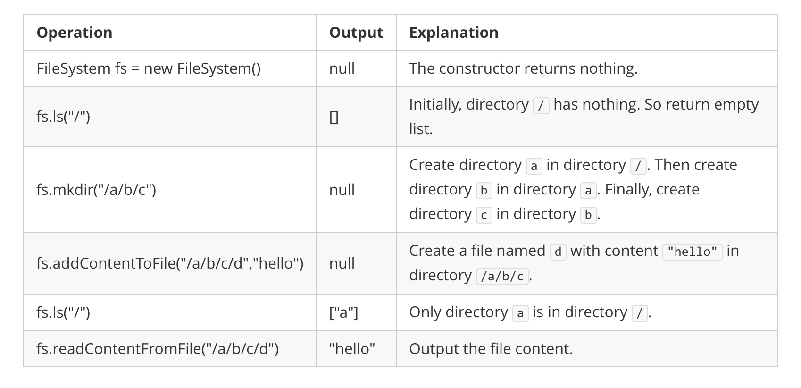

# [588. Design In-Memory File System](https://leetcode.com/problems/design-in-memory-file-system/)

| Category | Difficulty | Likes | Dislikes |
| :------: | :--------: | :---: | :------: |
| Algorithms | Hard | 1572 | 175 |

**Tags:** [`hash-table`](https://leetcode.com/tag/hash-table), [`string`](https://leetcode.com/tag/string), [`design`](https://leetcode.com/tag/design), [`trie`](https://leetcode.com/tag/trie), [`sorting`](https://leetcode.com/tag/sorting)

**Companies:** `uber`, `coinbase`, `oracle`, `snowflake`, `amazon`, `microsoft`, `tiktok`, `doordash`, `google`, `coupang`, `observeai`, `shopify`, `citadel`, `baidu`

## Description

Design a data structure that simulates an in-memory file system.

Implement the FileSystem class:

	- `FileSystem()` Initializes the object of the system.

	- `List ls(String path)`
	
		If `path` is a file path, returns a list that only contains this file's name.

		- If `path` is a directory path, returns the list of file and directory names **in this directory**.

	
	The answer should in **lexicographic order**.
	- `void mkdir(String path)` Makes a new directory according to the given `path`. The given directory path does not exist. If the middle directories in the path do not exist, you should create them as well.

	- `void addContentToFile(String filePath, String content)`
	
		If `filePath` does not exist, creates that file containing given `content`.

		- If `filePath` already exists, appends the given `content` to original content.

	
	
	- `String readContentFromFile(String filePath)` Returns the content in the file at `filePath`.

 

**Example 1:**


```

Input
[&quot;FileSystem&quot;, &quot;ls&quot;, &quot;mkdir&quot;, &quot;addContentToFile&quot;, &quot;ls&quot;, &quot;readContentFromFile&quot;]
[[], [&quot;/&quot;], [&quot;/a/b/c&quot;], [&quot;/a/b/c/d&quot;, &quot;hello&quot;], [&quot;/&quot;], [&quot;/a/b/c/d&quot;]]
Output
[null, [], null, null, [&quot;a&quot;], &quot;hello&quot;]

Explanation
FileSystem fileSystem = new FileSystem();
fileSystem.ls(&quot;/&quot;);                         // return []
fileSystem.mkdir(&quot;/a/b/c&quot;);
fileSystem.addContentToFile(&quot;/a/b/c/d&quot;, &quot;hello&quot;);
fileSystem.ls(&quot;/&quot;);                         // return [&quot;a&quot;]
fileSystem.readContentFromFile(&quot;/a/b/c/d&quot;); // return &quot;hello&quot;

```

 

**Constraints:**

	- `1 <= path.length, filePath.length <= 100`

	- `path` and `filePath` are absolute paths which begin with `'/'` and do not end with `'/'` except that the path is just `"/"`.

	- You can assume that all directory names and file names only contain lowercase letters, and the same names will not exist in the same directory.

	- You can assume that all operations will be passed valid parameters, and users will not attempt to retrieve file content or list a directory or file that does not exist.

	- You can assume that the parent directory for the file in `addContentToFile` will exist.

	- `1 <= content.length <= 50`

	- At most `300` calls will be made to `ls`, `mkdir`, `addContentToFile`, and `readContentFromFile`.

---

**Links:** [Submissions](https://leetcode.com/problems/design-in-memory-file-system/) | [Solutions](https://leetcode.com/problems/design-in-memory-file-system/)
