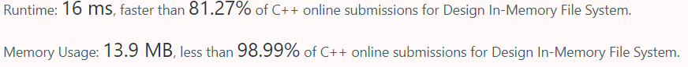

# C++ Trie with unordered_map, simple and fast!

**Author:** mkitreignn
**Votes:** 18
**Link:** [https://leetcode.com/problems/design-in-memory-file-system/solutions/1095503/](https://leetcode.com/problems/design-in-memory-file-system/solutions/1095503/)

---

Hopefully you guys found it useful. 
Give me an upvote if you guys did :D

```
struct Node {        
    unordered_map<string, Node *> dir = {};
    vector<string> pathList = {};
    string content = "";    
};

class FileSystem {
private:
    Node *main;
public:
    FileSystem() {
        main = new Node;
    }
    
    vector<string> ls(string path) {     
        Node *temp = file(path);
        if (temp->content.size())
            return {path.substr(path.find_last_of('/') + 1)};
        sort(temp->pathList.begin(), temp->pathList.end());
        return temp->pathList;
    }
    
    void mkdir(string path) {
        file(path);
    }
    
    void addContentToFile(string filePath, string content) {
        Node *temp = file(filePath);
        temp->content += content;  
    }
    
    string readContentFromFile(string filePath) {
        Node *temp = file(filePath);
        return temp->content;
    }
    
    Node *file(string path) {
        Node *temp = main;
        stringstream ss(path);
        string currPath = "";
        
        while (getline(ss, currPath, '/')) {
            // If the file does not exist
            if (temp->dir[currPath] == nullptr) {
                temp->pathList.push_back(currPath);                
                temp->dir[currPath] = new Node;
            }
            temp = temp->dir[currPath];                
        }
        return temp;
    }
};
```

