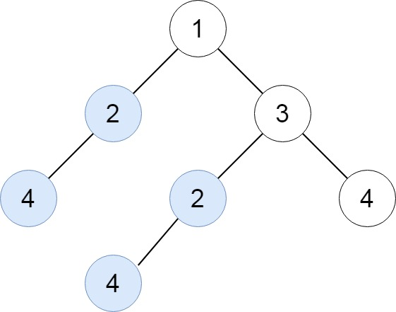
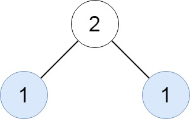
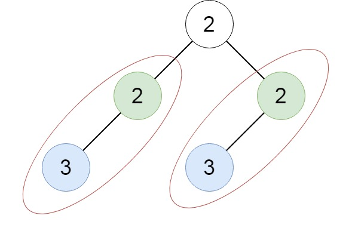

# [652. Find Duplicate Subtrees](https://leetcode.com/problems/find-duplicate-subtrees/)

| Category | Difficulty | Likes | Dislikes |
| :------: | :--------: | :---: | :------: |
| Algorithms | Medium | 6082 | 500 |

**Tags:** [`hash-table`](https://leetcode.com/tag/hash-table), [`tree`](https://leetcode.com/tag/tree), [`depth-first-search`](https://leetcode.com/tag/depth-first-search), [`binary-tree`](https://leetcode.com/tag/binary-tree)

**Companies:** `google`, `yandex`, `amazon`, `phonepe`, `microsoft`, `bloomberg`

## Description

Given the `root` of a binary tree, return all **duplicate subtrees**.

For each kind of duplicate subtrees, you only need to return the root node of any one of them.

Two trees are **duplicate** if they have the **same structure** with the **same node values**.

 

**Example 1:**


```

Input: root = [1,2,3,4,null,2,4,null,null,4]
Output: [[2,4],[4]]

```

**Example 2:**


```

Input: root = [2,1,1]
Output: [[1]]

```

**Example 3:**


```

Input: root = [2,2,2,3,null,3,null]
Output: [[2,3],[3]]

```

 

**Constraints:**

	- The number of the nodes in the tree will be in the range `[1, 5000]`

	- `-200 <= Node.val <= 200`

---

**Links:** [Submissions](https://leetcode.com/problems/find-duplicate-subtrees/) | [Solutions](https://leetcode.com/problems/find-duplicate-subtrees/)
