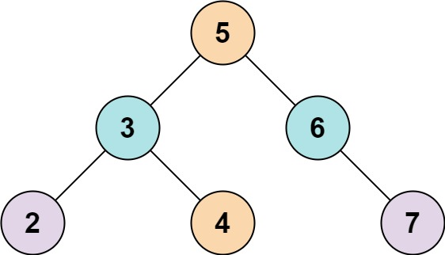
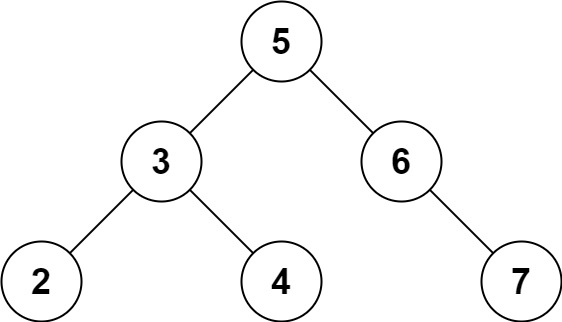

# [653. Two Sum IV - Input is a BST](https://leetcode.com/problems/two-sum-iv-input-is-a-bst/)

| Category | Difficulty | Likes | Dislikes |
| :------: | :--------: | :---: | :------: |
| Algorithms | Easy | 7204 | 289 |

**Tags:** [`hash-table`](https://leetcode.com/tag/hash-table), [`two-pointers`](https://leetcode.com/tag/two-pointers), [`tree`](https://leetcode.com/tag/tree), [`depth-first-search`](https://leetcode.com/tag/depth-first-search), [`breadth-first-search`](https://leetcode.com/tag/breadth-first-search), [`binary-search-tree`](https://leetcode.com/tag/binary-search-tree), [`binary-tree`](https://leetcode.com/tag/binary-tree)

**Companies:** `amazon`, `bloomberg`, `facebook`, `microsoft`, `google`, `goldman-sachs`, `oracle`, `samsung`

## Description

Given the `root` of a binary search tree and an integer `k`, return `true` *if there exist two elements in the BST such that their sum is equal to* `k`, *or* `false` *otherwise*.

 

**Example 1:**


```

Input: root = [5,3,6,2,4,null,7], k = 9
Output: true

```

**Example 2:**


```

Input: root = [5,3,6,2,4,null,7], k = 28
Output: false

```

 

**Constraints:**

	- The number of nodes in the tree is in the range `[1, 10^4]`.

	- `-10^4 <= Node.val <= 10^4`

	- `root` is guaranteed to be a **valid** binary search tree.

	- `-10^5 <= k <= 10^5`

---

**Links:** [Submissions](https://leetcode.com/problems/two-sum-iv-input-is-a-bst/) | [Solutions](https://leetcode.com/problems/two-sum-iv-input-is-a-bst/)
