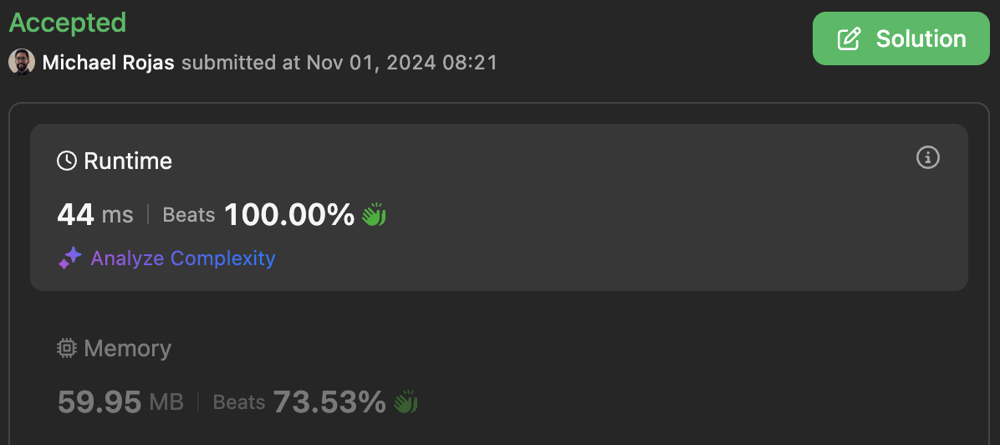
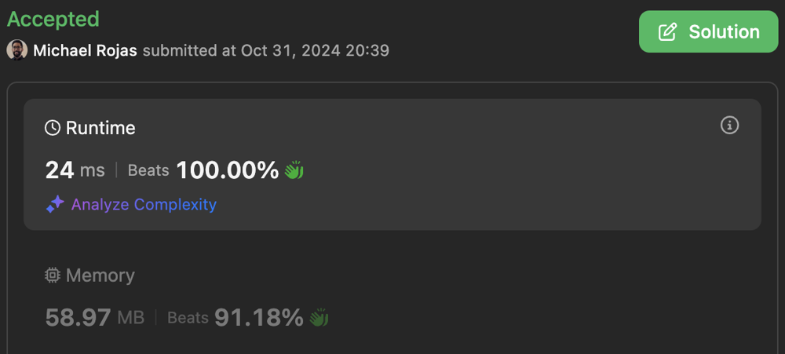

# 100% | BFS | Time: O(MNlogN) | Space: O(MN)

**Author:** rojas
**Votes:** 0
**Link:** [https://leetcode.com/problems/number-of-distinct-islands-ii/solutions/3982475/](https://leetcode.com/problems/number-of-distinct-islands-ii/solutions/3982475/)

---

# Table of Contents

[toc]

# Approach

When land is found:
1. BFS is used to find connected land in the cardinal directions (up, down, left, right). Any found land is turned into water to avoid revisiting the cell.
2. The minimum X & Y coordinates are used to translate the island to the origin (0, 0).
3. The coordinates array is converted to a double array separating x coordinates by row. This automatically sorts them vertically, but we must still sort each row horizontally.
4. After a shape is defined, the normal (representative) of that shape is found amongst its rotations. Due to the way rotations are handled, this does *NOT* involve any re-sorting of coordinates.
5. The normal is encoded into a string and added to the set of found shapes.

# Complexity

- Time complexity: $$O(MN\\log{N})$$

- Space complexity: $$O(MN)$$

# OOP

## Performance

[JavaScript](https://leetcode.com/problems/number-of-distinct-islands-ii/submissions/1439853380/)



## Code

```typescript []
type TransformFn<T> = (val: T) => T;

const WATER = 0;
const LAND = 1;
// Up, Left, Right, Down
const DIRS = [[-1, 0], [0, -1], [0, 1], [1, 0]];
const TRANSFORMS: TransformFn<Island>[] = [
    island => island.vFlip(),  // -y,  x : 180 deg"
    island => island.hFlip(),  // -y, -x : 180 deg
    island => island.vFlip(),  //  y, -x :   0 deg"
    island => island.invert(), // -x,  y :  90 deg"
    island => island.vFlip(),  //  x,  y : 270 deg
    island => island.hFlip(),  //  x, -y : 270 deg"
    island => island.vFlip(),  // -x, -y :  90 deg
];

function numDistinctIslands2(grid: number[][]): number {
    const Y = grid.length;
    const X = grid[0].length;
    const islands = new Set<string>();

    for (let y = 0; y < Y; ++y) {
        for (let x = 0; x < X; ++x) {
            if (grid[y][x] == LAND) {
                const island = bfs(grid, y, x);
                islands.add(island.normalize().toString());
            }
        }
    }
    
    return islands.size;
};

/**
 * Once a piece of an island is found, BFS across
 * all neighbors until entire island is found.
 * 
 * Clear land to avoid revisiting seen coordinates.
 */
function bfs(grid: number[][], y: number, x: number): Island {
    const Y = grid.length;
    const X = grid[0].length;
    const queue: number[][] = [[y, x]];

    grid[y][x] = WATER;
    let minY = y;
    let maxY = y;
    let minX = x;
    let maxX = x;

    // BFS
    for (let i = 0; i < queue.length; ++i) {
        const [y, x] = queue[i];
        minY = Math.min(minY, y);
        maxY = Math.max(maxY, y);
        minX = Math.min(minX, x);
        maxX = Math.max(maxX, x);
        for (const [dy, dx] of DIRS) {
            const y2 = y + dy;
            const x2 = x + dx;
            if (y2 >= 0 && y2 < Y && x2 >= 0 && x2 < X) {
                if (grid[y2][x2] == LAND) {
                    grid[y2][x2] = WATER;
                    queue.push([y2, x2]);
                }
            }
        }
    }

    // Create island
    const height = maxY - minY + 1;
    const width = maxX - minX + 1;
    const island = new Island(height, width);

    // Translate cells to origin
    // and place them into cells grid
    const cells = island.cells;
    for (const [y, x] of queue) {
        cells[y - minY].push(x - minX);
    }

    // Sort cell rows
    for (const row of cells) {
        row.sort((x1, x2) => x1 - x2);
    }

    // Return the island
    return island;
}

function compareNums(nums1: number[], nums2: number[]): number {
    const N = Math.min(nums1.length, nums2.length);
    for (let i = 0; i < N; ++i) {
        if (nums1[i] != nums2[i]) {
            return nums1[i] - nums2[i];
        }
    }
    return nums1.length - nums2.length;
}

function compareNums2D(nums1: number[][], nums2: number[][]): number {
    const Y = Math.min(nums1.length, nums2.length);
    for (let y = 0; y < Y; ++y) {
        const diff = compareNums(nums1[y], nums2[y]);
        if (diff != 0) {
            return diff;
        }
    }
    return nums1.length - nums2.length;
}

class Island {
    cells: number[][];
    height: number;
    width: number;

    constructor(height: number, width: number) {
        const cells = new Array(height);
        for (let i = 0; i < height; ++i) {
            cells[i] = [];
        }
        this.cells = cells;
        this.height = height;
        this.width = width;
    }

    clone(): Island {
        const cells = this.cells;
        const copy = new Array(cells.length);
        for (let y = 0; y < copy.length; ++y) {
            copy[y] = Array.from(cells[y]);
        }
        const island = new Island(0,this.width);
        island.cells = copy;
        island.height = this.height;
        return island;
    }

    compareTo(island: Island): number {
        return compareNums2D(this.cells, island.cells);
    }

    hFlip(): Island {
        const island = this.clone();

        const width = island.width - 1;
        for (const row of island.cells) {
            for (let i = 0; i < row.length; ++i) {
                row[i] = width - row[i];
            }
            row.reverse();
        }

        return island;
    }

    invert(): Island {
        const {cells, height, width} = this;
        const island = new Island(width, height);
        const copy = island.cells;
        for (let y = 0; y < height; ++y) {
            for (const x of cells[y]) {
                copy[x].push(y);
            }
        }

        return island;
    }

    normalize(): Island {
        let island: Island = this;
        
        // Optional optimization: 
        // If rectangular, make height > width and reduce comparisons
        island = (island.height >= island.width) ? island : island.invert();
        const max = (island.height == island.width) ? 7 : 3;

        let normal = island;
        for (let i = 0; i < max; ++i) {
            island = TRANSFORMS[i](island);
            if (normal.compareTo(island) > 0) {
                normal = island;
            }
        }
        return normal;
    }

    toString(): string {
        const {cells, height, width} = this;
        const sb: number[] = [height, width];
        for (let y = 0; y < height; ++y) {
            sb.push(-y, ...cells[y]);
        }
        return sb.join(",");
    }

    vFlip(): Island {
        const island = this.clone();
        island.cells.reverse();
        return island;
    }
}
```

```javascript []
// type TransformFn<T> = (val: T) => T;

const WATER = 0;
const LAND = 1;
// Up, Left, Right, Down
const DIRS = [[-1, 0], [0, -1], [0, 1], [1, 0]];
const TRANSFORMS = [
    island => island.vFlip(),  // -y,  x : 180 deg"
    island => island.hFlip(),  // -y, -x : 180 deg
    island => island.vFlip(),  //  y, -x :   0 deg"
    island => island.invert(), // -x,  y :  90 deg"
    island => island.vFlip(),  //  x,  y : 270 deg
    island => island.hFlip(),  //  x, -y : 270 deg"
    island => island.vFlip(),  // -x, -y :  90 deg
];

// MAIN
function numDistinctIslands2(grid) {
    const Y = grid.length;
    const X = grid[0].length;
    const shapes = new Set();

    for (let y = 0; y < Y; ++y) {
        for (let x = 0; x < X; ++x) {
            if (grid[y][x] == LAND) {
                const island = bfs(grid, y, x);
                shapes.add(island.normalize().toString());
            }
        }
    }
    
    return shapes.size;
};

/**
 * Once a piece of an island is found, BFS across
 * all neighbors until entire island is found.
 * 
 * Clear land to avoid revisiting seen coordinates.
 */
function bfs(grid, y, x) {
    const Y = grid.length;
    const X = grid[0].length;
    const queue = [[y, x]];

    grid[y][x] = WATER;
    let minY = y;
    let maxY = y;
    let minX = x;
    let maxX = x;

    // BFS
    for (let i = 0; i < queue.length; ++i) {
        const [y, x] = queue[i];
        minY = Math.min(minY, y);
        maxY = Math.max(maxY, y);
        minX = Math.min(minX, x);
        maxX = Math.max(maxX, x);
        for (const [dy, dx] of DIRS) {
            const y2 = y + dy;
            const x2 = x + dx;
            if (y2 >= 0 && y2 < Y && x2 >= 0 && x2 < X) {
                if (grid[y2][x2] == LAND) {
                    grid[y2][x2] = WATER;
                    queue.push([y2, x2]);
                }
            }
        }
    }

    // Create island
    const height = maxY - minY + 1;
    const width = maxX - minX + 1;
    const island = new Island(height, width);

    // Translate cells to origin
    // and place them into cells grid
    const cells = island.cells;
    for (const [y, x] of queue) {
        cells[y - minY].push(x - minX);
    }

    // Sort cell rows
    for (const row of cells) {
        row.sort((x1, x2) => x1 - x2);
    }

    // Return the island
    return island;
}

function compareNums(nums1, nums2) {
    const N = Math.min(nums1.length, nums2.length);
    for (let i = 0; i < N; ++i) {
        if (nums1[i] != nums2[i]) {
            return nums1[i] - nums2[i];
        }
    }
    return nums1.length - nums2.length;
}

function compareNums2D(nums1, nums2) {
    const N = Math.min(nums1.length, nums2.length);
    for (let i = 0; i < N; ++i) {
        const diff = compareNums(nums1[i], nums2[i]);
        if (diff != 0) {
            return diff;
        }
    }

    return nums1.length - nums2.length;
}

class Island {
    constructor(height, width) {
        const cells = new Array(height);
        for (let i = 0; i < height; ++i) {
            cells[i] = [];
        }
        this.cells = cells;
        this.height = height;
        this.width = width;
    }

    clone() {
        const cells = this.cells;
        const copy = new Array(cells.length);
        for (let y = 0; y < copy.length; ++y) {
            copy[y] = Array.from(cells[y]);
        }
        const island = new Island(0,this.width);
        island.cells = copy;
        island.height = this.height;
        return island;
    }

    compareTo(island) {
        return compareNums2D(this.cells, island.cells);
    }

    hFlip() {
        const island = this.clone();
        const width = island.width - 1;

        for (const row of island.cells) {
            for (let i = 0; i < row.length; ++i) {
                row[i] = width - row[i];
            }
            row.reverse();
        }

        return island;
    }

    invert() {
        const {cells, height, width} = this;
        const island = new Island(width, height);
        const copy = island.cells;

        for (let y = 0; y < height; ++y) {
            for (const x of cells[y]) {
                copy[x].push(y);
            }
        }

        return island;
    }

    normalize() {
        let island = this;
        
        // Optional optimization: 
        // If rectangular, make height > width and reduce comparisons
        island = (island.height >= island.width) ? island : island.invert();
        const max = (island.height == island.width) ? 7 : 3;

        let normal = island;
        for (let i = 0; i < max; ++i) {
            island = TRANSFORMS[i](island);
            if (normal.compareTo(island) > 0) {
                normal = island;
            }
        }
        return normal;
    }

    toString() {
        const {cells, height, width} = this;
        const sb = [height, width];
        for (let y = 0; y < height; ++y) {
            sb.push(-y, ...cells[y]);
        }
        return sb.join(",");
    }

    vFlip() {
        const island = this.clone();
        island.cells.reverse();
        return island;
    }
}
```

# Functional

## Performance

[JavaScript](https://leetcode.com/problems/number-of-distinct-islands-ii/submissions/1439443903/)



## Code

```typescript []
type TransformFn<T> = (val: T) => T;

interface Island {
    cells: number[][],
    height: number;
    width: number;
}

const WATER = 0;
const LAND = 1;
// Up, Left, Right, Down
const DIRS = [[-1, 0], [0, -1], [0, 1], [1, 0]];
const TRANSFORMS: TransformFn<Island>[] = [
    vFlip,  // -y,  x : 180 deg"
    hFlip,  // -y, -x : 180 deg
    vFlip,  //  y, -x :   0 deg"
    invert, // -x,  y :  90 deg"
    vFlip,  //  x,  y : 270 deg
    hFlip,  //  x, -y : 270 deg"
    vFlip,  // -x, -y :  90 deg
];

function numDistinctIslands2(grid: number[][]): number {
    const Y = grid.length;
    const X = grid[0].length;
    const islands = new Set<string>();

    for (let y = 0; y < Y; ++y) {
        for (let x = 0; x < X; ++x) {
            if (grid[y][x] == LAND) {
                const island = bfs(grid, y, x);
                islands.add(toString(normalize(island)));
            }
        }
    }
    
    return islands.size;
};

/**
 * Once a piece of an island is found, BFS across
 * all neighbors until entire island is found.
 * 
 * Clear land to avoid revisiting seen coordinates.
 */
function bfs(grid: number[][], y: number, x: number): Island {
    const Y = grid.length;
    const X = grid[0].length;
    const queue: number[][] = [[y, x]];

    grid[y][x] = WATER;
    let minY = y;
    let maxY = y;
    let minX = x;
    let maxX = x;

    // BFS
    for (let i = 0; i < queue.length; ++i) {
        const [y, x] = queue[i];
        minY = Math.min(minY, y);
        maxY = Math.max(maxY, y);
        minX = Math.min(minX, x);
        maxX = Math.max(maxX, x);
        for (const [dy, dx] of DIRS) {
            const y2 = y + dy;
            const x2 = x + dx;
            if (y2 >= 0 && y2 < Y && x2 >= 0 && x2 < X) {
                if (grid[y2][x2] == LAND) {
                    grid[y2][x2] = WATER;
                    queue.push([y2, x2]);
                }
            }
        }
    }

    // Get island dimensions
    const height = maxY - minY + 1;
    const width = maxX - minX + 1;

    // Initialize cells grid
    const cells: number[][] = new Array(height);
    for (let y = 0; y < height; ++y) {
        cells[y] = [];
    }

    // Translate cells to origin
    // and place them into cells grid
    for (const [y, x] of queue) {
        cells[y - minY].push(x - minX);
    }

    // Sort cell rows
    for (const row of cells) {
        row.sort((x1, x2) => x1 - x2);
    }

    // Return Island
    return {cells, height, width};
}

// Island

/**
 * Clones an Island
 */
function clone(island: Island): Island {
    const cells = island.cells;
    const copy = new Array(cells.length);
    for (let y = 0; y < copy.length; ++y) {
        copy[y] = Array.from(cells[y]);
    }
    return {cells: copy, height: island.height, width: island.width};
}

/**
 * Flips an Island horizontally (around y axis)
 */
function hFlip(island: Island): Island {
    island = clone(island);

    const width = island.width - 1;
    for (const row of island.cells) {
        for (let i = 0; i < row.length; ++i) {
            row[i] = width - row[i];
        }
        row.reverse();
    }

    return island;
}

/**
 * Inverts an Island ({y,x} becomes {x,y})
 */
function invert(island: Island): Island {
    const {cells, height, width} = island;

    // Create inverted cells
    const inverted: number[][] = new Array(width);
    for (let i = 0; i < width; ++i) {
        inverted[i] = [];
    }

    // Populate rows
    for (let y = 0; y < height; ++y) {
        for (const x of cells[y]) {
            inverted[x].push(y);
        }
    }

    return {cells: inverted, height: width, width: height};
}

function normalize(island: Island): Island {
    // Optional optimization: 
    // If rectangular island, make height > width and reduce comparisons
    island = (island.height >= island.width) ? island : invert(island);
    const max = (island.height == island.width) ? 7 : 3;

    let normal = island;
    for (let i = 0; i < max; ++i) {
        island = TRANSFORMS[i](island);
        if (compareNums2D(normal.cells, island.cells) > 0) {
            normal = island;
        }
    }

    return normal;
}

function toString(island: Island): string {
    const {cells, height, width} = island;
    const sb: number[] = [height, width];
    for (let y = 0; y < height; ++y) {
        sb.push(-y, ...cells[y]);
    }
    return sb.join(",");
}

/**
 * Flips an Island vertically (around x axis)
 */
function vFlip(island: Island): Island {
    island = clone(island);
    island.cells.reverse();
    return island;
}

// Helpers

function compareNums(nums1: number[], nums2: number[]): number {
    const N = Math.min(nums1.length, nums2.length);
    for (let i = 0; i < N; ++i) {
        if (nums1[i] != nums2[i]) {
            return nums1[i] - nums2[i];
        }
    }
    return nums1.length - nums2.length;
}

function compareNums2D(nums1: number[][], nums2: number[][]): number {
    const Y = Math.min(nums1.length, nums2.length);
    for (let y = 0; y < Y; ++y) {
        const diff = compareNums(nums1[y], nums2[y]);
        if (diff != 0) {
            return diff;
        }
    }
    return nums1.length - nums2.length;
}
```

```javascript []
/*
type TransformFn<T> = (val: T) => T;

interface Island {
    cells: number[][],
    height: number;
    width: number;
}
*/

const WATER = 0;
const LAND = 1;
// Up, Left, Right, Down
const DIRS = [[-1, 0], [0, -1], [0, 1], [1, 0]];
const TRANSFORMS = [
    vFlip,  // -y,  x : 180 deg"
    hFlip,  // -y, -x : 180 deg
    vFlip,  //  y, -x :   0 deg"
    invert, // -x,  y :  90 deg"
    vFlip,  //  x,  y : 270 deg
    hFlip,  //  x, -y : 270 deg"
    vFlip,  // -x, -y :  90 deg
];

/**
 * @param {number[][]} grid
 * @return {number}
 */
function numDistinctIslands2(grid) {
    const Y = grid.length;
    const X = grid[0].length;
    const islands = new Set();

    for (let y = 0; y < Y; ++y) {
        for (let x = 0; x < X; ++x) {
            if (grid[y][x] == LAND) {
                const island = bfs(grid, y, x);
                islands.add(toString(normalize(island)));
            }
        }
    }
    
    return islands.size;
};

/**
 * Once a piece of an island is found, BFS across
 * all neighbors until entire island is found.
 * 
 * Updates land to water to avoid revisiting seen coordinates.
 *
 * @param {number[][]} grid
 * @param {number} y
 * @param {number} x
 * @return {Shape}
 */
function bfs(grid, y, x) {
    const Y = grid.length;
    const X = grid[0].length;
    const queue = [[y, x]];

    grid[y][x] = WATER;
    let minY = y;
    let maxY = y;
    let minX = x;
    let maxX = x;

    // BFS
    for (let i = 0; i < queue.length; ++i) {
        const [y, x] = queue[i];
        minY = Math.min(minY, y);
        maxY = Math.max(maxY, y);
        minX = Math.min(minX, x);
        maxX = Math.max(maxX, x);
        for (const [dy, dx] of DIRS) {
            const y2 = y + dy;
            const x2 = x + dx;
            if (y2 >= 0 && y2 < Y && x2 >= 0 && x2 < X) {
                if (grid[y2][x2] == LAND) {
                    grid[y2][x2] = WATER;
                    queue.push([y2, x2]);
                }
            }
        }
    }

    // Get island dimensions
    const height = maxY - minY + 1;
    const width = maxX - minX + 1;

    // Initialize cells grid
    const cells = new Array(height);
    for (let y = 0; y < height; ++y) {
        cells[y] = [];
    }

    // Translate cells to origin
    // and place them into cells grid
    for (const [y, x] of queue) {
        cells[y - minY].push(x - minX);
    }

    // Sort cell rows
    for (const row of cells) {
        row.sort((x1, x2) => x1 - x2);
    }

    // Return island
    return {cells, height, width};
}

// Island

/**
 * Clones an Island
 *
 * @param {Island} island
 * @return {Island}
 */
function clone(island) {
    const cells = island.cells;
    const copy = new Array(cells.length);
    for (let y = 0; y < copy.length; ++y) {
        copy[y] = Array.from(cells[y]);
    }
    return {cells: copy, height: island.height, width: island.width};
}

/**
 * Flips an Island horizontally (around y axis)
 *
 * @param {Island} island
 * @return {Island}
 */
function hFlip(island) {
    island = clone(island);

    const width = island.width - 1;
    for (const row of island.cells) {
        for (let i = 0; i < row.length; ++i) {
            row[i] = width - row[i];
        }
        row.reverse();
    }

    return island;
}

/**
 * Inverts a Island ({y,x} becomes {x,y})
 *
 * @param {Island} shape
 * @return {Island}
 */
function invert(island) {
    const {cells, height, width} = island;

    // Create inverted cells
    const inverted = new Array(width);
    for (let i = 0; i < width; ++i) {
        inverted[i] = [];
    }

    // Populate rows
    for (let y = 0; y < height; ++y) {
        for (const x of cells[y]) {
            inverted[x].push(y);
        }
    }

    return {cells: inverted, height: width, width: height};
}

/**
 * Gets an Island's normal representation.
 *
 * @param {Island} island
 * @return {Island}
 */
function normalize(island) {
    // Optional optimization: 
    // If rectangular island, make height > width and reduce comparisons
    island = (island.height >= island.width) ? island : invert(island);
    const max = (island.height == island.width) ? 7 : 3;

    let normal = island;
    for (let i = 0; i < max; ++i) {
        island = TRANSFORMS[i](island);
        if (compareNums2D(normal.cells, island.cells) > 0) {
            normal = island;
        }
    }
    return normal;
}

/**
 * Encodes an Island to a string
 *
 * @param {Island} island
 * @return {string}
 */
function toString(island) {
    const {cells, height, width} = island;
    const sb = [height, width];
    for (let y = 0; y < height; ++y) {
        sb.push(-y, ...cells[y]);
    }
    return sb.join(",");
}

/**
 * Flips an Island vertically (around x axis)
 *
 * @param {Island} island
 * @return {Island}
 */
function vFlip(island) {
    island = clone(island);
    island.cells.reverse();
    return island;
}

// Helpers

/**
 * Compares 2 numeric arrays
 *
 * @param {number[]} nums1
 * @param {number[]} nums2
 * @return {number}
 */
function compareNums(nums1, nums2) {
    const N = Math.min(nums1.length, nums2.length);
    for (let i = 0; i < N; ++i) {
        if (nums1[i] != nums2[i]) {
            return nums1[i] - nums2[i];
        }
    }
    return nums1.length - nums2.length;
}

/**
 * Compares 2 numeric double arrays
 *
 * @param {number[][]} cells1
 * @param {number[][]} cells2
 * @return {number}
 */
function compareNums2D(cells1, cells2) {
    const N = Math.min(cells1.length, cells2.length);
    for (let i = 0; i < N; ++i) {
        const diff = compareNums(cells1[i], cells2[i]);
        if (diff != 0) {
            return diff;
        }
    }
    return cells1.length - cells2.length;
}
```
