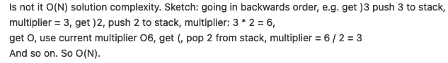

# Easy to remember / Coding it up

**Author:** 2pac_shakur
**Votes:** 1
**Link:** [https://leetcode.com/problems/number-of-atoms/solutions/1104152/](https://leetcode.com/problems/number-of-atoms/solutions/1104152/)

---

Inspired by https://leetcode.com/problems/number-of-atoms/solution/131465


```
fun countOfAtoms(formula: String): String {
        val map = HashMap<String, Int>()
        val countStack = Stack<Int>()
        var atom = ""
        var countStr = ""
        var mul = 1
        for (i in formula.lastIndex downTo 0) {
            val ch = formula[i]
            when {
                ch.isDigit() -> countStr = "$ch" + countStr
                ch.isLowerCase() -> atom = "$ch" + atom
                ch == ')' -> {
                    if (countStr.isNotEmpty()) {
                        val nextCount = countStr.toInt()
                        countStack.push(nextCount)
                        mul *= nextCount
                        countStr = ""
                    }
                }
                ch == '(' -> {
                    if (countStack.isNotEmpty()) {
                        val prevCount = countStack.pop()
                        mul /= prevCount
                    }
                }
                ch.isUpperCase() -> {
                    atom = "$ch" + atom
                    val nextCount = if (countStr.isEmpty()) 1 else countStr.toInt()
                    map[atom] = map.getOrDefault(atom, 0) + nextCount * mul
                    countStr = ""
                    atom = ""
                }
            }
        }
        val ans = StringBuilder()
        for (name in map.toSortedMap().keys) {
            ans.append(name)
            val times = map[name]!!
            if (times > 1) ans.append("" + times)
        }
        return String(ans)
    }
```