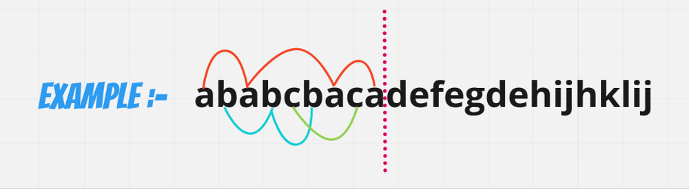
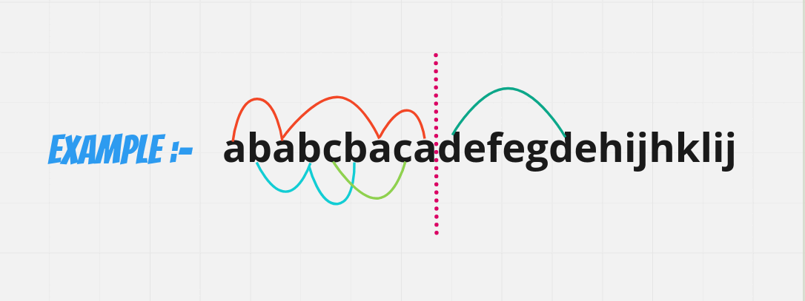
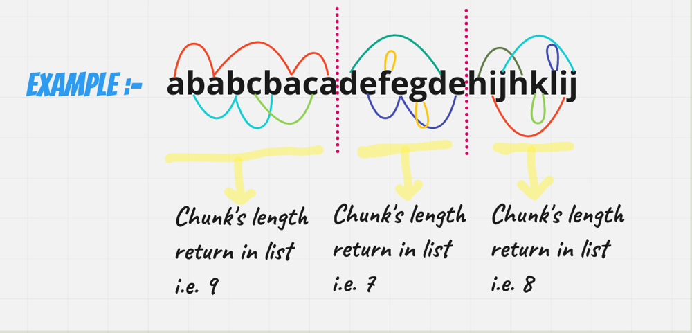
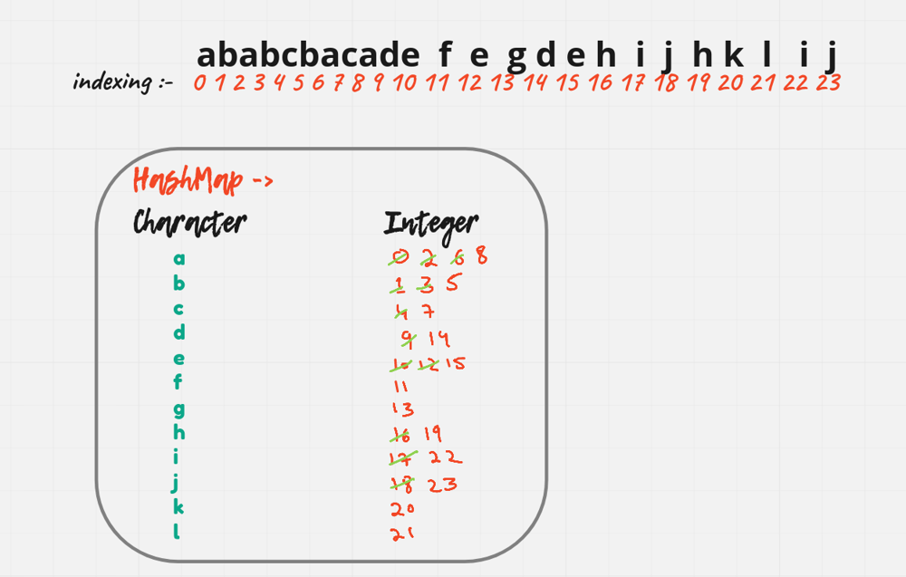

# [Java/C++] VISUALLY EXPLAINEDDDDD!!

**Author:** hi-malik
**Votes:** 639
**Link:** [https://leetcode.com/problems/partition-labels/solutions/1868842/](https://leetcode.com/problems/partition-labels/solutions/1868842/)

---

How's Going Ladies - n - Gentlemen, today we are going to solve one of the coolest problem i.e. **Partition Labels**

Let's understand what problem statement is,
```
We have given an string. And we have to divide strings into partition. But here is one condition :-

"Character's are not present beyond it's partition"
```

***Let's understand with an example,***

**Input**: s = "ababcbacadefegdehijhklij"
**Output**: [9,7,8]

So, what we'll do now is jump on an charcater and see till where a particular character exists `Let's understand it visually:`
* As you can see we jump over the character `a` till where it's impacting.


* Now we jump over character `b` till there it's impacting.


* Now we jump over character `c` till there it's impacting.


So as you can see we get **one of the partition**, as uptill here similar character's are present.

**`Similarly, we gonna do the same thing for other as well.`**


```
Now finally, return each partition length in List i.e.[9, 7, 8] :-
```


Okay, so till now we have understand the problem, now let's talk about it's approach how we gonna solve it:-

Well, i think for that we gonna need the help of HashMap, to solve this problem!! Now you will ask, why HashMap?? I'll say because, we gonna need each & every character index in our hashmap & by that we'll got an indea, from where to partition it.

Still, confuse. Don't worry just walk with me >>

First create an HashMap of Character & Integer *`[where integer tell us maximum imapct of a character at this index]`* & after that fill it: `Let's look at it visually >`



Now, we will use one formula in order to solve this. 
So, our formula will be **max - prev** where max intially is **0** & prev intially is **-1**

Using the same above example, let's implement it:
* Intially we will be at `a` and in our hashmap we know that `a` is impacting till **8**. So, we will update our **max to 8** for now.
* * Next we encounter `b` & it's range is 5. So, it is in the range of **8**
* * Next we encounter `b` & it's range is 7. So, it is in the range of **8**
* * So, there is no more element further in our range, we gonna use our formula :-
```
max - prev                                  where max is 8 & prev is -1
8 - (-1)
=> 9
```

* Now we are at `d` and in our hashmap we know that `d` is impacting till **14**. So, we will update our **max to 14** for now & update our **previous as well to 8**
* * Next we encounter `e` & it's range is 15. So, it is out the range of **14** we gonna update our max to **15**
* * Next we encounter `f` & it's range is 11. So, it is in the range of **15**
* * Next we encounter `g` & it's range is 13. So, it is in the range of **15**
* * So, there is no more element further in our range, we gonna use our formula :-
```
max - prev                                  where max is 15 & prev is 8
15 - 8
=> 7
```
* Now we are at `h` and in our hashmap we know that `h` is impacting till **19**. So, we will update our **max to 19** for now & update our **previous as well to 15**
* * Next we encounter `i` & it's range is 22. So, it is out the range of **19** we gonna update our max to **22**
* * Next we encounter `j` & it's range is 23. So, it is out the range of **22** we gonna update our max to **23**
* * Next we encounter `k` & it's range is 20. So, it is in the range of **23**
* * Next we encounter `l` & it's range is 21. So, it is in the range of **23**
* * So, there is no more element further in our range, we gonna use our formula :-
```
max - prev                                  where max is 23 & prev is 15
23 - 15
=> 8
```

Thus, we add these values to our ArrayList of let's say result & return them i.e. `[9, 7, 8]`

*I hope ladies - n - gentlemen approach is absolute clear,* **Let's code it up,**

**Java**
```
class Solution {
    public List<Integer> partitionLabels(String s) {
        Map<Character, Integer> map = new HashMap<>();
        // filling impact of character's
        for(int i = 0; i < s.length(); i++){
            char ch = s.charAt(i);
            map.put(ch, i);
        }
        // making of result
        List<Integer> res = new ArrayList<>();
        int prev = -1;
        int max = 0;
        
        for(int i = 0; i < s.length(); i++){
            char ch = s.charAt(i);
            max = Math.max(max, map.get(ch));
            if(max == i){
                // partition time
                res.add(max - prev);
                prev = max;
            }
        }
        return res;
    }
}
```
**C++**
```
class Solution {
public:
    vector<int> partitionLabels(string s) {
        unordered_map<char,int>mp;
        // filling impact of character's
        for(int i = 0; i < s.size(); i++){
            char ch = s[i];
            mp[ch] = i;
        }
        // making of result
        vector<int> res;
        int prev = -1;
        int maxi = 0;
        
        for(int i = 0; i < s.size(); i++){
            maxi = max(maxi, mp[s[i]]);
            if(maxi == i){
                // partition time
                res.push_back(maxi - prev);
                prev = maxi;
            }
        }
        return res;
    }
};
```
ANALYSIS :-
* **Time Complexity :-** BigO(N)
* **Space Complexity :-** BigO(N)