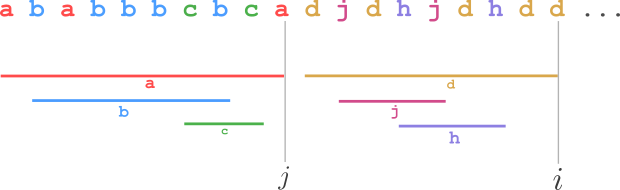
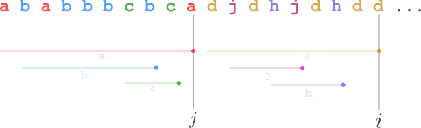
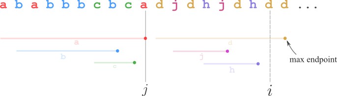

# 2 solutions (explanation + picture) ^^

**Author:** andrii_khlevniuk
**Votes:** 84
**Link:** [https://leetcode.com/problems/partition-labels/solutions/899214/](https://leetcode.com/problems/partition-labels/solutions/899214/)

---

Both solutions are two-pass, `O(N)` time, `O(N)` space.

**Explanation**

A key fact to understand is that each character has its "range" (drawn as colored bar on the picture). The range is defined by the lowest index of the character in the input string and its highest index. 
<br>

<br>
We are searching for the intervals `(j, i]` so that "ranges" of all characters in this interval lie inside it.
Note that for the task we actually need only the endpoints of the "ranges" (you don't need startpoints).
<br>

<br>
We hit new partition checkpoint at index `i` iff the enpoints of all characters after the previous partition checkpoint are less than or equal than `i`.
In other words we hit a new partition checkpoint  precisely when the running **maximum** enpoint is equal to `i`.
For example, this is **not** checkpoint situation:
<br>

<br>
The algo is the following:
* at the first pass use `map M` to store the endpoints of ranges for all characters in a string;
* at the second pass use running maximum `MM` to store the largest enpoint of the characters in the current partition segment. Let `j` be the previous partition checkpoint and `i` be the current index. As soon as `MM` equals current index `i` we hit the new partition checkpoint: `push_back` `j-i` into the output vector, set `j` to `i` and proceed.

**Solution 1**

```
vector<int> partitionLabels(string s)
{
	 int M[256]{0};   
	 vector<int> out;

	 for(int i{0}; i<size(s); ++i) M[s[i]]=i;

	 for(int i{0}, j{-1}, MM{0}; i<size(s); ++i)
		 if((MM = max(MM, M[s[i]]))==i)
			 out.push_back(i-j), j=i; 

	 return out;
}
```

**Solution 2**

This solution is worse, instead of using the running endpoint maximum it uses `unordered_set` to store the chars with enpoints larger than the current index `i`.
We hit the partition checkpoint as soon as the set becomes empty.

```
vector<int> partitionLabels(string s)
{
	 int m[256]{0};   
	 vector<int> out;
	 unordered_set<char> us;

	 for(auto i{0}; i<size(s); ++i) m[s[i]]=i;

	 for(auto i{0}, j{-1}; i<size(s); ++i)
		 if(m[s[i]]==i)
			 if(us.erase(s[i]); empty(us))
				 out.push_back(i-j), j=i; 
			 else;               
		 else
			 us.insert(s[i]);

	 return out;
}
```