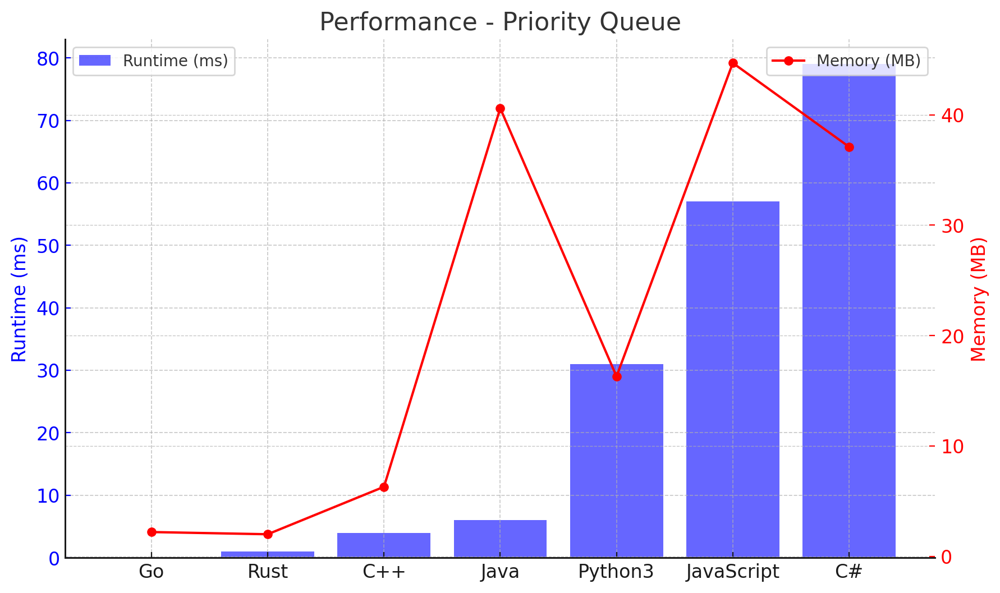
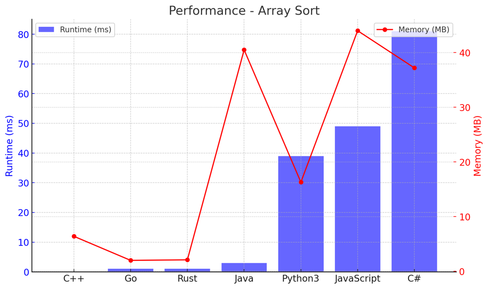

# ✅ 100% 2-Approaches Priority Queue & Sort

**Author:** vanAmsen
**Votes:** 144
**Link:** [https://leetcode.com/problems/reorganize-string/solutions/3947780/](https://leetcode.com/problems/reorganize-string/solutions/3947780/)

---

# Problem Understanding

In the "767. Reorganize String" problem, we are given a string  `s`  consisting of lowercase English letters. The task is to rearrange the string such that no two adjacent characters are the same. If it's not possible to do so, we return an empty string.

For instance, given the input "aab," the output could be "aba"

---

# Live Coding & Explenation
## Priority Queue
https://youtu.be/69ViY9Trto8


- [Priority Queue in Python \uD83D\uDC0D](https://youtu.be/69ViY9Trto8)
- [Array Sort  in Python \uD83D\uDC0D](https://youtu.be/eCBOPJNE4to)


---

## Approach 1: Priority Queue Approach

### Objective
To solve the "767. Reorganize String" problem, the priority queue approach leverages a max heap to maintain the frequency of each character. By doing so, we can alternate the most frequent characters with the remaining ones to ensure no adjacent characters are the same.

### Key Data Structures
- **Max Heap**: Used for storing characters sorted by their frequency in descending order.

### Enhanced Breakdown

1. **Initialization**:
    - Count the frequency of each character in the string.
    - Populate the max heap with these frequencies.
  
2. **Processing Each Character**:
    - Pop the top two characters from the max heap (i.e., the ones with the highest frequency).
    - Append these two characters to the result string.
    - Decrement their frequencies and re-insert them back into the max heap.
    - If only one character remains in the heap, make sure it doesn't exceed half of the string length, otherwise, return an empty string.

3. **Wrap-up**:
    - If there's a single remaining character with a frequency of 1, append it to the result.
    - Join all the characters to return the final reorganized string.

## Example:

Given the input "aab":

- Max heap after initialization: `[(-2, 'a'), (-1, 'b')]`
- Result after first iteration: "ab"
- Wrap-up: Result is "aba"

---

## Approach 2: Array Sort Approach

### Objective
In this approach, we sort the array of characters by their frequency and then place them at alternate positions in the result string. This ensures that no two adjacent characters are the same.

### Key Data Structures
- **Array**: Used for storing characters sorted by frequency for easy access.

### Enhanced Breakdown

1. **Initialization**:
    - Count the frequency of each character in the string.
    - Sort the array of characters based on their frequency in descending order.
  
2. **Processing Each Character**:
    - Start placing the most frequent characters first. Place them at even indices (0, 2, 4, ...).
    - Next, place the remaining characters at the odd indices (1, 3, 5, ...).
    - During this process, if the most frequent character appears more than $$(\	ext{length of string} + 1) / 2$$ times, return an empty string as reorganization is not possible.

3. **Wrap-up**:
    - Combine all the individual characters to form the final reorganized string.

## Example:

Given the input "aab":

- Sorted array after initialization: `['a', 'a', 'b']`
- Result after processing: "aba"

---

# Complexity:

## Time Complexity:

1. **Priority Queue Approach: $$ O(n \\log k) $$**

    - $$ O(n) $$ for counting the frequency of each character in the string. Here, $$ n $$ is the length of the string.
    - $$ O(k \\log k) $$ for building the max heap, where $$ k $$ is the number of unique characters in the string.
    - The heap operations (insertion and deletion) would require $$ \\log k $$ time each. In the worst-case scenario, you would be doing these operations $$ n $$ times (once for each character in the string).
  

2. **Array Sort Approach: $$ O(n + k \\log k) $$**

    - $$ O(n) $$ for counting the frequency of each character in the string.
    - $$ O(k \\log k) $$ for sorting the unique characters by their frequency.
    - $$ O(n) $$ for placing the characters into the new string. Here, you iterate through each character, inserting them into their respective places in the result string.

---

## Space Complexity:

1. **Both approaches: $$ O(n) $$**

    - For both approaches, you would need an additional data structure (either a max heap or an array) to store the characters and their frequencies. 
    - In the Priority Queue Approach, the heap would contain at most $$ k $$ elements (unique characters), and the result string would contain $$ n $$ characters.
    - In the Array Sort Approach, the sorted array and result string would also contain $$ n $$ characters.

---

# Performance:

## Priority Queue
| Language  | Runtime (ms) | Runtime Beat (%) | Memory (MB) | Memory Beat (%) |
|-----------|--------------|------------------|-------------|-----------------|
| Go        | 0            | 100%             | 2.2         | 60.78%          |
| Rust      | 1            | 83.33%           | 2           | 100%            |
| C++       | 4            | 38.45%           | 6.3         | 46.7%           |
| Java      | 6            | 35.10%           | 40.6        | 67.8%           |
| Python3   | 31           | 98.6%            | 16.3        | 46.15%          |
| JavaScript| 57           | 91.34%           | 44.7        | 63.78%          |
| C#        | 79           | 62.86%           | 37.1        | 85.71%          |




## Array Sort
| Language  | Runtime (ms) | Runtime Beat (%) | Memory (MB) | Memory Beat (%) |
|-----------|--------------|------------------|-------------|-----------------|
| C++       | 0            | 100%             | 6.4         | 21.22%          |
| Go        | 1            | 72.55%           | 2           | 70.59%          |
| Rust      | 1            | 83.33%           | 2.1         | 16.67%          |
| Java      | 3            | 68.33%           | 40.5        | 87.22%          |
| Python3   | 39           | 85.26%           | 16.3        | 46.15%          |
| JavaScript| 49           | 99.21%           | 44          | 79.53%          |
| C#        | 81           | 60%              | 37.2        | 82.86%          |




# Code Priority Queue
``` Python []
class Solution:
    def reorganizeString(self, s: str) -> str:
        freq_map = {}
        for char in s:
            freq_map[char] = freq_map.get(char, 0) + 1
            
        max_heap = [(-freq, char) for char, freq in freq_map.items()]
        heapq.heapify(max_heap)
        
        res = []
        
        while len(max_heap) >= 2:
            freq1, char1 = heapq.heappop(max_heap)
            freq2, char2 = heapq.heappop(max_heap)
            
            res.extend([char1, char2])
            
            if freq1 + 1 < 0:
                heapq.heappush(max_heap, (freq1 + 1, char1))
            if freq2 + 1 < 0:
                heapq.heappush(max_heap, (freq2 + 1, char2))
                
        if max_heap:
            freq, char = heapq.heappop(max_heap)
            if -freq > 1:
                return ""
            res.append(char)
            
        return "".join(res)

```
``` Rust []
use std::collections::BinaryHeap;
use std::collections::HashMap;
use std::cmp::Reverse;

impl Solution {
    pub fn reorganize_string(s: String) -> String {
    let mut freq_map = HashMap::new();
    for c in s.chars() {
        *freq_map.entry(c).or_insert(0) += 1;
    }
    
    let mut max_heap: BinaryHeap<(i32, char)> = BinaryHeap::new();
    for (&ch, &freq) in freq_map.iter() {
        max_heap.push((freq, ch));
    }
    
    let mut res = Vec::new();
    while max_heap.len() >= 2 {
        let (freq1, char1) = max_heap.pop().unwrap();
        let (freq2, char2) = max_heap.pop().unwrap();
        
        res.push(char1);
        res.push(char2);
        
        if freq1 > 1 { max_heap.push((freq1 - 1, char1)); }
        if freq2 > 1 { max_heap.push((freq2 - 1, char2)); }
    }
    
    if let Some((freq, ch)) = max_heap.pop() {
        if freq > 1 {
            return "".to_string();
        }
        res.push(ch);
    }
    
    let result: String = res.into_iter().collect();
    result
}
}
```
``` Go []
import (
	"container/heap"
	"strings"
)

type CharFreq struct {
	char  rune
	count int
}

type MaxHeap []CharFreq

func (h MaxHeap) Len() int           { return len(h) }
func (h MaxHeap) Less(i, j int) bool { return h[i].count > h[j].count }
func (h MaxHeap) Swap(i, j int)      { h[i], h[j] = h[j], h[i] }

func (h *MaxHeap) Push(x interface{}) {
	*h = append(*h, x.(CharFreq))
}

func (h *MaxHeap) Pop() interface{} {
	old := *h
	n := len(old)
	x := old[n-1]
	*h = old[0 : n-1]
	return x
}

func reorganizeString(s string) string {
	freqMap := make(map[rune]int)
	for _, c := range s {
		freqMap[c]++
	}

	maxHeap := &MaxHeap{}
	heap.Init(maxHeap)
	for c, freq := range freqMap {
		heap.Push(maxHeap, CharFreq{c, freq})
	}

	var res strings.Builder
	for maxHeap.Len() >= 2 {
		charFreq1 := heap.Pop(maxHeap).(CharFreq)
		charFreq2 := heap.Pop(maxHeap).(CharFreq)

		res.WriteRune(charFreq1.char)
		res.WriteRune(charFreq2.char)

		if charFreq1.count > 1 {
			heap.Push(maxHeap, CharFreq{charFreq1.char, charFreq1.count - 1})
		}
		if charFreq2.count > 1 {
			heap.Push(maxHeap, CharFreq{charFreq2.char, charFreq2.count - 1})
		}
	}

	if maxHeap.Len() > 0 {
		lastFreq := heap.Pop(maxHeap).(CharFreq)
		if lastFreq.count > 1 {
			return ""
		}
		res.WriteRune(lastFreq.char)
	}

	return res.String()
}
```
``` C++ []
class Solution {
public:
    string reorganizeString(string s) {
        unordered_map<char, int> freq_map;
        for (char c : s) {
            freq_map[c]++;
        }

        priority_queue<pair<int, char>> max_heap;
        for (auto &[ch, freq] : freq_map) {
            max_heap.push({freq, ch});
        }

        string res;
        while (max_heap.size() >= 2) {
            auto [freq1, char1] = max_heap.top(); max_heap.pop();
            auto [freq2, char2] = max_heap.top(); max_heap.pop();

            res += char1;
            res += char2;

            if (--freq1 > 0) max_heap.push({freq1, char1});
            if (--freq2 > 0) max_heap.push({freq2, char2});
        }

        if (!max_heap.empty()) {
            auto [freq, ch] = max_heap.top();
            if (freq > 1) return "";
            res += ch;
        }

        return res;
    }
};
```
``` Java []
public class Solution {
    public String reorganizeString(String s) {
        HashMap<Character, Integer> freqMap = new HashMap<>();
        for (char c : s.toCharArray()) {
            freqMap.put(c, freqMap.getOrDefault(c, 0) + 1);
        }

        PriorityQueue<Character> maxHeap = new PriorityQueue<>((a, b) -> freqMap.get(b) - freqMap.get(a));
        maxHeap.addAll(freqMap.keySet());

        StringBuilder res = new StringBuilder();
        while (maxHeap.size() >= 2) {
            char char1 = maxHeap.poll();
            char char2 = maxHeap.poll();

            res.append(char1);
            res.append(char2);

            freqMap.put(char1, freqMap.get(char1) - 1);
            freqMap.put(char2, freqMap.get(char2) - 1);

            if (freqMap.get(char1) > 0) maxHeap.add(char1);
            if (freqMap.get(char2) > 0) maxHeap.add(char2);
        }

        if (!maxHeap.isEmpty()) {
            char ch = maxHeap.poll();
            if (freqMap.get(ch) > 1) return "";
            res.append(ch);
        }

        return res.toString();
    }
}
```
``` C# []
public class Solution {
    public string ReorganizeString(string s) {
        Dictionary<char, int> freqMap = new Dictionary<char, int>();
        foreach (char c in s) {
            if (!freqMap.ContainsKey(c)) freqMap[c] = 0;
            freqMap[c]++;
        }

        var maxHeap = new SortedSet<(int, char)>();
        foreach (var kvp in freqMap) {
            maxHeap.Add((kvp.Value, kvp.Key));
        }

        List<char> res = new List<char>();
        while (maxHeap.Count >= 2) {
            var elem1 = maxHeap.Max; maxHeap.Remove(elem1);
            var elem2 = maxHeap.Max; maxHeap.Remove(elem2);

            res.Add(elem1.Item2);
            res.Add(elem2.Item2);

            if (--elem1.Item1 > 0) maxHeap.Add(elem1);
            if (--elem2.Item1 > 0) maxHeap.Add(elem2);
        }

        if (maxHeap.Count > 0) {
            var elem = maxHeap.Max;
            if (elem.Item1 > 1) return "";
            res.Add(elem.Item2);
        }

        return new string(res.ToArray());
    }
}
```
``` JavaScript []
/**
 * @param {string} s
 * @return {string}
 */
var reorganizeString = function(s) {
    const freqMap = {};
    for (const c of s) {
        freqMap[c] = (freqMap[c] || 0) + 1;
    }

    const maxHeap = [...Object.keys(freqMap)].sort((a, b) => freqMap[b] - freqMap[a]);

    let res = "";
    while (maxHeap.length >= 2) {
        const char1 = maxHeap.shift();
        const char2 = maxHeap.shift();

        res += char1;
        res += char2;

        if (--freqMap[char1] > 0) maxHeap.push(char1);
        if (--freqMap[char2] > 0) maxHeap.push(char2);

        maxHeap.sort((a, b) => freqMap[b] - freqMap[a]);
    }

    if (maxHeap.length) {
        const char = maxHeap[0];
        if (freqMap[char] > 1) return "";
        res += char;
    }

    return res;
}
```

# Code Array Sort
``` Python []
class Solution:
    def reorganizeString(self, s: str) -> str:
        freq_map = {}
        for char in s:
            freq_map[char] = freq_map.get(char, 0) + 1
            
        sorted_chars = sorted(freq_map.keys(), key=lambda x: freq_map[x], reverse=True)
        
        if freq_map[sorted_chars[0]] > (len(s) + 1) // 2:
            return ""
        
        res = [None] * len(s)
        
        i = 0
        for char in sorted_chars:
            for _ in range(freq_map[char]):
                if i >= len(s):
                    i = 1
                res[i] = char
                i += 2
                
        return "".join(res)
```
``` Rust []
use std::collections::HashMap;

impl Solution {
    pub fn reorganize_string(s: String) -> String {
        let mut freq_map: HashMap<char, usize> = HashMap::new();
        for c in s.chars() {
            *freq_map.entry(c).or_insert(0) += 1;
        }

        let mut sorted_chars: Vec<char> = freq_map.keys().cloned().collect();
        sorted_chars.sort_by_key(|&c| std::cmp::Reverse(freq_map[&c]));

        if freq_map[&sorted_chars[0]] > (s.len() + 1) / 2 {
            return "".to_string();
        }

        let mut res = vec![' '; s.len()];
        let mut i = 0;
        for &c in sorted_chars.iter() {
            for _ in 0..freq_map[&c] {
                if i >= s.len() {
                    i = 1;
                }
                res[i] = c;
                i += 2;
            }
        }

        res.iter().collect()
    }
}
```
``` Go []
import "strings"

func reorganizeString(s string) string {
    freqMap := make(map[rune]int)
    for _, c := range s {
        freqMap[c]++
    }

    var sortedChars []rune
    for ch := range freqMap {
        sortedChars = append(sortedChars, ch)
    }

    sort.Slice(sortedChars, func(i, j int) bool {
        return freqMap[sortedChars[i]] > freqMap[sortedChars[j]]
    })

    if freqMap[sortedChars[0]] > (len(s)+1)/2 {
        return ""
    }

    res := make([]rune, len(s))
    i := 0
    for _, ch := range sortedChars {
        for j := 0; j < freqMap[ch]; j++ {
            if i >= len(s) {
                i = 1
            }
            res[i] = ch
            i += 2
        }
    }

    return string(res)
}
```
``` C++ []
class Solution {
public:
    string reorganizeString(std::string s) {
    std::unordered_map<char, int> freq_map;
    for (char c : s) {
        freq_map[c]++;
    }

    std::vector<char> sorted_chars;
    for (auto& pair : freq_map) {
        sorted_chars.push_back(pair.first);
    }

    std::sort(sorted_chars.begin(), sorted_chars.end(), [&](char a, char b) {
        return freq_map[a] > freq_map[b];
    });

    if (freq_map[sorted_chars[0]] > (s.length() + 1) / 2) {
        return "";
    }

    std::string res(s.length(), ' ');
    int i = 0;
    for (char c : sorted_chars) {
        for (int j = 0; j < freq_map[c]; ++j) {
            if (i >= s.length()) {
                i = 1;
            }
            res[i] = c;
            i += 2;
        }
    }

    return res;
}
};
```
``` Java []
public class Solution {
    public String reorganizeString(String s) {
        HashMap<Character, Integer> freqMap = new HashMap<>();
        for (char c : s.toCharArray()) {
            freqMap.put(c, freqMap.getOrDefault(c, 0) + 1);
        }

        PriorityQueue<Character> maxHeap = new PriorityQueue<>((a, b) -> freqMap.get(b) - freqMap.get(a));
        maxHeap.addAll(freqMap.keySet());

        if (freqMap.get(maxHeap.peek()) > (s.length() + 1) / 2) {
            return "";
        }

        StringBuilder res = new StringBuilder();
        char[] result = new char[s.length()];
        int i = 0;
        while (!maxHeap.isEmpty()) {
            char c = maxHeap.poll();
            for (int j = 0; j < freqMap.get(c); j++) {
                if (i >= s.length()) i = 1;
                result[i] = c;
                i += 2;
            }
        }

        return new String(result);
    }
}
```
``` C# []
public class Solution {
    public string ReorganizeString(string s) {
        Dictionary<char, int> freqMap = new Dictionary<char, int>();
        foreach (char c in s) {
            if (!freqMap.ContainsKey(c)) freqMap[c] = 0;
            freqMap[c]++;
        }

        List<char> sortedChars = new List<char>(freqMap.Keys);
        sortedChars.Sort((a, b) => freqMap[b].CompareTo(freqMap[a]));

        if (freqMap[sortedChars[0]] > (s.Length + 1) / 2) return "";

        char[] res = new char[s.Length];
        int i = 0;
        foreach (char c in sortedChars) {
            for (int j = 0; j < freqMap[c]; j++) {
                if (i >= s.Length) i = 1;
                res[i] = c;
                i += 2;
            }
        }

        return new string(res);
    }
}
```
``` JavaScript []
/**
 * @param {string} s
 * @return {string}
 */
var reorganizeString = function(s) {
    const freqMap = {};
    for (const c of s) {
        freqMap[c] = (freqMap[c] || 0) + 1;
    }

    const sortedChars = Object.keys(freqMap).sort((a, b) => freqMap[b] - freqMap[a]);

    if (freqMap[sortedChars[0]] > Math.floor((s.length + 1) / 2)) {
        return "";
    }

    const res = Array(s.length).fill(null);
    let i = 0;
    for (const c of sortedChars) {
        for (let j = 0; j < freqMap[c]; j++) {
            if (i >= s.length) i = 1;
            res[i] = c;
            i += 2;
        }
    }

    return res.join('');
}
```

# Live Coding & Explenation
## Array Sort

https://youtu.be/eCBOPJNE4to

Whether you're prepping for interviews or just love solving algorithmic challenges, understanding different approaches to problem-solving will sharpen your coding skills. \uD83D\uDCA1\uD83C\uDF20\uD83D\uDC69\u200D\uD83D\uDCBB\uD83D\uDC68\u200D\uD83D\uDCBB
