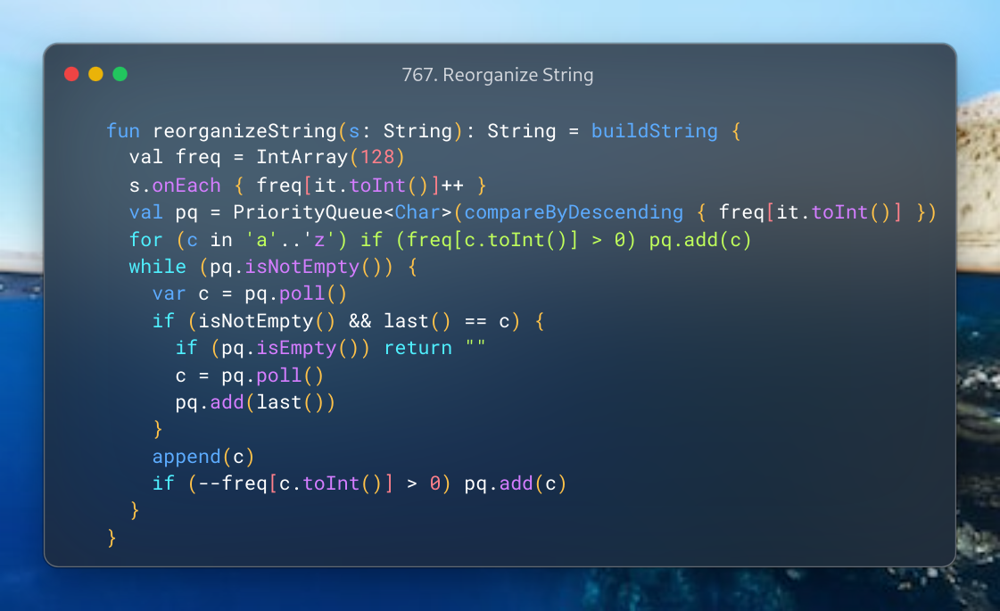

# Kotlin | PriorityQueue

**Author:** SamoylenkoDmitry
**Votes:** 3
**Link:** [https://leetcode.com/problems/reorganize-string/solutions/4242006/](https://leetcode.com/problems/reorganize-string/solutions/4242006/)

---



#### Join me on Telegram

https://t.me/leetcode_daily_unstoppable/391

#### Problem TLDR

Non repeating consequent chars string from another string

#### Intuition

The naive bruteforce solution is to do Depth-First Search and memoization by given current char, previous one and used chars set. It gives TLE, as it takes O(n^3).

Next, use `hint`.

To take chars one by one from the two most frequent we will use a PriorityQueue

#### Approach

* if previous is equal to the current and there is no other chars - we can't make a result
* consider appending in a single point of code to simplify the solution
* use Kotlin's API: `buildString`, `compareByDescending`, `onEach`

#### Complexity

- Time complexity:
$$O(n)$$, assume constant `128log(128)` for a Heap sorting

- Space complexity:
$$O(n)$$

#### Code

```kotlin

    fun reorganizeString(s: String): String = buildString {
      val freq = IntArray(128)
      s.onEach { freq[it.toInt()]++ }
      val pq = PriorityQueue<Char>(compareByDescending { freq[it.toInt()] })
      for (c in 'a'..'z') if (freq[c.toInt()] > 0) pq.add(c)
      while (pq.isNotEmpty()) {
        var c = pq.poll()
        if (isNotEmpty() && last() == c) {
          if (pq.isEmpty()) return ""
          c = pq.poll()
          pq.add(last())
        }
        append(c)
        if (--freq[c.toInt()] > 0) pq.add(c)
      }
    }

```