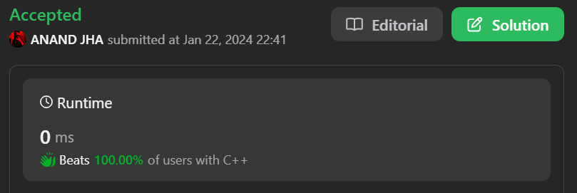

# ✅💯Beats 100.00% of users || Best solution in C++/C#/C || Beginner friendly👍🤝

**Author:** anand18402
**Votes:** 5
**Link:** [https://leetcode.com/problems/jewels-and-stones/solutions/4610280/](https://leetcode.com/problems/jewels-and-stones/solutions/4610280/)

---

# PLEASE DO UPVOTE


# Intuition
<!-- Describe your first thoughts on how to solve this problem. -->
You can simply solve it just by storing the count of the stones and comparing it with jewels and return the sum of it.

# Approach
<!-- Describe your approach to solving the problem. -->
1. create a hashmap in which you will store the count of each stone.
2. Then find the jewels in the hashmap and add the count of that jewel in the variable `sum`.
3. At then end just return the `sum`.

# Complexity
- Time complexity: O(n+m)
<!-- Add your time complexity here, e.g. $$O(n)$$ -->

- Space complexity: O(n)
<!-- Add your space complexity here, e.g. $$O(n)$$ -->

# Code
```C++ []
class Solution {
public:
    int numJewelsInStones(string j, string s) {
        unordered_map<char, int> gems;
        for(int i=0; i<s.size(); i++){
            gems[s[i]]++;
        }
        int sum=0;
        for(auto i: gems){
            if(j.find(i.first) != string::npos) {
                sum += i.second;
            }
        }
        return sum;
    }
};
```
```C# []
class Program {
    static int NumJewelsInStones(string j, string s) {
        int[] gems = new int[256];
        int sum = 0;

        foreach (char stone in s) {
            gems[(int)stone]++;
        }

        foreach (char jewel in j) {
            if (s.Contains(jewel.ToString())) {
                sum += gems[(int)jewel];
            }
        }

        return sum;
    }
```
```C []
int numJewelsInStones(char *j, char *s) {
    int gems[256] = {0};
    int sum = 0;

    for (int i = 0; s[i] != '\\0'; i++) {
        gems[(unsigned char)s[i]]++;
    }

    for (int i = 0; j[i] != '\\0'; i++) {
        if (strchr(s, j[i]) != NULL) {
            sum += gems[(unsigned char)j[i]];
        }
    }

    return sum;
}
```