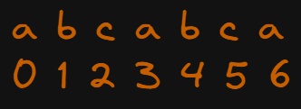
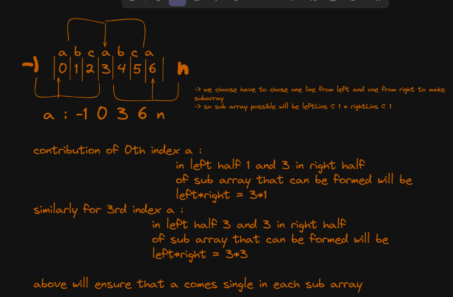

# 🚀 Contribution Technique | 🚀 Easy and Simple Implementation  | runs 100% Faster | cpp

**Author:** mynk28nv
**Votes:** 6
**Link:** [https://leetcode.com/problems/count-unique-characters-of-all-substrings-of-a-given-string/solutions/3926155/](https://leetcode.com/problems/count-unique-characters-of-all-substrings-of-a-given-string/solutions/3926155/)

---

# Intuition
1. we want to count the number of single occuring char in all the substrings .
    eg : characters : cnt: - 3 size {h,t,e} occ single time  

2. here we cant really generate all the sub array and cnt the number of single occuring char. so we will use **Contribution Technique** .

3. So we count for all the characters in string that till how much the frq of char is one 


4. lets cnt for a 
```
cnt += (occ[i][j] - occ[i][j - 1]) * (occ[i][j + 1] - occ[i][j]);

```



# Approach 

1. create a array of vector of 26 size then push -1 first 
2. then for each char from a to z push index so that we can count the subarray it is contributing 
3. then push n at last 

4. use the cnt += (occ[i][j] - occ[i][j - 1]) * (occ[i][j + 1] - occ[i][j]);  to calculate the number of subarray in which it contributes uniquely 

# Complexity
- Time complexity:
    O(26*n)

# Code
```
class Solution {
public:
    int uniqueLetterString(string s) {
        int n = s.size();
        vector<int> occ[26];
        for (int i = 0 ; i < 26; i++) {
            occ[i].push_back(-1);
        }
        for (int i = 0 ; i < n ; i++) {
            occ[s[i] - 'A'].push_back(i);
        }
        for (int i = 0 ; i < 26 ; i++) {
            occ[i].push_back(n);
        }
        int cnt = 0 ;
        // (ontribution technique
        // iterate on char and a_____a_____a
        //                        x     y
        //                  -1 0     i     n
        //             cnt+=  (1*(i)) + (n-i*i)
        for (int i = 0 ; i < 26 ; i++) {
            for (int j = 1 ; j < (occ[i].size() - 1) ; j++) {
                cnt += (occ[i][j] - occ[i][j - 1]) * (occ[i][j + 1] - occ[i][j]);
            }
        }
        return cnt ; 
    }
};
```