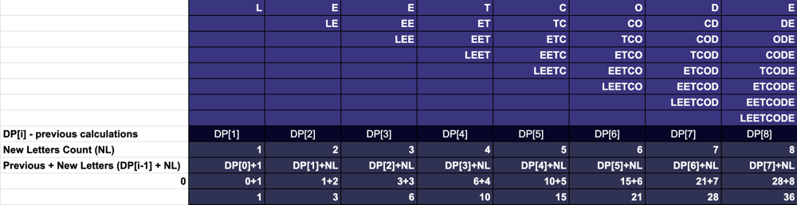
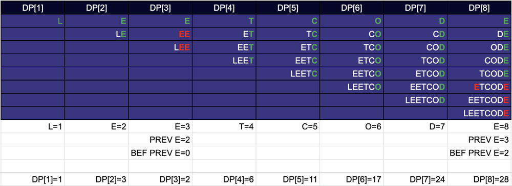

# DP O(N) Graphic Solution with detailed explanation. Kotlin code

**Author:** gektor650
**Votes:** 18
**Link:** [https://leetcode.com/problems/count-unique-characters-of-all-substrings-of-a-given-string/solutions/2053185/](https://leetcode.com/problems/count-unique-characters-of-all-substrings-of-a-given-string/solutions/2053185/)

---

Firstly, let's think how to solve this problem **WITHOUT** the unique chars requirement. 
How we should count **ALL** letters in **all** possible substrings?
In the table below, we can see possible variants and how to count them on the string **LEETCODE**.



Theoretically, we can calculate everything in **one loop**.

For the first iteration (DP[1]) we have only one option: **L**. The length of it is **1**.
For the second we have two options **E** and **LE**. We know that we **have added 2 letters E**, and total amount of letters will be equals to the **previous calculations + new letters amount**. 
The previous is 1, we added 2 letters, so we have **3** for the current step.
For the third combination the formula remains the same: 
**PREVIOUS + NEW LETTERS** (we add **i** letters each step). Let's check it for **3**:
DP=**3**(previous) + **3** (current step) = **6**. 
So the formula is: 
**DP[i] = DP[i - 1] + i** The sum of previous + amoun of new letters.
```
DP[1] = L = 1
DP[2] = E, LE = 1 + 2 = 3
DP[3] = E, EE, LEE = 3 + 3 = 6
DP[4] = T, ET, EET, LEET  = 6 + 4 = 10
DP[5] = C, TC, ETC...., LEETC = 10 + 5 = 15
```
and so on.

Okey, this problem can be easily solved with one loop and addtional array of size *string.size + 1*.

Now, let's think about the **unique letters problem**.
The graphic solution looks like:



Where:
Green - New letters: should be added to the result.
Red - Previously counted and should be subtracted from the result.

It works in the same way, except when we met alread\u0443 added letters.

```
DP[1] = L = 1 //We have never seen L before
DP[2] = E, LE = 1 + 2 = 3 //We have never seen E before
DP[3] = E, EE, LEE = 3 + 3 = 6 - 2 * 2 // We HAVE SEEN E before. The previous amount of "E" was 2.
// For this situation we should remove previous amount multiplied by 2.
// Because we are removing it from current and from previous result. (See in the table, marked RED)
....... // Let's skip the rest, because they don't have non unique chars
DP[7] = 24 // Look at the table
DP[8] = E, DE, ODE, ...., LEETCODE  = 24 + 8 -  (previous * 2 - beforePrevious)
// As we can see from the picture, we should count only 5 new E and remove the one we count on the step 3.
DP[8] = 24 + 8 - (3 * 2 - 2) = 24 + 8 - 4 // (marked red in the table)
DP[8] = 28 // You can count and check it for the last row.
```

So we can improve our formula:

**DP[i] = DP[i - 1] + i - (PREV_CHAR_COUNT * 2 - BEFORE_PREV_CHAR_COUNT)** 

If **we met E once** at row **2** - we will store **PREV_CHAR_COUNT  = 2**
If **we met E the second time** at row **3**: we will store  **PREV_CHAR_COUNT  =  3**, **BEFORE_PREV_CHAR_COUNT = 2**

So we should store TWO latest positions when we met this char before now.

To **store** it we can use something like a **HashMap<Char, Int>** 
Or if we have limited amount of Chars (A-Z) we can use an  **IntArray** with size of chats count.

The final solution looks like:

```
class Solution {
    fun uniqueLetterString(s: String): Int {
        val previousStore = IntArray(28)
        val beforePreviousStore = IntArray(28)
        
        val dp = IntArray(s.length + 1)
        var sum = 0
        for (i in 1 .. s.length) {
            var ch = s[i-1]
            dp[i] = dp[i-1] + i
            
            val previous = previousStore[ch - 'A']
            val beforePrevious = beforePreviousStore[ch - 'A']
            
            dp[i] -= previous * 2 - beforePrevious
            
            beforePreviousStore[ch - 'A'] = previous
            previousStore[ch - 'A'] = i
            
            sum += dp[i]
        }
        return sum
    }
}
```