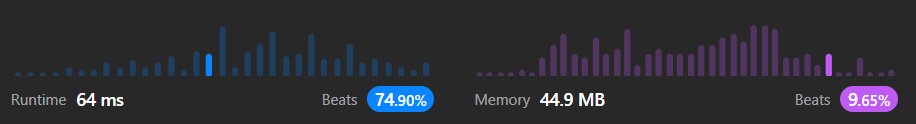

# Easy 🔥 & explained code with comments || Beats 74.90%

**Author:** Atanu_200
**Votes:** 4
**Link:** [https://leetcode.com/problems/buddy-strings/solutions/3712741/](https://leetcode.com/problems/buddy-strings/solutions/3712741/)

---

# Intuition
This easy problem is solved by normal char checking in both the `source` string and the `goal` string

# Approach
1. First & basic test case is if the strings lengths are not same then there is no possibility for getting same string after swapping also so return `false`.
2. Store the indexes of the different characters from `s` and `goal` in an array `diffCharsInd`.
3. If the length of `diffCharsInd` array is 2 means we found 2 different characters then check that if you swap the character then are you getting the same strings like `s === goal` or not, if yes then return `true`.
4. But if you got `0` different characters but as per the Problem-statement, suppose the test-case is `s => "aa" & goal => "aa"`
we should get `true` as ans because here we can swap and get same strings, for this corner case what you can do is, create a 'Set' and check if you are getting the size of the Set is less then the original `s` string that means we have some duplicate characters in the `s` it self and that's where we can return `true`
5. For all the other cases the ans will be `false`.




> IF YOU FIND IT HELPFUL, GIVE IT A `UPVOTE \u2B06` SO THAT OTHER PEOPLES CAN ALSO FIND IT EASILY, THANK YOU FOR YOUR TIME \u231A

# Complexity
- Time complexity: $$O(n)$$
- Space complexity: $$O(n)$$
    - Where `n` is the length of smallest string between `s` and `goal`

# Javascript Code
```javascript
function buddyStrings(s, goal): boolean {
    // If the strings doesn't have same length
    // then there is no possibility for getting same string after swapping also 
    if (s.length !== goal.length) return false;

    // push the indexes of the different characters
    let diffCharsInd = [];

    // go through the `s` & `goal` string and get the different character's indexes;
    for (let i = 0; i < s.length; i++) {
        if (s[i] !== goal[i]) diffCharsInd.push(i);
    }


    if (diffCharsInd.length === 0) {
        const set = new Set(s)
        // if any duplicate characters present in 's';
        // example test-case: s => 'aa' & goal => 'aa'
        if (set.size < s.length) return true;
    } else if (diffCharsInd.length == 2) {
        // if number fo different charaters are 2 and the characters in 
        // different indexes will match after swapping then only return true
        const [x, y] = diffCharsInd;
        if (s[x] === goal[y] && s[y] === goal[x]) return true;
    }

    return false;
};
```


# Typescript Code
```typescript
function buddyStrings(s: string, goal: string): boolean {
    // If the strings doesn't have same length
    // then there is no possibility for getting same string after swapping also 
    if (s.length !== goal.length) return false;

    // push the indexes of the different characters
    let diffCharsInd: number[] = [];

    // go through the `s` & `goal` string and get the different character's indexes;
    for (let i: number = 0; i < s.length; i++) {
        if (s[i] !== goal[i]) diffCharsInd.push(i);
    }


    if (diffCharsInd.length === 0) {
        const set = new Set(s)
        // if any duplicate characters present in 's';
        // example test-case: s => 'aa' & goal => 'aa'
        if (set.size < s.length) return true;
    } else if (diffCharsInd.length == 2) {
        // if number fo different charaters are 2 and the characters in 
        // different indexes will match after swapping then only return true
        const [x, y] = diffCharsInd;
        if (s[x] === goal[y] && s[y] === goal[x]) return true;
    }

    return false;
};
```