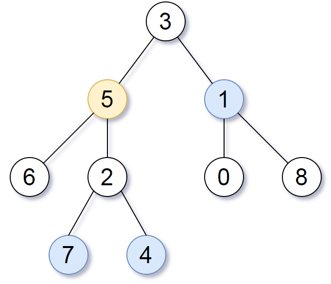

# [863. All Nodes Distance K in Binary Tree](https://leetcode.com/problems/all-nodes-distance-k-in-binary-tree/)

| Category | Difficulty | Likes | Dislikes |
| :------: | :--------: | :---: | :------: |
| Algorithms | Medium | 11954 | 272 |

**Tags:** [`hash-table`](https://leetcode.com/tag/hash-table), [`tree`](https://leetcode.com/tag/tree), [`depth-first-search`](https://leetcode.com/tag/depth-first-search), [`breadth-first-search`](https://leetcode.com/tag/breadth-first-search), [`binary-tree`](https://leetcode.com/tag/binary-tree)

**Companies:** `facebook`, `amazon`, `microsoft`, `okta`, `google`, `salesforce`, `tiktok`, `walmart-labs`, `apple`, `wix`

## Description

Given the `root` of a binary tree, the value of a target node `target`, and an integer `k`, return *an array of the values of all nodes that have a distance *`k`* from the target node.*

You can return the answer in **any order**.

 

**Example 1:**


```

Input: root = [3,5,1,6,2,0,8,null,null,7,4], target = 5, k = 2
Output: [7,4,1]
Explanation: The nodes that are a distance 2 from the target node (with value 5) have values 7, 4, and 1.

```

**Example 2:**

```

Input: root = [1], target = 1, k = 3
Output: []

```

 

**Constraints:**

	- The number of nodes in the tree is in the range `[1, 500]`.

	- `0 <= Node.val <= 500`

	- All the values `Node.val` are **unique**.

	- `target` is the value of one of the nodes in the tree.

	- `0 <= k <= 1000`

---

**Links:** [Submissions](https://leetcode.com/problems/all-nodes-distance-k-in-binary-tree/) | [Solutions](https://leetcode.com/problems/all-nodes-distance-k-in-binary-tree/)
