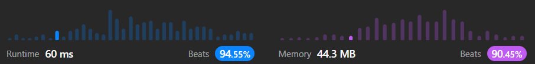

# Easy Graph 🕸 solution || explanatory comments || Beats 94.55% in runtime || Beats 90.45% in memory

**Author:** Atanu_200
**Votes:** 4
**Link:** [https://leetcode.com/problems/all-nodes-distance-k-in-binary-tree/solutions/3750423/](https://leetcode.com/problems/all-nodes-distance-k-in-binary-tree/solutions/3750423/)

---

## Intuition

The intuition behind the solution is to create a graph of all the nodes in the binary tree, where each node is connected to its parent and its children. This allows us to easily traverse the graph and find all the nodes that are at a distance of `k` from the target node.

## Approach

The approach is as follows:

1. Create a graph of all the nodes in the binary tree.
2. Traverse the graph and find all the nodes that are at a distance of `k` from the target node.
3. Return the node values of all the nodes found in the previous step.

## TC & SC

The time complexity of the solution is $$O(N)$$, where `N` is the number of nodes in the binary tree. The space complexity of the solution is $$O(N)$$, where `N` is the number of nodes in the graph.




# Javascript Code
```javascript
/**
 * Definition for a binary tree node.
 * function TreeNode(val) {
 *     this.val = val;
 *     this.left = this.right = null;
 * }
 */
/**
 * @param {TreeNode} root
 * @param {TreeNode} target
 * @param {number} k
 * @return {number[]}
 */
var distanceK = function (root, target, k) {
    if (!root) return null;
    if (k === 0) return [target.val]
    // create a new graph
    const graph = new Map();
    graph.set(root.val, [])
    // create the bi-directional connections via traversing the tree
    preOrder(root, graph)
    // console.log({ graph })

    const elemsWithDistK = [];
    const visited = new Set();
    // traverse the graph and collect the node values with k distance from target
    graphTraversal(graph, target.val, k, visited, elemsWithDistK)
    // get only distinct node values
    const tempSet = new Set(elemsWithDistK)

    return [...tempSet];
};

function graphTraversal(graph, root, k, visited, elemsWithDistK) {
    if (k < 0 || visited.has(root)) return;

    // console.log({ root, k, visited, elemsWithDistK })

    if (k === 0) {
        elemsWithDistK.push(root);
        return;
    }

    visited.add(root)

    for (let node of graph.get(root)) {
        graphTraversal(graph, node, k - 1, visited, elemsWithDistK)
    }
}

function preOrder(root, graph) {
    if (!root) return;

    if (root.left) {
        graph.get(root.val).push(root.left.val);
        graph.set(root.left.val, [root.val]);
    }
    if (root.right) {
        graph.get(root.val).push(root.right.val);
        graph.set(root.right.val, [root.val]);
    }


    preOrder(root.left, graph);
    preOrder(root.right, graph);
}
```

---

# Typescript Code
```typescript

/**
 * Definition for a binary tree node.
 * class TreeNode {
 *     val: number
 *     left: TreeNode | null
 *     right: TreeNode | null
 *     constructor(val?: number, left?: TreeNode | null, right?: TreeNode | null) {
 *         this.val = (val===undefined ? 0 : val)
 *         this.left = (left===undefined ? null : left)
 *         this.right = (right===undefined ? null : right)
 *     }
 * }
 */

function distanceK(root: TreeNode | null, target: TreeNode | null, k: number): number[] {
    if (!root) return null;
    if (k === 0) return [target.val]
    // create a new graph
    const graph = new Map<number, number[]>();
    graph.set(root.val, [])
    // create the bi-directional connections via traversing the tree
    preOrder(root, graph)

    const elemsWithDistK: Array<number> = [];
    const visited = new Set<number>();
    // traverse the graph and collect the node values with k distance from target
    graphTraversal(graph, target.val, k, visited, elemsWithDistK)
    // get only distinct node values
    const tempSet = new Set(elemsWithDistK)

    return [...tempSet];
};

function graphTraversal(graph: Map<number, number[]>, root: number, k: number, visited: Set<number>, elemsWithDistK: Array<number>): undefined {
    if (k < 0 || visited.has(root)) return;


    if (k === 0) {
        elemsWithDistK.push(root);
        return;
    }

    visited.add(root)

    for (let node of graph.get(root)) {
        graphTraversal(graph, node, k - 1, visited, elemsWithDistK)
    }
}

function preOrder(root: TreeNode, graph: Map<number, number[]>): void {
    if (!root) return;

    if (root.left) {
        graph.get(root.val).push(root.left.val);
        graph.set(root.left.val, [root.val]);
    }
    if (root.right) {
        graph.get(root.val).push(root.right.val);
        graph.set(root.right.val, [root.val]);
    }


    preOrder(root.left, graph);
    preOrder(root.right, graph);
}

```