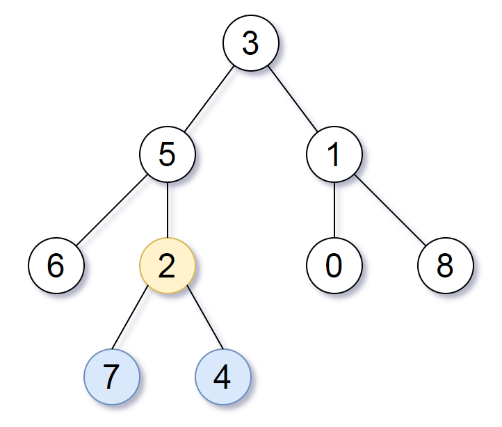

# [865. Smallest Subtree with all the Deepest Nodes](https://leetcode.com/problems/smallest-subtree-with-all-the-deepest-nodes/)

| Category | Difficulty | Likes | Dislikes |
| :------: | :--------: | :---: | :------: |
| Algorithms | Medium | 2815 | 383 |

**Tags:** [`hash-table`](https://leetcode.com/tag/hash-table), [`tree`](https://leetcode.com/tag/tree), [`depth-first-search`](https://leetcode.com/tag/depth-first-search), [`breadth-first-search`](https://leetcode.com/tag/breadth-first-search), [`binary-tree`](https://leetcode.com/tag/binary-tree)

**Companies:** `facebook`

## Description

Given the `root` of a binary tree, the depth of each node is **the shortest distance to the root**.

Return *the smallest subtree* such that it contains **all the deepest nodes** in the original tree.

A node is called **the deepest** if it has the largest depth possible among any node in the entire tree.

The **subtree** of a node is a tree consisting of that node, plus the set of all descendants of that node.

 

**Example 1:**


```

Input: root = [3,5,1,6,2,0,8,null,null,7,4]
Output: [2,7,4]
Explanation: We return the node with value 2, colored in yellow in the diagram.
The nodes coloured in blue are the deepest nodes of the tree.
Notice that nodes 5, 3 and 2 contain the deepest nodes in the tree but node 2 is the smallest subtree among them, so we return it.

```

**Example 2:**

```

Input: root = [1]
Output: [1]
Explanation: The root is the deepest node in the tree.

```

**Example 3:**

```

Input: root = [0,1,3,null,2]
Output: [2]
Explanation: The deepest node in the tree is 2, the valid subtrees are the subtrees of nodes 2, 1 and 0 but the subtree of node 2 is the smallest.

```

 

**Constraints:**

	- The number of nodes in the tree will be in the range `[1, 500]`.

	- `0 https://leetcode.com/problems/lowest-common-ancestor-of-deepest-leaves/

---

**Links:** [Submissions](https://leetcode.com/problems/smallest-subtree-with-all-the-deepest-nodes/) | [Solutions](https://leetcode.com/problems/smallest-subtree-with-all-the-deepest-nodes/)
