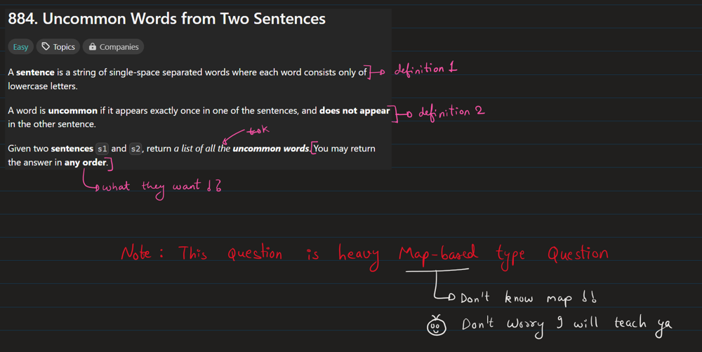
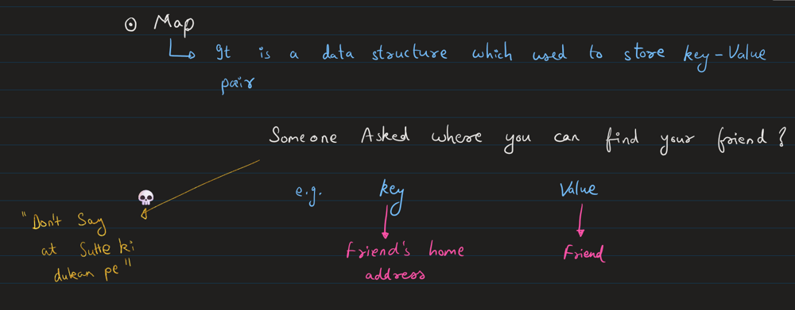
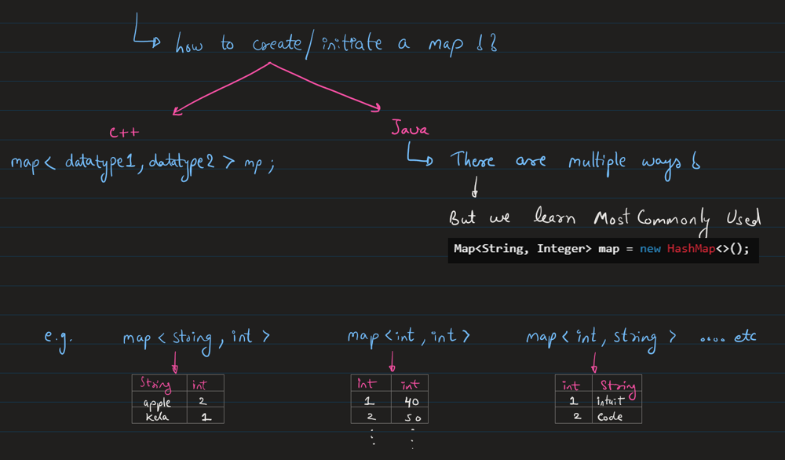
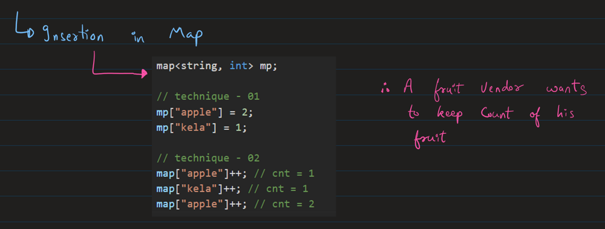
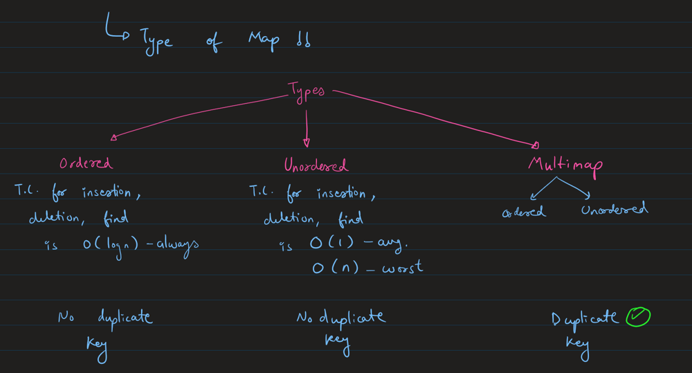
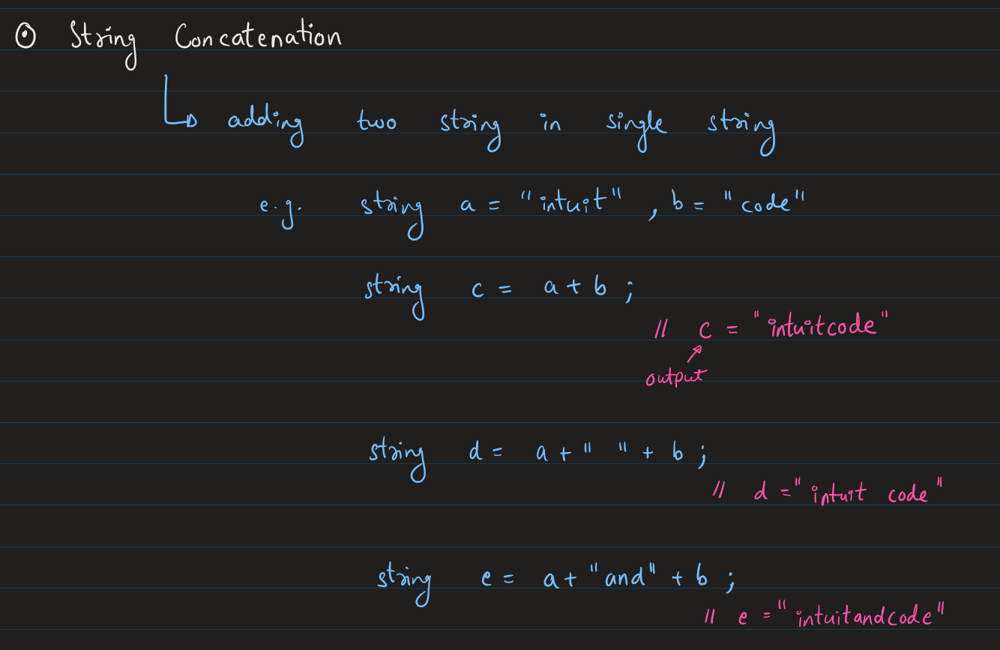
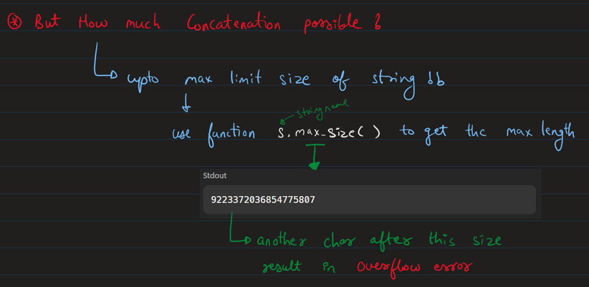
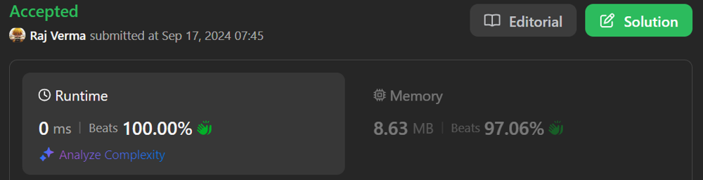
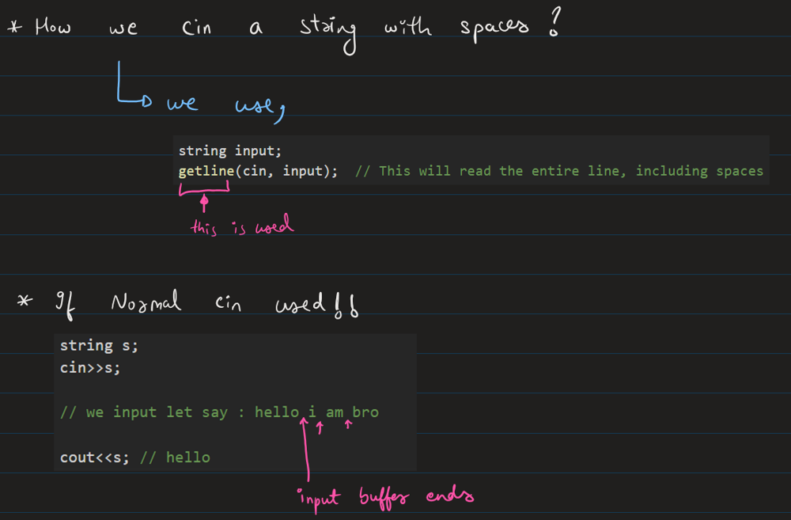
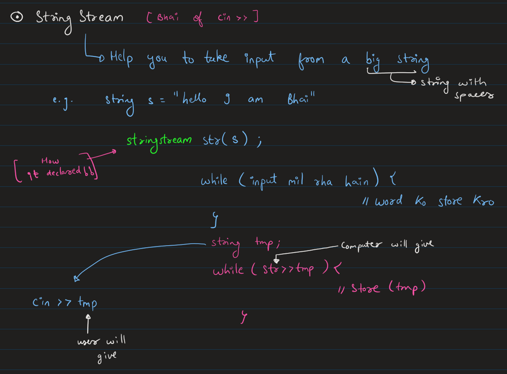

# Bhai of cin -> stringstream + Full Map Concept, Chalo aao smjhe [ Beats 100% ]

**Author:** Rarma
**Votes:** 79
**Link:** [https://leetcode.com/problems/uncommon-words-from-two-sentences/solutions/5797112/](https://leetcode.com/problems/uncommon-words-from-two-sentences/solutions/5797112/)

---

# Youtube Explanation 
Will Soon to be on Youtube Channel : https://www.youtube.com/@Intuit_and_Code
Edited:
> Start Points,
For Beginner : 00:00
For Non-StringStream Concept : 10:53
For StringString Concept : 18:51

https://youtu.be/nrSDo-l_vZg?si=iDCoL-YSFnwNDADJ

# Intuition & Approach
> Jump on whichever Section You need to Learn, as it include beginner's Concepts











# Code - 01 [ Without String-Stream ]
``` C++ []
class Solution {
public:
    vector<string> uncommonFromSentences(string s1, string s2) {
        // we need to find unique occurences
        string s = s1 + " " + s2;

        cout<<s1.max_size();

        // store all words from s
        unordered_map<string,int> um;
        string tmp="";
        for(auto& val : s){ // similar to, i=0;i<s.size();i++
            if(val == ' '){
                um[tmp]++;
                tmp = "";
            }
            else{
                tmp += val; // denotes, val = s[i]
            }
        }
        
        // condition needed if empty string allowed
        if(tmp != ""){
            um[tmp]++;
            tmp = "";
        }

        // check unique means single count
        vector<string> ans;
        for(auto& val:um){ // auto it=um.begin();it<um.end();it++

            // val.first = apple, val.second = 2

            if(val.second==1){
                ans.emplace_back(val.first); // can use push_back also                
            }

        }

        return ans;
    }
};
```
``` java []
public List<String> uncommonFromSentences(String s1, String s2) {
        // Concatenate both sentences with a space
        String s = s1 + " " + s2;
        
        // Create a map to store the word counts
        Map<String, Integer> wordCount = new HashMap<>();
        
        // Split the combined string into words
        String[] words = s.split(" ");
        
        // Count the occurrences of each word
        for (String word : words) {
            wordCount.put(word, wordCount.getOrDefault(word, 0) + 1);
        }
        
        // Create a list to store the uncommon words (those with a count of 1)
        List<String> result = new ArrayList<>();
        
        for (Map.Entry<String, Integer> entry : wordCount.entrySet()) {
            if (entry.getValue() == 1) {
                result.add(entry.getKey());
            }
        }
        
        return result;
    }
```
# Why and How Using stringstream help ?



# Complexity
- Time complexity:O(n)
<!-- Add your time complexity here, e.g. $$O(n)$$ -->

- Space complexity:O(n)
<!-- Add your space complexity here, e.g. $$O(n)$$ -->

# Code
```cpp []
class Solution {
public:
    vector<string> uncommonFromSentences(string s1, string s2) {
        // we need to find unique occurences
        string s = s1 + " " + s2 + " ";
        stringstream str(s);

        cout<<s1.max_size();

        // store all words from s
        unordered_map<string,int> um;
        string tmp;
        while(str>>tmp){
            um[tmp]++;
        }

        // check unique means single count
        vector<string> ans;
        for(auto& val:um){ // auto it=um.begin();it<um.end();it++

            // val.first = apple, val.second = 2

            if(val.second==1){
                ans.emplace_back(val.first); // can use push_back also                
            }

        }

        return ans;
    }
};
```
``` java []
class Solution {
    public List<String> uncommonFromSentences(String s1, String s2) {
        // Concatenate both sentences with a space
        String s = s1 + " " + s2;
        
        // Create a map to store the word counts
        Map<String, Integer> wordCount = new HashMap<>();
        
        // Split the combined string into words
        String[] words = s.split(" ");
        
        // Count the occurrences of each word
        for (String word : words) {
            wordCount.put(word, wordCount.getOrDefault(word, 0) + 1);
        }
        
        // Create a list to store the uncommon words (those with a count of 1)
        List<String> result = new ArrayList<>();
        
        for (Map.Entry<String, Integer> entry : wordCount.entrySet()) {
            if (entry.getValue() == 1) {
                result.add(entry.getKey());
            }
        }
        
        return result;
    }
```
> Sadly Can't Think of any Brute-Force Today !! \uD83E\uDD72
