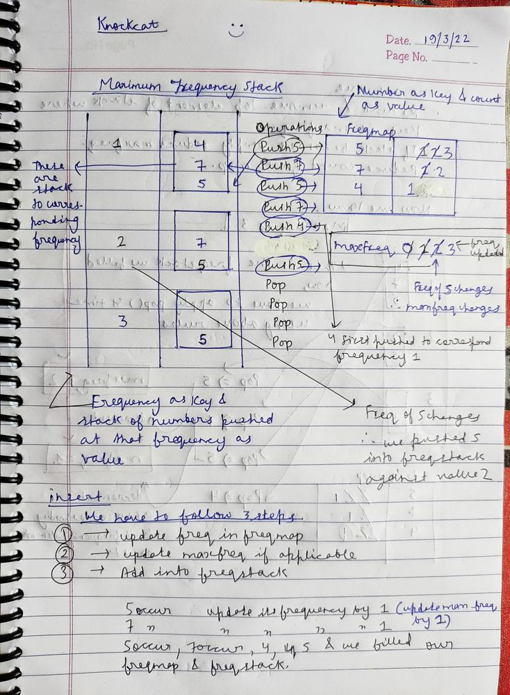
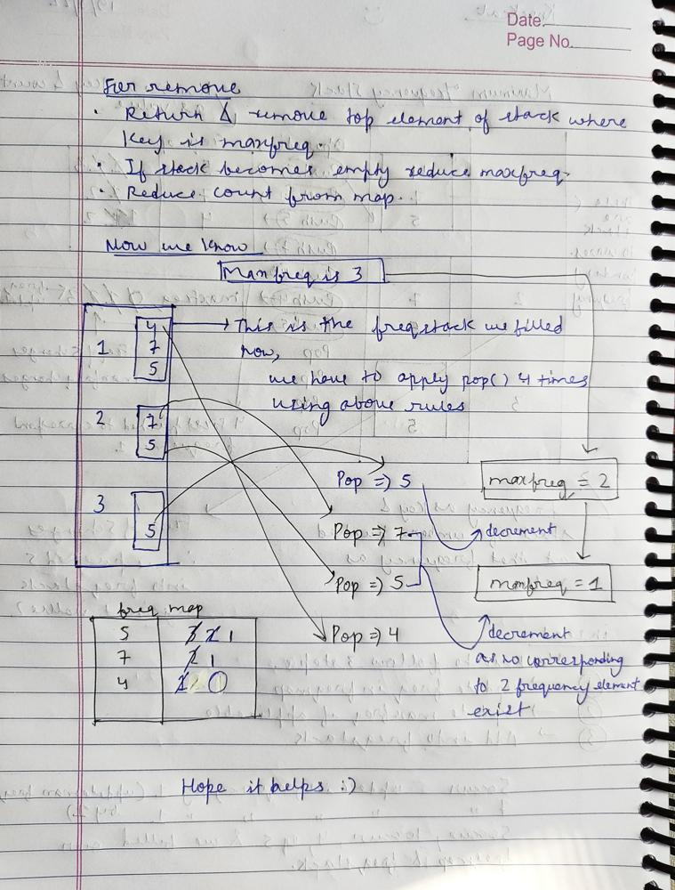

# ✅ C++ || Explained With Algorithm || HashMap

**Author:** knockcat
**Votes:** 34
**Link:** [https://leetcode.com/problems/maximum-frequency-stack/solutions/1862055/](https://leetcode.com/problems/maximum-frequency-stack/solutions/1862055/)

---

# 895. Maximum Frequency Stack
**KNOCKCAT**

```
1. Easy C++
2. Line by Line Explanation with Comments.
3. Detailed Explanation \u2705
4. Map for frequcency and another map for mapping same frequncy in one group.
5. Please Upvote if it helps\u2B06\uFE0F
6. Link to my Github Profile contains a repository of Leetcode with all my Solutions. \u2B07\uFE0F
	// \uD83D\uDE09If you Like the repository don't foget to star & fork the repository\uD83D\uDE09
```
``` ```
[LeetCode](http://github.com/knockcat/Leetcode) **LINK TO LEETCODE REPOSITORY**
``` ```
Please upvote my comment so that i get to win the 2022 giveaway and motivate to make such discussion post.
**Happy new Year 2023 to all of you**
**keep solving keep improving**
Link To comment
[Leetcode Give away comment](https://leetcode.com/discuss/general-discussion/2946993/2022-Annual-Badge-and-the-Giveaway/1734919)

**ALGORITHM**
1. **We will maintain 2 HashMap**, one is **frequency map** which **map elements to their frequencies.**
2. And, **setMap** which **maps all the element with same frequency in one group (stack).**
3. We have to **implement 3 functions,**
	```
	FreqStack() 
	{
            // constructor for initialisation
    } // but i have defined map globally
	```
	```
	void push(int val) 
	{
			// for insert
	}
	```
	```
	int pop()
	{
			// for removing & then return the top
	}
	```
4. **push**(int **val**) : 
	1. **map the element** (val) **with frequency hashmap** and **update the freq variable**( which is **holding minimum frequency till now**). 
	2.**setMap** **maintains a stack**  which c**ontains all the elements with same frequency**.
5. **pop():**
	1. **get the maximum element** **from the setmap** and **then decrement the frequency of popped element.**
	2. **After poping** if the **stack becomes empty** then **decrement the max frequency.**
``` ```

**DRY RUN**






``` ```
**CODE WITH EXPLANATION**
```
				// \uD83D\uDE09\uD83D\uDE09\uD83D\uDE09\uD83D\uDE09Please upvote if it helps \uD83D\uDE09\uD83D\uDE09\uD83D\uDE09\uD83D\uDE09
class FreqStack {
public:
    // freqMap is to map element to its frequency
    map<int,int> freqMap;
    
    // set map is to map frequency to the
    // element list with this frequency
    map<int,stack<int> > setMap;
    
    // for keeping record of maximum frequency
    int maxfreq = 0;
    
    FreqStack() {
            // KNOCKCAT
    }
    
    // insert
    void push(int val) {
        // frequency of x
        int freq = freqMap[val] + 1;
        
        // Mapping of x with its frequency
        freqMap[val] = freq;
        
        // if freq is greater than maxfreq
        // update max freq
        if(freq > maxfreq)
            maxfreq = freq;
        
        // Mapping element to  its frequency list
        setMap[freq].push(val);
    }
    
    
    // remove
    int pop() {
        // remove element from setMap
        // from maximum frequency list
        int top = setMap[maxfreq].top();
        setMap[maxfreq].pop();
        
        // decrement the frequcy of the popped element
        --freqMap[top];
        
        // if whole list popped decrement the max freq
        if(setMap[maxfreq].size() == 0)
            --maxfreq;
        return top;
    }
};
