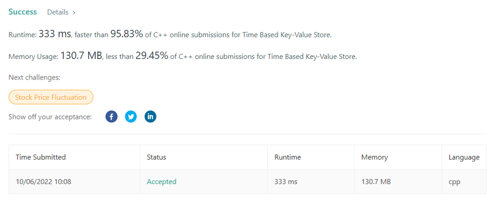

# Time Based Key-Value Store || 95.83% FASTER || 3 LINE C++CODE || RUNTIME: 333 ms

**Author:** shivambit
**Votes:** 24
**Link:** [https://leetcode.com/problems/time-based-key-value-store/solutions/2667042/](https://leetcode.com/problems/time-based-key-value-store/solutions/2667042/)

---

**SHIVAM DAILY LEETCODE SOLUTIONS || CHECK : [https://bit.ly/leetcode-solutions](https://bit.ly/leetcode-solutions)
Runtime: 333 ms, faster than 95.83% of C++ online submissions for Time Based Key-Value Store.
Memory Usage: 130.7 MB, less than 29.45% of C++ online submissions for Time Based Key-Value Store.**

```
class TimeMap {
public:
    unordered_map<string,map<int,string>>m;
    TimeMap() {
        
    }
    
    void set(string key, string value, int timestamp) {
        m[key][timestamp]=value;
    }
    
    string get(string key, int timestamp) {
        auto it=m[key].upper_bound(timestamp);
        if(it==m[key].begin())return "";
        it--;
        return it->second;
    }
};
```


