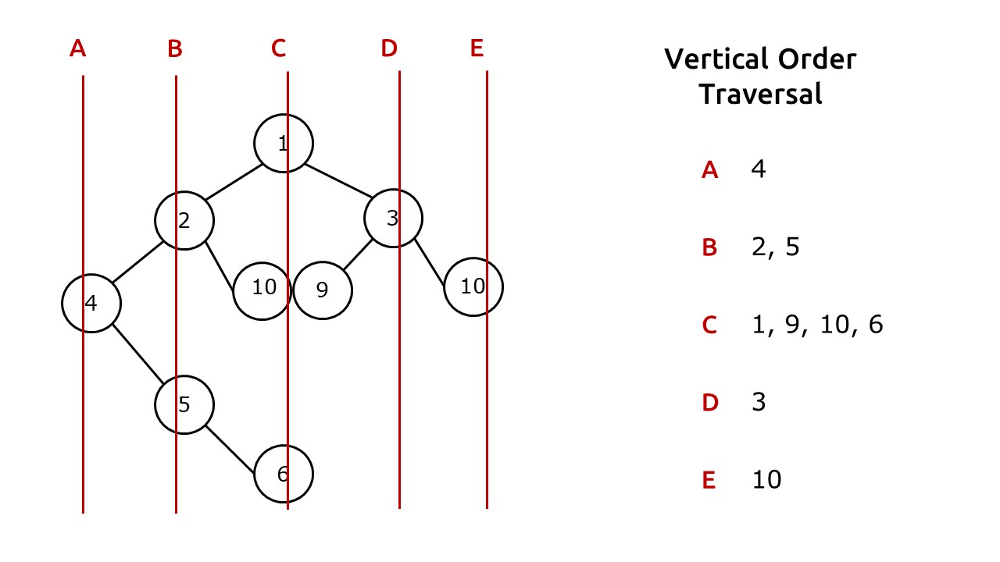

# C++ | BFS/Multiset | Striver Method ✅

**Author:** prantik0128
**Votes:** 57
**Link:** [https://leetcode.com/problems/vertical-order-traversal-of-a-binary-tree/solutions/2527032/](https://leetcode.com/problems/vertical-order-traversal-of-a-binary-tree/solutions/2527032/)

---

**Knowledge Credits**: TakeUForward(Aka **Striver**)

**Intuition:**
* We firstly need to assign **vertical** and **level** to every node.
* After we complete the assigning part then we need to figure out how can we store them in a suitable **Data Structure.**
* The data structure should give us the nodes with **left-side vertical first** and in every vertical, top-level **node** should appear **first**.


**Visualization of how the vertical lines passing through the nodes will look like:**

**Approach:**
* We will perform a **tree traversal** and assign a **vertical** and **level** to every node. 
* Based on this vertical and node, we store the node in our **special** data structure that we are gonna create. 
* For easy understanding, let's break it into **three** steps:

**Step-1:** **Vertical and Level Assign to every node:**
* We are going to use **level** order traversal, initially we will push the **root** in the queue and also two more variables one for **vertical** and the other for **level**, both intialized with **0**.
* Whenever we push the **left child** we are going to decrease the **vertical** by one and increase level by 1 and in the case of **right child** we are going to increase both the vertical and level both by 1.

**Step-2: Storing Verticals and Levels to our Data Structure:**
* We require a data structure that can store nodes according to their vertical value and give us the nodes of least values first. 
* Hence we will use a **map** as it satisfies both criterias.
* Lastly for every level, we need a data-structure which can store node values in a **sorted** order. 
* Moreover, as **duplicate** values are allowed in our tree, our data structure needs to handle this well. This is acheived by using **multiset** in C++
How the data structure will look like --> **map<int,map<int,multiset<int>>> mp;**

**Step-3: Finally just print the vertical order traversal from the data structure that we have built:**
* Just iterate over our verticals by using the data structure that we created. 
* In every iteration, we take a **list**(to store all nodes of that vertical) and again iterate over the levels. We then push the nodes of the level (stored in the multiset/priority queue) and push it to our vertical list. 
* Once we iterate over all verticals we get our vertical order traversal.
```
class Solution {
public:
    vector<vector<int>> verticalTraversal(TreeNode* root) {
        map<int,map<int,multiset<int>>> mp;
        queue<pair<TreeNode*,pair<int,int>>> q;
        q.push({root,{0,0}});
        while(!q.empty()){
            auto p = q.front();
            q.pop();
            TreeNode* node = p.first;
            int x = p.second.first, y = p.second.second;
            mp[x][y].insert(node->val);
            if(node->left){
                q.push({node->left,{x-1,y+1}});
            }
            if(node->right){
                q.push({node->right,{x+1,y+1}});
            }
        }
        vector<vector<int>> ans;
        for(auto q:mp){
            vector<int> col;
            for(auto p:q.second){
                col.insert(col.end(),p.second.begin(),p.second.end());
            }
            ans.push_back(col);
        }
        return ans;
    }
};
```
****
**Time Complexity: O(N*logN*logN*logN)
Space Complexity: O(N)**
****