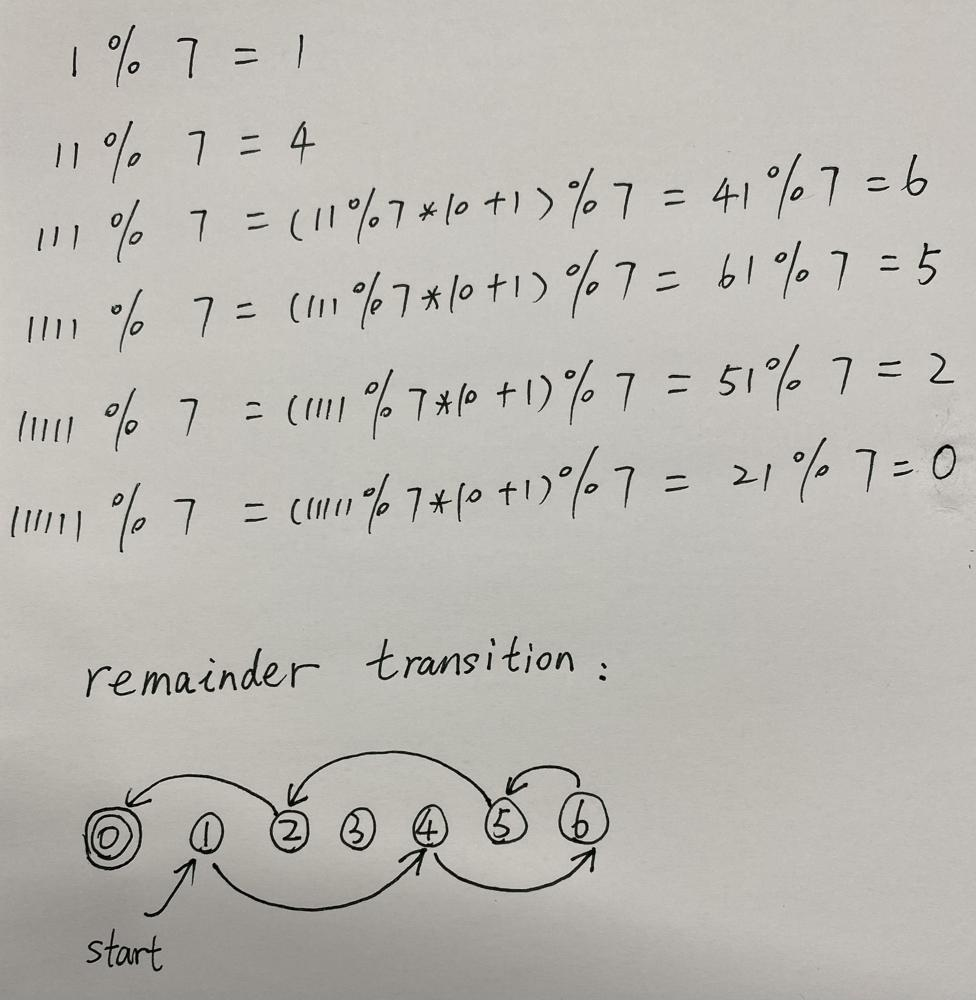
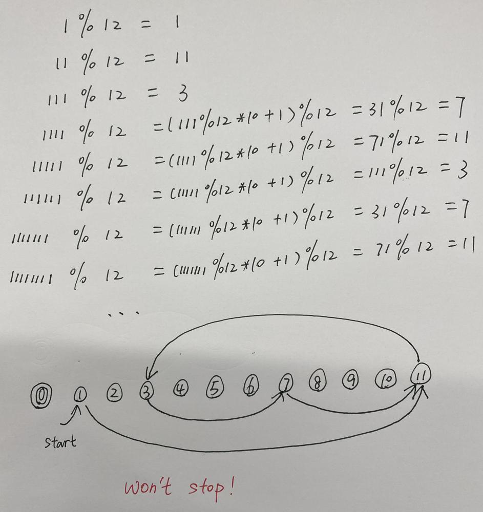

# ✅ [C++/Java/Python] 5 lines || Image Explain || Beginner Friendly

**Author:** linfq
**Votes:** 80
**Link:** [https://leetcode.com/problems/smallest-integer-divisible-by-k/solutions/1655732/](https://leetcode.com/problems/smallest-integer-divisible-by-k/solutions/1655732/)

---

**PLEASE UPVOTE if you like** \uD83D\uDE01 **If you have any question, feel free to ask.** 
* Inspired by the Theorem
	* A fraction is either a finite decimal or an infinite loop decimal
		* 3 / 5 = 0.6
		* 2 / 7. = 0.**285714** 285714 2857...
	* Furthermore the length of the loop does not exceed the denominator.
		* because 0 <= remainder < denominator
* Different from appending 0 to continue dividing when the fraction has a remainder, we append 1. But the state transition of remainder and divisor is similar.
	* **once the remainder repeats, in other word the loop starts that means it cannot be divisible**.
* `if k % 2 == 0 or k % 5 == 0: return -1` trick can save a little time
* when we code, we can either stop at repeated remainder or stop after k transfers.
	* stop at repeated remainder, we need to record the previous remainders, so the Space Complexity is O(k), but can save a little time
	* stop after k transfers, we can reduce the **Space Complexity to O(1)**
	* **Time Complexity** of both solutions above is **O(k)**, because 0 <= remainder < k, according to the **Pigeonhole Theorem**
	
* It may be better to understand this problem from the perspective of state transition
	* we directly define the remainder as the state
	* The stop condition is that the remainder is 0, so 0 is the stop state.
	* `k = 7` can stop after 6 transfers, so we `return 6`

		

	* `k = 12` enters the loop and won't stop, so we `return -1`

		


```
Time  Complexity:O(k)
Space Complexity:O(k)
```

**Python**
```
class Solution(object):
    def smallestRepunitDivByK(self, k):
        # if k % 2 == 0 or k % 5 == 0: return -1  # this trick may save a little time
        hit, n, ans = [False] * k, 0, 0
        while True:  # at most k times, because 0 <= remainder < k
            ans, n = ans + 1, (n * 10 + 1) % k  # we only focus on whether to divide, so we only need to keep the remainder.
            if n == 0: return ans  # can be divisible
            if hit[n]: return -1  # the remainder of the division repeats, so it starts to loop that means it cannot be divisible.
            hit[n] = True
```
**C++**
```
class Solution {
public:
    int smallestRepunitDivByK(int k) {
        // if (k % 2 == 0 || k % 5 == 0) return -1;  // this trick may save a little time
        int n = 0, ans = 0;
        bool *hit = new bool[k];     
        for (int i = 0; i < k; i ++) hit[i] = false;
        while (true) { // at most k times, because 0 <= remainder < k
            ++ ans;
            n = (n * 10 + 1) % k; // we only focus on whether to divide, so we only need to keep the remainder.
            if (n == 0) return ans; // can be divisible
            if (hit[n]) return -1; // the remainder of the division repeats, so it starts to loop that means it cannot be divisible.
            hit[n] = true;
        }
    }
};
```
**Java**
```
class Solution {
    public int smallestRepunitDivByK(int k) {
        // if (k % 2 == 0 || k % 5 == 0) return -1;  // this trick may save a little time
        boolean[] hit = new boolean[k];
        int n = 0, ans = 0;
        while (true) { // at most k times, because 0 <= remainder < k
            ++ ans;
            n = (n * 10 + 1) % k; // we only focus on whether to divide, so we only need to keep the remainder.
            if (n == 0) return ans; // can be divisible
            if (hit[n]) return -1; // the remainder of the division repeats, so it starts to loop that means it cannot be divisible.
            hit[n] = true;
        }
    }
}
```


```
Time  Complexity:O(k)
Space Complexity:O(1)
```

**Python**
```
class Solution(object):
    def smallestRepunitDivByK(self, k):
        # if k % 2 == 0 or k % 5 == 0: return -1  # this trick may save a little time
        n = 0
        for i in range(k):  # at most k times, because 0 <= remainder < k
            n = (n * 10 + 1) % k  # we only focus on whether to divide, so we only need to keep the remainder.
            if n == 0: return i + 1  # i started from 0, so before return it should be added 1
        return -1  # If it had not stop after k transfers, it must enter the loop, and it won't stop.
```
**C++**
```
class Solution {
public:
    int smallestRepunitDivByK(int k) {
		// if (k % 2 == 0 || k % 5 == 0) return -1;  // this trick may save a little time
        int n = 0;
        for (int i = 0; i < k; i++) { // at most k times, because 0 <= remainder < k
            n = (n * 10 + 1) % k; // we only focus on whether to divide, so we only need to keep the remainder.
            if (n == 0) return i + 1; // i started from 0, so before return it should be added 1
        }
        return -1; // If it had not stop after k transfers, it must enter the loop, and it won't stop.
    }
};
```
**Java**
```
class Solution {
    public int smallestRepunitDivByK(int k) {
		// if (k % 2 == 0 || k % 5 == 0) return -1;  // this trick may save a little time
        int n = 0;
        for (int i = 0; i < k; i ++) { // at most k times, because 0 <= remainder < k
            n = (n * 10 + 1) % k; // we only focus on whether to divide, so we only need to keep the remainder.
            if (n == 0) return i + 1; // i started from 0, so before return it should be added 1
        }
        return -1; // If it had not stop after k transfers, it must enter the loop, and it won't stop.
    }
}
```

**PLEASE UPVOTE if you like** \uD83D\uDE01 **If you have any question, feel free to ask.**