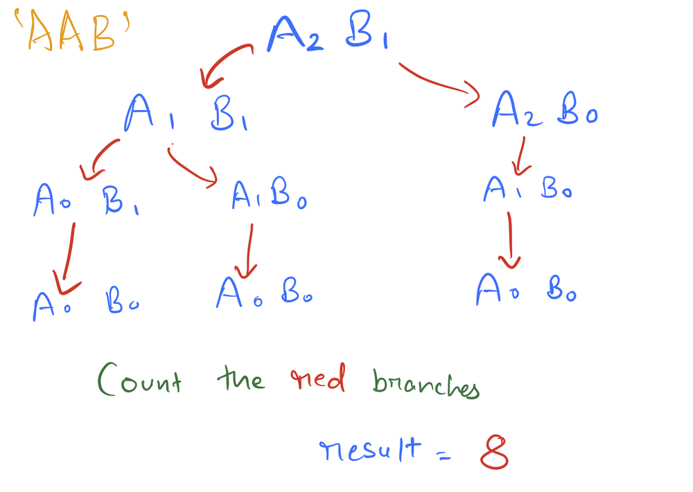

# JavaScript solution

**Author:** vxn701
**Votes:** 20
**Link:** [https://leetcode.com/problems/letter-tile-possibilities/solutions/310304/](https://leetcode.com/problems/letter-tile-possibilities/solutions/310304/)

---

Here we require the count of all possible permutations of a combination. So the idea is to use map to store the count of each letter in the string.
Then iterate over the key value pairs and for each key in the map if it's value is greater than zero we increment the sum decrement the value . Then we recursively find the combinations of the remaining string and add it to to our sum. After that branch of recursion completes we restore the value (or count) of that key.

```
var numTilePossibilities = function(tiles) {
	let map = new Map();
	for(let i = 0; i < tiles.length; i++) {
		map.set(tiles[i], (map.get(tiles[i]) || 0) +  1);
	}
	return helper(map);
};

function helper(map) {
    let sum = 0;
    for(let [key, value] of map.entries()) {
        if(value === 0) continue;
        sum++;
        map.set(key, map.get(key) - 1);
        sum += helper(map, sum);
        map.set(key, map.get(key) + 1);
    }
    return sum
}
```

## Flow


