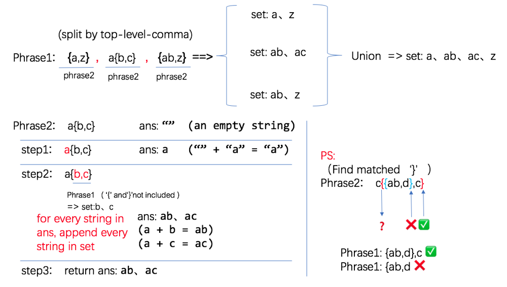

# share my clear cpp solution, explain with pic

**Author:** JellyZhang
**Votes:** 2
**Link:** [https://leetcode.com/problems/brace-expansion-ii/solutions/499816/](https://leetcode.com/problems/brace-expansion-ii/solutions/499816/)

---

``` 
class Solution {
public:
    vector<string> braceExpansionII(string expression) {
        set<string> ans = phrase2(expression);
        vector<string> rtn(ans.begin(),ans.end());
        return rtn;
    }
    set<string> phrase1(string exp){
        int end = find_next_top_level_comma(exp);
        if(end == -1){
            set<string> ans = phrase2(exp);
            return ans;
        }else{
            // continue phrase1 the right part
            set<string> temp1 = phrase1(exp.substr(end+1));
            // phrase2 the left part
            set<string> temp2 = phrase2(exp.substr(0,end));
            // union
            temp1.insert(temp2.begin(),temp2.end());
            return temp1;
        }
    }
    set<string> phrase2(string exp){
        set<string> ans;
        ans.insert("");
        int index = 0;
        while(index < exp.size()){
            if(isalpha(exp[index])){
                set<string> newans;
                for(auto str:ans){
                    newans.insert(str + exp[index]);
                }
                ans = newans;
                index++;
            }else if(exp[index] == '{'){
                int level = 1;
                int end = index + 1;
                // find matched '}'
                while(level > 0){
                    if(exp[end] == '{'){
                        level++;
                    }else if(exp[end] == '}'){
                        level--;
                    }
                    end++;
                }
                // currently end is at right side of '}'
                // ps: exclued '{' and '}'
                set<string> temp_set = phrase1(exp.substr(index+1, end-index-2));
                set<string> newans;
                for(auto str1:ans){
                    for(auto str2:temp_set){
                        newans.insert(str1 + str2);
                    }
                }
                ans = newans;
                index = end;
            }
        }
        return ans;
    }
    int find_next_top_level_comma(string exp){
        int level = 0;
        for(int i=0;i<exp.size();++i){
            if(exp[i] == ',' && level == 0) return i;
            if(exp[i] == '{'){
                level++;
            }    
            else if(exp[i] == '}'){
                level--;
            }
        }
        return -1;
    }

};
```


