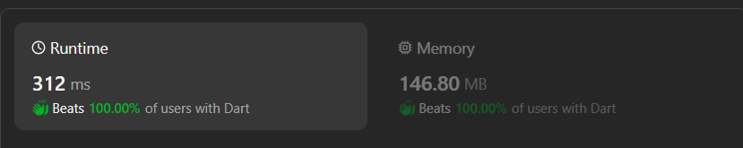

# ✔Easy & Full Explanation with comments🔥 , Beats 💯% of Time and Sapce Complexity JAVA & DART ✔

**Author:** m3n99
**Votes:** 7
**Link:** [https://leetcode.com/problems/remove-zero-sum-consecutive-nodes-from-linked-list/solutions/4862917/](https://leetcode.com/problems/remove-zero-sum-consecutive-nodes-from-linked-list/solutions/4862917/)

---

image.png

image.png

# Intuition
The problem involves removing zero-sum sublists from a given linked list. To achieve this, we can use a two-pass approach. In the first pass, we calculate cumulative sums and store the last occurrence of each sum in a HashMap. In the second pass, we use the HashMap to identify and remove zero-sum sublists.


# Approach
1. Initialize a dummy node to serve as a new starting point for the linked list.
2. Traverse the linked list in the first pass, calculating cumulative sums and saving the last occurrence of each sum in a HashMap.
3. Reset the sum and the current node to the dummy head.
4. Traverse the linked list again in the second pass, updating the current sum and removing zero-sum sublists based on the information stored in the HashMap

# Complexity
- Time complexity: **O(n)**, where n is the number of nodes in the linked list. Both passes involve traversing the linked list once.
<!-- Add your time complexity here, e.g. $$O(n)$$ -->

- Space complexity: **O(n)**, where n is the number of nodes in the linked list. The HashMap can have at most n entries, one for each node in the linked list.
<!-- Add your space complexity here, e.g. $$O(n)$$ -->

418489166_861230982359514_5675836723312989679_n.jpg


# Code
```Dart []
/**
 * Definition for singly-linked list.
 * class ListNode {
 *   int val;
 *   ListNode? next;
 *   ListNode([this.val = 0, this.next]);
 * }
 */
class Solution {
  ListNode? removeZeroSumSublists(ListNode? head) {
    // Dummy node to serve as a new starting point for the linked list
    ListNode? dummy = ListNode(0,head); 
    ListNode? current = dummy; // Current node, starting from the dummy head
    
    // HashMap to store the cumulative sum and corresponding node 
    Map<int,ListNode?> mapSum = {}; 
    int sum = 0;

    // First pass: Calculate cumulative sums and save the last occurrence 
    // of each sum in the HashMap
    while(current != null){
        sum += current.val;
        mapSum[sum] = current;
        current = current.next;
    }
    // reset
    sum = 0;
    current = dummy;

    // Second pass: Remove zero-sum 
    while(current != null){
        sum += current.val;

        // If we have seen this sum before, it means the sublist between the 
        // previous occurrence and this one sums to zero
        current.next = mapSum[sum]?.next;
        current = current.next;
    }

    return dummy.next;  // Return the updated list without the dummy head
  }
}
```
```Java []
/**
 * Definition for singly-linked list.
 * public class ListNode {
 *     int val;
 *     ListNode next;
 *     ListNode() {}
 *     ListNode(int val) { this.val = val; }
 *     ListNode(int val, ListNode next) { this.val = val; this.next = next; }
 * }
 */
class Solution {
    public ListNode removeZeroSumSublists(ListNode head) {
        // Dummy node to serve as a new starting point for the linked list
        ListNode dummy = new ListNode(0, head);
        // HashMap to store the cumulative sum and corresponding node 
        Map<Integer, ListNode> mapSum = new HashMap<>();
      
        int sum = 0; // Variable to hold the cumulative sum of node values
        ListNode current = dummy; // Current node, starting from the dummy head
      
        // First pass: Calculate cumulative sums and save the last occurrence 
        // of each sum in the HashMap
        while (current != null) {
            sum += current.val;
            mapSum.put(sum, current);
            current = current.next;
        }
      
        sum = 0; // Reset the sum for the second pass
        current = dummy; // Reset current node to the dummy head
      
        // Second pass: Remove zero-sum sublists
        while (current != null) {
            sum += current.val; // Update the cumulative sum
          
            // If we have seen this sum before, it means the sublist between the 
            // previous occurrence and this one sums to zero
            current.next = mapSum.get(sum).next;
          
            current = current.next; // Move to the next node
        }
      
        return dummy.next; // Return the updated list without the dummy head
        
    }
}
```
