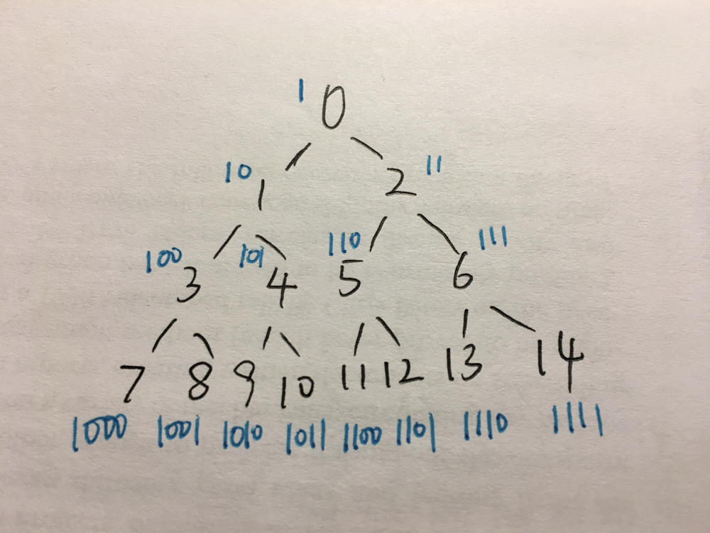

# Python Special Way for find() without HashSet  O(1) Space O(logn) Time

**Author:** zhaoqxu
**Votes:** 139
**Link:** [https://leetcode.com/problems/find-elements-in-a-contaminated-binary-tree/solutions/431229/](https://leetcode.com/problems/find-elements-in-a-contaminated-binary-tree/solutions/431229/)

---

It's obvious to use `BFS` for the initial part. However, a lot of people use HashSet(`set()` in python) to pre-store all the values in the initial part, which may cause MLE when the values are huge. There is a special way to implement `find()` that  costs O(1) in space and O(logn) in time. 

Firstly, let's see what a complete tree will look like in this problem: 


It's very easy to find that numbers in each layer range from `[2^i-1,2^(i+1)-2]`
what if we add 1 to each number? Then it should range from `[2^i, 2^(i+1)-1]`
See?  the binary of all numbers in each layer should be: `100..00` to `111...11`

Hence we could discover that maybe we could use the `binary number` of `target+1` to find a path:



I'm not proficient in English, so I would prefer to show my code here to explain my idea:

```python
def find(self, target: int) -> bool:
		binary = bin(target+1)[3:]                  # remove the useless first `1`
        index = 0
        root = self.root                                    # use a new pointer `root` to traverse the tree
        while root and index <= len(binary): # traverse the binary number from left to right
            if root.val == target:
                return True
            if  binary[index] == '0':  # if it's 0, we have to go left
                root = root.left
            else:  # if it's 1, we have to go right
                root = root.right
            index += 1
        return False
```